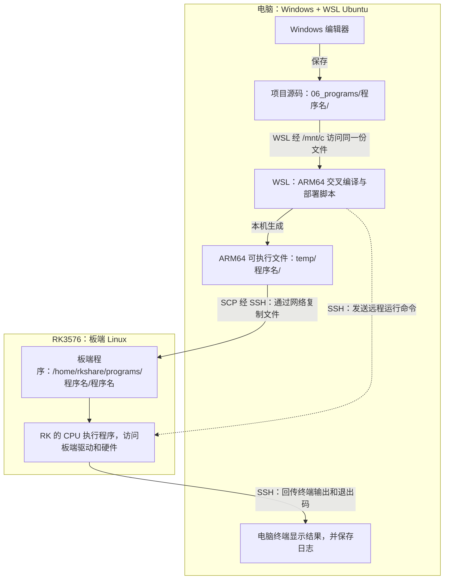

# RK3576 Linux 基础知识

整理日期：2026-10-21。适用项目：立创泰山派 3M RK3576；现有记录环境为 Ubuntu 24.04 系列、Linux 6.1.99 / aarch64。

本文合并原串口入门笔记，集中解释文件接口、GPIO、设备树、UART，以及 Windows 上的 WSL Ubuntu 和 ARM64 Linux 交叉编译。资料链接放在相关内容旁，并说明用途；示意流程不代表板端已经执行。待办与验收标准见[开发计划](../plans/development_plan.md)，实测步骤和证据仍保存在对应记录中。后续相关知识继续整合到本文。

**本轮学习入口：**第 7 节解释 WSL、用户主目录与命令执行位置；第 8 节解释交叉编译、目标库、上传运行及常见报错。先读中文资料建立认识，再按需要查英文手册中的具体选项。

## 1. 先把硬件与 Linux 的关系连起来

可以沿着下面两条线理解项目：

```text
配置：原理图、引脚表 → 设备树描述硬件 → 内核驱动初始化设备
使用：C 程序或命令 → Linux 接口 → 内核驱动 → 控制器 → 实物引脚
```

设备树说明“这块板有什么、怎样连接”，驱动负责“怎样操作硬件”，用户程序通过驱动提供的接口使用设备。引脚功能已经正确启用时，可以先写应用程序；只有配置不匹配时，才需要进一步调整设备树或驱动。

| 概念 | 在本项目中怎样理解 |
| --- | --- |
| 用户态 | shell、测试程序所在的位置，通过系统调用访问内核 |
| 内核态 | 驱动管理硬件资源、处理中断，并向用户态提供接口 |
| GPIO | 通用输入输出；输出设定电平，输入读取电平或等待变化 |
| pinctrl / pinmux | 配置引脚的功能复用、上下拉等；同一引脚可能候选为 GPIO、UART、PWM |
| API / ABI | API 是程序调用方式；ABI 在这里主要指内核与用户程序约定的接口和数据格式 |

**资料：**[Linux 6.1 设备树使用模型](https://docs.kernel.org/6.1/devicetree/usage-model.html)解释硬件描述如何参与设备创建和驱动匹配，适合建立整体认识；[Linux 6.1 pinctrl 文档](https://www.kernel.org/doc/html/v6.1/driver-api/pin-control.html)用于查引脚复用和电气配置的职责，不必一开始通读驱动实现。

## 2. “通过文件操作引脚”到底是什么意思

### 2.1 路径相似，读写的含义不同

| 类型与例子 | 读写的实际含义 | 是否是普通磁盘文件 |
| --- | --- | --- |
| 源码、日志，如 `test.c`、`test.log` | 保存程序文本或实验结果 | 是，通常需要持久保存 |
| `/sys/` 下的属性，如 GPIO `value` | 读取内核状态，或向内核提交一个属性值 | 不是；内容由内核接口提供 |
| `/dev/` 下的字符设备，如 `/dev/ttyS4`、`/dev/gpiochipN` | 按该设备的协议收发数据、配置参数或申请资源 | 不是；设备节点是驱动的访问入口 |
| `/proc/` 下的信息，如 `/proc/version` | 查看内核提供的系统或进程信息 | 不是普通磁盘文件 |

因此，“向 GPIO 的 `value` 写入 1”表示请求内核设置状态；它与“把日志文件里的字符改为 1”有不同含义。sysfs 的读写会进入内核对应的处理函数。不能用编辑器保存普通文件的思路理解所有设备操作，也不能把 `/dev/gpiochipN` 当成接收字符 `1` 的文本文件。

**资料：**[Linux 6.1 sysfs 说明](https://www.kernel.org/doc/html/v6.1/filesystems/sysfs.html)解释属性读写如何进入内核的 `show` / `store` 回调，是理解“看起来是文件，背后却在操作设备”的依据。

### 2.2 C 程序需要认识的几个操作

| 操作 | 用途 | 需要记住的区别 |
| --- | --- | --- |
| `open()` / `close()` | 打开、关闭访问入口 | 打开成功得到文件描述符 `fd`，它是进程内的句柄，不是 GPIO 编号 |
| `read()` / `write()` | 读入或写出数据 | 数据可能是文本、串口字节或事件结构，取决于接口 |
| `ioctl()` | 发出设备专用控制请求 | GPIO 字符设备的申请、取值和设值等操作使用它，通常交给 libgpiod 封装 |
| `poll()` | 等待某个 fd 出现指定事件或超时 | 是等待内核通知，不是不断读文件、比较内容 |
| `lseek()` | 调整读取位置 | sysfs GPIO 事件后重读常需回到开头；串口等设备不适用普通文件的随机定位方式 |

程序应检查返回值和 `errno`；一次 `read()` / `write()` 不一定完成预期的全部串口数据。设备可打开、命令返回成功，也不等于外部电路已经产生正确结果。

**资料：**Linux man-pages 的 [open(2)](https://man7.org/linux/man-pages/man2/open.2.html)用于查打开方式和 fd；[ioctl(2)](https://man7.org/linux/man-pages/man2/ioctl.2.html)解释设备控制请求；[poll(2)](https://man7.org/linux/man-pages/man2/poll.2.html)解释事件等待和返回标志。读写细节可从这些页面进入 `read(2)`、`write(2)`。

### 2.3 常见命令与权限

`cat` 常用于读取文本属性，`ls -l` 用于查看类型、属主和权限，`readlink -f` 用于追踪符号链接。`>` 连接命令输出与目标路径，写普通文件时通常会覆盖原内容；`>>` 表示追加，不能因此推断设备属性也支持追加语义。

还要注意：`sudo echo ... > 路径` 中，重定向由当前 shell 执行，目标路径的写入未必取得 root 权限。需要权限时，可由 `sudo tee` 或具有权限的 shell 完成写入；实际命令按目标接口编写。权限错误、引脚占用和设备未启用是不同问题，不能都靠提高权限解决。

**资料：**[Bash 手册的 REDIRECTION 部分](https://man7.org/linux/man-pages/man1/bash.1.html#REDIRECTION)用于查 `>`、`>>` 和 shell 如何打开重定向目标，帮助理解命令权限与文件写入权限的关系。

### 2.4 目录条目与 ls 显示的空间

目录可以看作一份名称清单。**目录条目**就是其中一条“名称与文件或子目录对象的对应记录”，不是文件内容本身。`ls` 列出这些名称，并显示对应对象的属性。

以当前共享目录 `/home/rkshare` 为例：

| 名称 | 指向的对象 |
| --- | --- |
| `.` | 当前被列出的目录，即 `/home/rkshare` |
| `..` | 它的上级目录，即 `/home` |
| 普通文件名 | 目录中的具体文件；删除测试文件后不再出现其名称 |

`ls -la` 的 `-l` 显示详细信息，`-a` 包括隐藏项及 `.`、`..`。如果只列出这两个名称，就说明没有其他文件或子目录；目录自身仍需要保存管理信息。

`total` 是本次列出对象已分配磁盘空间的合计，不是文件数量，也不是递归统计所有子目录内容。GNU `ls` 在未设置相关显示选项和环境变量时，默认单位为 **1 KiB = 1024 字节**；因此 `total 8` 按默认单位表示 **8 KiB = 8192 字节**。使用 `-a` 时，合计也包含 `.`、`..` 对应目录的已分配空间，不能把这个数直接理解成共享目录中测试文件的大小。

每行中的 `4096` 在默认 `ls -l` 下是该目录对象的大小，单位为字节，不是其内部所有文件大小的总和；它与按分配块统计的 `total` 含义不同。显示单位还可能受 `LS_BLOCK_SIZE`、`BLOCK_SIZE`、`BLOCKSIZE`、`POSIXLY_CORRECT` 或命令选项影响。

如需直观显示单位，在板端运行以下只读命令；这是查看方式，不是本次新增的实测结果：

```bash
ls -lah /home/rkshare
```

**资料：**[Linux 路径解析中的 `.` 与 `..`](https://man7.org/linux/man-pages/man7/path_resolution.7.html)解释当前目录和父目录；[GNU ls 长格式说明](https://www.gnu.org/software/coreutils/manual/html_node/What-information-is-listed.html)解释 `total` 与大小字段；[GNU 显示块大小说明](https://www.gnu.org/s/coreutils/manual/html_node/Block-size.html)用于查默认单位、环境变量及单位换算。

## 3. GPIO：编号、输出与输入捕获

### 3.1 先分清三套编号

| 名称 | 含义 | 例子 |
| --- | --- | --- |
| 物理针号 | 40Pin 排针上的位置 | 13 针，供接线使用 |
| SoC 引脚名 | 芯片的 bank、组和位 | `GPIO2_C6` |
| Linux 字符设备定位 | 控制器设备 + 控制器内偏移 offset | 确认对应控制器后，使用 offset 22 |

Rockchip 的 A、B、C、D 组分别对应 0、1、2、3，组内编号为 0～7：`offset = 组号 × 8 + 位号`。因此 `GPIO2_C6` 的 offset 为 `2 × 8 + 6 = 22`，bank 为 2。

结合[工程资源表](../../04_references/RK3576_40Pin工程资源分配表.jpg)，可先理解以下映射；它们是资料对应关系，实际可用性仍须检查：

| 工程规划 | 物理针号 | 官方资料中的 SoC 引脚 | offset |
| --- | --- | --- | --- |
| LED-R 输出候选 | 13 | GPIO2_C6 | 22 |
| K2 输入候选 | 31 | GPIO2_B0 | 8 |

`gpiochipN` 的编号应结合 `gpiodetect` 的标签确认，不能始终假设 N 就是 bank。旧 sysfs 的全局编号又是另一套：应由实际控制器的 `base + offset` 确认，不能把物理针号直接写进 `export`。`/sys/class/gpio/gpiochipN` 中的 N 和 `/dev/gpiochipN` 中的 N 也不能直接等同。

**资料：**[立创 GPIO 与 libgpiod 使用指南](https://wiki.lckfb.com/zh-hans/tspi-3-rk3576/system-development-compilation/gpio-libgpiod/)有本板的针号、GPIO 名称、offset 和工具示例，是当前最直接的中文入口；文中的默认状态属于其配套镜像配置，不能替代对当前板卡的检查。

### 3.2 两种 Linux GPIO 接口

| 项目 | sysfs GPIO（旧接口） | GPIO 字符设备（新程序优先考虑） |
| --- | --- | --- |
| 入口 | `/sys/class/gpio/` | `/dev/gpiochipN` |
| 使用方式 | 导出后读写 `direction`、`value`、`edge` 等属性 | 申请控制器上的 line，通过 libgpiod 或内核 ioctl 接口操作 |
| 输出 | 配置输出方向，设置 `value` | 申请输出 line 并设置值，在需要保持输出时持续持有申请 |
| 输入事件 | 设置 `edge`，对 `value` 等待通知后重新读取 | 申请边沿事件，读取事件记录 |
| 使用前提 | 内核启用了相应支持，且引脚允许用户态控制 | 内核与工具支持对应 ABI，权限、复用和资源占用符合要求 |

GPIO sysfs 已被内核标为废弃，新程序优先考虑字符设备接口；旧教程仍可用于理解属性，但是否使用要结合工程现状。本项目板端已确认 libgpiod 为 **1.6.3**，现有 GPIO C 程序使用 1.x API，见[GPIO 实测记录](../../02_records/20261021_gpio_output.md)。不能直接把网上所有命令和 C 示例混用：1.x 与 2.x 存在不兼容变化，**内核版本、内核 GPIO ABI 版本和 libgpiod 版本是三个概念**。

**资料：**[Linux 6.1 GPIO sysfs](https://www.kernel.org/doc/html/v6.1/admin-guide/gpio/sysfs.html)是查旧接口属性、编号和事件流程的依据；[GPIO 字符设备 API](https://docs.kernel.org/userspace-api/gpio/chardev.html)解释 chip、line 和申请句柄，页面面向当前内核，具体功能需对照本项目 6.1 厂商内核；[libgpiod 官方工具文档](https://libgpiod.readthedocs.io/en/master/gpio_tools.html)解释 `gpiodetect`、`gpioinfo`、`gpioget`、`gpioset`、`gpiomon`，其 master 文档不一定匹配本机版本；[libgpiod 发布记录](https://kernel.googlesource.com/pub/scm/libs/libgpiod/libgpiod/%2B/8da049f2d7eacac5a290af27a90a871685b35ee4/NEWS)可查大版本变化。

### 3.3 输出的 0/1 与实物电压

- **方向：**输出由控制器驱动电平，输入用于采样。上下拉为输入提供默认状态，不能把悬空引脚当成稳定的 0 或 1。
- **有效极性：**`active_low` 表示物理低电平为有效状态。逻辑值 1 表示“有效”，未必表示物理高电平；记录时写清逻辑值、有效极性和实测电压。
- **占用与保持：**line 可能被驱动或其他程序使用。字符设备申请释放后，不应假设输出仍保持原值；用 `gpioset` 时应按版本选择保持方式，并在保持期间测量。
- **验证：**程序打印的是设定或读回结果，万用表测量才是本次输出实验的外部证据。高电平电压按 IO 电源域确认，不能预设为 5V。

**资料：**[gpioset 官方说明](https://libgpiod.readthedocs.io/en/master/gpioset.html)重点看输出保持与程序退出后的行为；极性与 line 配置参见上面的内核 GPIO API 文档。

### 3.4 输入捕获的是电平变化，不是文件被修改

必须区分“现在是什么电平”和“曾经发生过什么变化”。定时读取可能漏过两次读取之间的短脉冲；边沿事件记录变化，但也受内核缓冲和用户程序处理速度限制。

| 概念 | 含义及用途 |
| --- | --- |
| 上升沿 / 下降沿 | 通常指 0→1 / 1→0；启用有效低后，要按接口的逻辑极性解释事件 |
| 硬件中断 / 用户态通知 | 内核处理中断后通知程序；用户态的 `poll()` 不是直接执行硬件中断处理函数 |
| 消抖 | 机械按键一次操作可能产生多次跳变，需要按实际情况过滤；不能把所有重复事件都当成软件错误 |
| 事件时间 / 打印时间 | 内核记录事件与程序打印不是同一时刻；比较时延要确认时钟来源，不能用打印快慢判断实时性 |

两条典型流程如下，属于理解流程，不是可直接运行的代码：

```text
sysfs：确认支持 → 输入方向 → edge=both → 打开 value 并初读
       → poll 关注 POLLPRI | POLLERR → lseek 回开头 → read 当前值 → 继续等待

字符设备：打开 gpiochip → 申请输入 line 和边沿检测
          → poll 等待申请 fd 可读 → read 事件类型、时间等 → 按需读取当前值
```

sysfs 的通知和重新读值不能当作逐个边沿排队记录。字符设备的事件也不能保证无限缓存；GPIO v2 可用序号辅助识别丢失。事件发生后的当前值可能已再次变化，输出日志时要分清“事件方向”和“此刻读值”。

不要通过文件修改时间、`inotify` 或 `tail -f value` 设计 GPIO 输入捕获，它们不能代替 GPIO 边沿接口。本项目要先打印初始值，再显示受控变化及其方向，与实际按键或外部输入对应。

**资料：**[GPIO v2 边沿事件读取](https://docs.kernel.org/userspace-api/gpio/gpio-v2-line-event-read.html)解释事件缓冲、等待与读取，以及缓冲溢出；[inotify(7)](https://man7.org/linux/man-pages/man7/inotify.7.html)说明文件系统事件监测的适用范围和伪文件系统限制，用于理解它与 GPIO 事件的区别。

## 4. 设备树：决定设备怎样被描述和启用

### 4.1 文件之间的关系

```text
板级 .dts + 引用的 .dtsi → 经预处理、dtc 编译 → .dtb
→ 由实际启动流程加载并传给内核 → 内核解析，驱动使用相关资源
```

| 名称 | 用途 |
| --- | --- |
| `.dts` | 板级设备树源码入口，描述具体板卡配置 |
| `.dtsi` | 被包含的公共描述，如 SoC 资源、板级外设或引脚配置 |
| `.dtb` | 编译后的二进制设备树；只修改源码不会自动改变运行中的板卡 |
| binding | 约定某类设备节点应该怎样写，属性类型和含义是什么 |
| overlay / `.dtbo` | 对基础设备树的补充；能否加载及加载方式由启动链和系统支持决定 |

厂商 SDK 中可从 `kernel-6.1/arch/arm64/boot/dts/rockchip/tspi-3m-rk3576.dts` 查起，再追踪其包含的文件；40Pin 相关配置可查 `tspi-3m-rk3576-40pin.dtsi`。这些是资料中的 SDK 路径，当前记录仓库尚未包含该源码，也不能据此推定板端 DTB 的安装路径。

**资料：**[立创设备树文件结构](https://wiki.lckfb.com/zh-hans/linux-docs-tspi3-rk3576/linux-driver-Basics/device-tree/device-tree-file-structure.html)适合入门查 DTS/DTSI 的分层及本板文件名；40Pin 配置入口见前面的立创 GPIO 指南。

### 4.2 阅读时先找哪些属性

| 属性或写法 | 主要含义 |
| --- | --- |
| `compatible` | 声明设备兼容标识，供驱动匹配等用途；本身不会生成驱动 |
| `status = "okay"` / `"disabled"` | 表示设备的可用状态；启用后仍要满足驱动、时钟、电源等条件 |
| `reg` | 由父总线定义格式，可能是寄存器地址范围，也可能是 I²C 地址等，不是物理针号 |
| `pinctrl-names`、`pinctrl-0` | 声明引脚配置状态及其引用的配置组 |
| `xxx-gpios`、`gpios` | 按 binding 描述 GPIO 控制器、线偏移和标志等信息 |
| `label:`、`&label` | 定义标签、引用已有节点；常用于在板级文件中补充或覆盖配置 |

设备树节点与 `/dev/` 设备节点不是一回事：前者是硬件描述，后者是用户程序的访问入口。并非每个设备树节点都会出现同名 `/dev/` 文件，具体接口由驱动和对应子系统决定。

**资料：**[Devicetree Specification：基础结构与属性](https://devicetree-specification.readthedocs.io/en/stable/devicetree-basics.html)用于查节点、引用、`compatible`、`status`、`reg` 的正式定义；具体设备属性还应查匹配内核源码中的 `Documentation/devicetree/bindings/`。

### 4.3 怎样联系当前项目

3/5 针的 UART3 与 I²C7、27/28 针的 UART7 与 I²C8，以及 GPIO 与 PWM 的候选用途，都涉及复用选择，不能默认同时启用。`gpioinfo` 显示空闲也不能单独证明引脚复用、电压和外接电路已经适合测试。

需要调整时，按“确认实物和占用 → 找到实际生效的配置 → 修改匹配源码 → 按 SDK 构建部署 → 启动后核对”的顺序处理，保留可恢复配置。`/sys/firmware/devicetree/base/` 是运行设备树的查看入口，不按普通配置文件直接编辑；字符串属性可能包含 NUL 分隔符。

## 5. UART / TTL：保留原笔记中的必要知识

UART 是异步串行收发硬件，TX 发送、RX 接收；USB 转 TTL 模块让 Windows 通过 COM 口与板卡交换数据。“TTL 串口”不能直接等同于 5V，电气规格应按板卡和模块确认，也不能直接连接 RS-232 电平。

普通双向通信在电平兼容、接口确认后使用以下连接；具体排针位置仍看丝印和原理图：

```text
开发板 TX  → 模块 RX
开发板 RX  ← 模块 TX
开发板 GND — 模块 GND
```

板卡独立供电时，模块 VCC 不接板卡；接线前断电并核对电平。模块的 3V3 供电脚不等于已证明 TX/RX 信号电平。

双方需约定一致的波特率、数据位、校验、停止位和流控。`115200、8N1` 表示 8 个数据位、无校验、1 个停止位，包含起止位开销，并不等于每秒传输 115200 个字符。Linux C 程序通常打开 `/dev/ttyS*`，用 `termios` 设置串口，再通过 `read()` / `write()` 收发。

调试串口用于启动日志和登录，业务串口用于外设数据；不能未经检查就共用。Windows PowerShell 在电脑执行，SSH 或串口登录后的 Linux shell 在板端执行，不能只凭“窗口开在电脑上”判断命令运行位置。

本项目保留这些已确认的信息，其余步骤见[TTL 串口统一记录](../../02_records/20261021_TTL串口调试验证.md)：

- 三针调试口使用 CH340 / COM18，1500000、8N1、无流控；业务 UART4 为 `/dev/ttyS4`，历史回环参数为 115200、8N1。两者参数独立，回环不替代 Windows 实际收发。
- 实际收发要核对两端具体内容，如 `PC_TO_RK_0001`、`RK_TO_PC_0001`；终端回显不能单独证明对端收到。改接 CH340 时先移除 TX—RX 回环线，板端操作可走已验证的 SSH。
- 调试口曾因连续小写 `fiq` 进入 `debug>`。出现该状态时输入 `console`，看到恢复提示后用 Ctrl+C 清除残留输入；含触发片段的检查命令优先走 SSH。

**资料：**[ADI UART 入门](https://www.analog.com/en/resources/analog-dialogue/articles/uart-a-hardware-communication-protocol.html)解释收发线、波特率和帧结构；[termios(3)](https://man7.org/linux/man-pages/man3/termios.3.html)用于查 Linux 串口参数和原始模式；[立创 Ubuntu24 串口调试](https://wiki.lckfb.com/zh-hans/tspi-3-rk3576/system-usage/ubuntu24-usage/serial-debug.html)用于核对调试口教程参数；[Rockchip 调试口接收源码](https://github.com/rockchip-linux/kernel/blob/develop-6.1/drivers/soc/rockchip/fiq_debugger/rk_fiq_debugger.c)可查特殊触发逻辑。

## 6. 后续项目按什么方式使用这些知识

| 项目内容 | 对应的 Linux 思路 | 需要看见的结果 |
| --- | --- | --- |
| GPIO 输出 | 确认映射和复用，再通过 GPIO 接口设值并保持 | 打印设定值，万用表测量高低电压 |
| GPIO 输入 | 读取初值，再等待和读取边沿事件 | 外部变化能与状态、方向和时间对应 |
| UART | 字符设备 + 参数配置 + 字节流读写 | 两个方向都显示实际收到的内容 |
| PWM | 使用 PWM 子系统提供的配置接口 | 示波器或逻辑分析仪测量频率、占空比 |
| SPI / I²C | 使用对应总线驱动或用户接口，按外设协议通信 | 返回数据可按器件资料核对 |
| CAN | 使用 SocketCAN 的套接字接口 | 核对实际帧 ID、数据、时间及回环范围 |
| Samba | 通过网络共享普通目录和文件 | Windows 与 Linux 实际双向传文件 |

“Linux 提供统一的访问方式”不代表所有外设都用相同的文件路径和文本写入命令。例如 CAN 常用 socket；UART、SPI、I²C 也各有配置和通信协议。后续按具体任务补充知识，不需要先把所有驱动从头学完。

建议先读第 1、2 节建立整体认识，再结合 GPIO 实验读第 3 节；遇到复用或设备未启用时回查第 4 节，串口开发查第 5 节。初次检查 GPIO 可在**板端 Linux shell**中逐条运行以下只读命令；它们是建议检查项，本次未连接板卡执行。

查看内核版本：

```bash
uname -r
```

列出 GPIO 控制器及标签（需要已安装 gpiod 工具）：

```bash
gpiodetect
```

确认工具版本：

```bash
gpioset --version
```

查看本机支持的参数，再决定用哪一版本的教程：

```bash
gpioinfo --help
```

已有网络与共享知识的操作细节可从[固定 IP / SSH 记录](../../02_records/20261021_固定IP地址.md)和[Samba 记录](../../02_records/20261021_Samba共享文件夹.md)进入。板端测试程序沿用 C 和 GCC；具体编译、上传、运行方法随对应程序记录，不把资料示例写成实测通过。

## 7. Windows 上的 WSL Ubuntu

### 7.1 WSL、Ubuntu、VMware 分别是什么

Windows 是笔记本当前使用的操作系统；Ubuntu 是 Linux 发行版，提供软件包、命令和开发工具；WSL 是让 Windows 运行 Linux 环境的功能。**WSL 2 使用真实的 Linux 内核，由 Windows 在后台管理轻量虚拟机。**

| 方式 | 使用体验 | 与本次工作的关系 |
| --- | --- | --- |
| VMware 中安装 Ubuntu | 自己创建虚拟机、安装系统，管理虚拟硬件和网络；通常使用完整桌面 | 可作为交叉编译环境 |
| WSL 2 中安装 Ubuntu | 与 Windows 集成，常从终端使用 Linux 命令和工具 | 本项目已选用的交叉编译环境 |

两种方式都能用于本项目的 C 程序编译。USB 设备接入、桌面和网络配置另有区别；本次先通过网络传文件，GPIO 程序最终在 RK 板上操作硬件。

**资料：**[微软：比较 WSL 版本](https://learn.microsoft.com/zh-cn/windows/wsl/compare-versions)用于理解 WSL 2 的内核和虚拟化架构；[VMware：虚拟机网络说明与排查](https://knowledge.broadcom.com/external/article/307964/)用于认识 NAT、桥接等配置。本项目采用 WSL，不需要额外安装 VMware 来完成本次编译。

### 7.2 先判断命令究竟在哪里执行

| 环境 | 提示符或进入方式 | 本次负责的工作 |
| --- | --- | --- |
| Windows PowerShell | 常见 `PS C:\Users\52400>` | 安装、启动和管理 WSL |
| 笔记本 WSL Ubuntu | 当前账号 `qyq`，常见 `qyq@qyq:~$` | 安装交叉工具链、准备依赖、编译和上传 |
| RK 板端 Linux | 通过 SSH 或串口登录；现有板端账号为 `lckfb` | 检查目标环境、运行产物、测量 GPIO |

提示符中的用户名和主机名可以修改，只能作为线索；应结合登录方式和环境查询判断位置。窗口开在 Windows 桌面上，并不表示其中的命令一定在 Windows 执行。

在 **Windows PowerShell** 启动指定的 Ubuntu：

```powershell
wsl -d Ubuntu-24.04
```

在 **Ubuntu shell** 退出当前会话、返回启动它的上一级终端：

```bash
exit
```

如果刚刚通过 SSH 进入 RK，`exit` 退出的是那次 SSH 会话。启动 Ubuntu 和 SSH 登录 RK 是两次不同的操作。

**资料：**[微软：WSL 基本命令](https://learn.microsoft.com/zh-cn/windows/wsl/basic-commands)可查启动、发行版列表和版本切换；在 Ubuntu 内调用 Windows 的 WSL 管理命令时使用 `wsl.exe`。

### 7.3 用户主目录、当前目录与 Windows 磁盘

**用户主目录是账号自己的个人文件夹；当前目录是 shell 此刻所在的位置。** 对当前 Ubuntu 账号 `qyq`，主目录为 `/home/qyq`；`~` 在通常的 shell 用法中代表当前用户主目录，`/` 则是 Linux 文件系统根目录。

| 路径或符号 | 含义 |
| --- | --- |
| `/home/qyq`、`~` | 当前 Ubuntu 用户 `qyq` 的主目录 |
| `/mnt/c/Users/52400` | 在 WSL 中访问 Windows 的 `C:\Users\52400` |
| `/mnt/c/Windows/system32` | 在 WSL 中访问 Windows 的 `C:\Windows\System32` |
| `.`、`..` | 当前目录、父目录；详见第 2.4 节 |

在 **WSL Ubuntu** 回到用户主目录：

```bash
cd ~
```

查看当前目录的绝对路径：

```bash
pwd
```

本例切换后的预期输出是 `/home/qyq`。`cd` 只切换目录，不会切换操作系统；`pwd` 只显示位置。提示符末尾的 `~` 也用于简写主目录。

用 Linux 工具编译时，将项目放在 WSL 的 Linux 文件系统中通常能减少跨文件系统访问的开销。**本项目按用户要求，后续统一在 Windows 的 `C:\Users\52400\Desktop\internship\seerain\20260907_RK3576_Linux` 中开发**，WSL 通过 `/mnt/c/Users/52400/Desktop/internship/seerain/20260907_RK3576_Linux` 访问同一份文件。正式应用源码及构建文件放 `06_programs/<program>/`，独立接口测试保留在 `05_tools/tests/`；编译产物和中间文件放根目录 `temp/<program>/`，实际需要时再建子目录。此前 GPIO 实验的 `~/rk3576-linux-dev` 保留为历史构建目录，后续不在两份源码间分别修改。

**资料：**[微软：跨 Windows 和 Linux 文件系统工作](https://learn.microsoft.com/zh-cn/windows/wsl/filesystems)介绍 `/mnt/c/`、文件访问与性能建议；[Bash 手册](https://man7.org/linux/man-pages/man1/bash.1.html)可搜索 `Tilde Expansion`、`cd` 和 `pwd` 查具体规则。

### 7.4 安装、版本与联网检查要分开理解

| 名称 | 表示什么 | 本项目的例子 |
| --- | --- | --- |
| WSL 软件包版本 | Windows 上 WSL 软件本身的版本 | 用户已提供 `3.0.3.0` |
| WSL 1 / WSL 2 | 某个 Linux 发行版使用的运行架构 | `Ubuntu-24.04` 的 `VERSION` 已确认是 `2` |
| Ubuntu 版本 | Linux 发行版的发布版本 | Ubuntu 24.04 LTS |
| Linux 内核版本 | 当前环境运行的内核 | WSL 内核与 RK 的 6.1.99 分别管理 |

因此，`wsl --version` 显示 3.0.3.0，与发行版使用 WSL 2 并不矛盾。

安装参考命令在 **管理员 PowerShell** 执行；本项目已经完成安装，学习时无需重复：

```powershell
wsl --install --web-download -d Ubuntu-24.04
```

`-d` 指定发行版，`--web-download` 使用在线下载来源。安装遇到“需要提升”时检查管理员权限；403 表示访问被拒绝，还需根据下载来源和网络诊断，不能只凭该状态码认定原因。微软也提供从官方 WSL 发布页下载 MSI 的手动安装方法。

在 **当前 WSL Ubuntu** 查询发行版的运行状态和 WSL 架构：

```bash
wsl.exe --list --verbose
```

查询当前 Linux 环境的 CPU 架构：

```bash
uname -m
```

刷新 Ubuntu 软件包索引：

```bash
sudo apt update
```

`sudo` 以管理员权限执行后面的命令，输入的是当前 Ubuntu 用户密码，输入时不显示字符。`apt update` 刷新软件索引，`apt install` 安装指定软件，`apt upgrade` 升级已装软件；出现“若干软件包可以升级”本身不是更新失败。

NAT 模式中的 WSL 与 Windows 有各自的网络环境，Windows 的 `localhost` 代理不能直接当作 WSL 内的同一地址。先按实际访问结果判断是否需要配置：**本项目用户提供的 `apt update` 输出已成功完成，先前代理提示未阻止本次软件源访问。** 这也不能替代后续 WSL 到 RK 的 SSH 连通性检查。

**资料：**[微软：安装 WSL](https://learn.microsoft.com/zh-cn/windows/wsl/install)含安装、手动安装及首次用户设置入口；[Ubuntu：软件包管理](https://ubuntu.com/server/docs/how-to/software/package-management/)解释 APT；[微软：WSL 网络](https://learn.microsoft.com/zh-cn/windows/wsl/networking)用于理解 NAT、主机地址及镜像网络的适用条件。

### 7.5 终端窗口与复制粘贴快捷键

Ubuntu 是这里使用的 Linux 发行版，Bash 是解释命令的 shell，Windows Terminal 是显示终端内容、处理选区和快捷键的窗口程序。**可以用不同终端软件打开同一个 WSL Ubuntu；更换窗口程序不需要重新安装 Ubuntu、工具链或源码。**

本机已检查到安装了 Windows Terminal，当前用户配置将 `Ctrl+C` 绑定为复制、`Ctrl+V` 绑定为粘贴。可按 **Win+R** 打开“运行”，输入下面一条命令并回车，在 Windows Terminal 中启动已有的 Ubuntu 并进入其主目录：

```text
wt.exe wsl.exe -d Ubuntu-24.04 --cd ~
```

这个启动命令在 Windows 的“运行”窗口或 PowerShell 使用。也可以从开始菜单打开 Windows Terminal，再从下拉菜单选择 Ubuntu-24.04；需要调整时，在其“设置 → 操作”中检查复制、粘贴绑定。

| 操作 | Windows Terminal 中的用法 |
| --- | --- |
| 复制 | 鼠标选中终端文字，再按 `Ctrl+C`；默认也支持 `Ctrl+Shift+C` |
| 粘贴 | `Ctrl+V`；默认也支持 `Ctrl+Shift+V` 或 `Shift+Insert` |
| 中断命令 | 没有选区时，`Ctrl+C` 通常传给 shell 或前台程序，用于中断 |
| 清空未执行的输入 | 在 Bash 常用默认编辑模式中，`Ctrl+U` 删除光标之前的内容；光标在行末时可清空该行 |

因此，终端中使用 `Ctrl+C` 复制前要先选中文字。复制命令时只取命令正文，不包含 `qyq@qyq:~$` 这类提示符。

如果粘贴后看到 `^[[200~` 等字符混入命令，应先取消或清空这一行，再用终端的粘贴快捷键重试。这种字符与括号粘贴（bracketed paste）的控制序列有关；本次截图中的失败命令带有该前缀，**推测它影响了命令解析**，不能据此认定 `sudo` 未安装。更换窗口后的实际粘贴效果还需操作确认。

**资料：**[微软：Windows Terminal 复制、粘贴与键绑定](https://learn.microsoft.com/zh-cn/windows/terminal/customize-settings/actions)可查默认快捷键、选区行为及自定义操作；[微软：Windows Terminal 命令行参数](https://learn.microsoft.com/zh-cn/windows/terminal/command-line-arguments)用于查 `wt.exe` 启动方式；[微软：Windows Terminal 设置](https://learn.microsoft.com/zh-cn/windows/terminal/install)说明默认终端、默认配置文件及自动发现 WSL 发行版。

### 7.6 用 WindTerm 直接进入 WSL Ubuntu

WindTerm 也可以作为已安装 WSL Ubuntu 的终端窗口。**会话名称、启动目标和启动参数是不同的设置。** 在本机配置文件 `C:\WindTerm\.wind\profiles\default.v10\terminal\user.sessions` 中，`session.target` 决定运行哪个程序，`process.arguments` 只填写传给该程序的参数。

当前 `wsl` 会话的有效字段如下，配置内容不作为终端命令执行；直接编辑文件时先完全退出 WindTerm，保留会话的其余字段：

| 字段 | 当前值 |
| --- | --- |
| `session.target` | `C:\Windows\System32\wsl.exe` |
| `process.arguments` | `-d Ubuntu-24.04 -u qyq --cd /mnt/c/Users/52400/Desktop/internship/seerain/20260907_RK3576_Linux/06_programs` |
| `process.workingDirectory` | `C:\Users\52400\Desktop\internship\seerain\20260907_RK3576_Linux\06_programs` |

其中 `-d` 选择发行版，`-u` 选择用户，`--cd` 指定进入项目的程序目录。等效的完整 Windows 启动命令为：

```text
C:\Windows\System32\wsl.exe -d Ubuntu-24.04 -u qyq --cd /mnt/c/Users/52400/Desktop/internship/seerain/20260907_RK3576_Linux/06_programs
```

**启动时出现 gsudo 管理员授权弹窗的原因：**原会话继承了 `admin:cmd` 的 `session.target`，仍指向 `vendors/gsudo/gsudo.exe`；即使参数中写了 WSL 命令，也仍会先运行提权工具。本机已将 `wsl` 的目标改为直接运行 `wsl.exe`，`windows` 的目标改为直接运行 `cmd.exe`，并将参数中的重复程序名去掉。

保存并重新打开会话后，在 WSL 执行：

```bash
pwd
```

预期输出：

```text
/mnt/c/Users/52400/Desktop/internship/seerain/20260907_RK3576_Linux/06_programs
```

**2026-10-21 已验证：**以普通用户权限重新启动 WindTerm，实际进程链为 `WindTerm.exe → winpty-agent.exe → wsl.exe`，没有启动 `gsudo.exe`。配置和原始弹窗照片见[统一记录第 6 节](../../02_records/20261021_workspace_setup.md#6-修复启动时的-gsudo-管理员授权弹窗)。原有 Ubuntu、工具链和 WSL SSH 密钥继续使用；WindTerm 自身的 SSH 会话使用其客户端配置，两者分别管理。

如果还希望**每次启动 WindTerm 软件时自动打开这个会话**，打开 **会话 → 首选项 → 设置 → 应用程序 → 启动**，选择 **指定一个会话或一组会话**，添加刚才的 `wsl` 会话并保存。该项是软件启动时的会话选择，与前面设置会话内部启动哪个程序是两项配置。

**资料：**[WindTerm 作者：WSL 启动程序使用完整路径](https://github.com/kingToolbox/WindTerm/discussions/2644)解释部分版本仅填写 `wsl.exe` 时的路径查找问题；[WindTerm 作者：启动时打开指定会话](https://github.com/kingToolbox/WindTerm/issues/108)给出启动会话设置入口；[微软：WSL 基本命令](https://learn.microsoft.com/zh-cn/windows/wsl/basic-commands)用于查发行版选择、用户和主目录等启动方式。

## 8. 从 WSL 交叉编译，再放到 RK 运行

### 8.1 编写、编译、传输与运行的整体逻辑

**交叉编译是在一种环境中运行编译器，为另一种目标环境生成程序。** 本项目的编译工作在笔记本 WSL Ubuntu 中进行，生成的程序交给 RK3576 的 ARM64 Linux 执行。

本项目后续自行开发的 RK Linux 应用沿用这套方式，包括下位机调度、算法和 Qt 上位机；当前 GPIO 程序是第一个流程验证实例。各应用分别选择 C / GCC 或 C++ / G++，准备自己的目标库并验证实际功能。Qt 还需要与目标 Qt 版本匹配的主机构建工具和 ARM64 开发库，参见 [Qt 官方交叉编译说明](https://doc.qt.io/qt-6/cross-compiling-qt.html)；该链接为 Qt 6 资料，项目具体 Qt 版本尚未选定。

**WindTerm 是进入不同环境的窗口：**`windows` 会话执行 Windows 命令，`wsl` 会话在电脑的 Ubuntu 中编译和部署，SSH / 串口登录后的会话在 RK 上执行命令。Windows 编辑器和 WSL 访问同一份项目源码；编译器在电脑上运行，业务程序最终由 RK 的 CPU 执行。



| 连接方式 | 在本项目中传什么 |
| --- | --- |
| WSL 挂载访问 `/mnt/c/` | 在同一台电脑上读写 Windows 项目文件，无需另复制一份源码到 WSL |
| SCP / SFTP，经 SSH | 通过网络在电脑与 RK 之间复制程序、日志等文件；自动工作流使用 `scp` |
| SSH | 通过网络登录 RK、执行命令并传回终端输出和退出码 |
| Samba / SMB | Windows 资源管理器访问 `\\192.168.100.123\rkshare`，通过网络读写 RK 的 `/home/rkshare`；也可用来复制文件 |
| USB 转 TTL 调试串口 | 通过串口传控制台输入、输出和启动日志，当前流程不使用它上传程序 |

上传后两端各保留一份产物；修改电脑源码后，要重新编译、上传并启动新程序。当前自动流程由 [`06_programs/rk.sh`](../../06_programs/rk.sh) 串起，上传后核对 SHA-256 和运行库，从部署目录执行；具体用法见[工作流记录](../../02_records/20261021_ai_workflow.md)。

`x86_64` 与 Ubuntu 软件包中的 `amd64` 是这类笔记本架构的常见写法；本项目目标中的 `aarch64` 与 `arm64` 都指 ARM 64 位架构。两端都使用 Ubuntu，也仍需区分 CPU 架构。

| 编译方式 | 编译器运行在哪里 | 生成程序供哪里使用 |
| --- | --- | --- |
| RK 板端原生编译 | RK Linux 中的 GCC | 当前 RK Linux；已做过的 GPIO 实验属于这一类 |
| 笔记本交叉编译 | WSL x86_64 Ubuntu 中的 `aarch64-linux-gnu-gcc` | 匹配依赖后的 AArch64 Linux，如本项目 RK |
| 笔记本原生编译 | WSL x86_64 Ubuntu 中面向本机的 GCC | x86_64 Linux |

编译器名称中的 `aarch64-linux-gnu` 标识目标平台。Windows MinGW 工具链通常面向 Windows，`arm-none-eabi` 常用于 ARM 裸机/单片机；应按目标平台选择工具链。本次编译的是使用现有 GPIO 驱动的**用户态 C 应用程序**，不需要为了它重新编译整个内核或烧录系统。

**资料：**[Ubuntu：gcc-aarch64-linux-gnu](https://packages.ubuntu.com/en/noble/gcc-aarch64-linux-gnu)用于核对 Ubuntu 24.04 的目标编译器和依赖。

### 8.2 从源码到程序，头文件与库各做什么

典型过程是 `预处理 → 编译 → 汇编 → 链接`。GCC 命令通常负责组织这些步骤，最后得到可执行文件；链接阶段需要解决程序调用的外部函数。

| 文件或概念 | 本次用途 |
| --- | --- |
| `.c` 源码 | 现有 [gpio_output.c](../../05_tools/tests/gpio/gpio_output.c) 定义程序行为 |
| `.h` 头文件 | 如 `gpiod.h`，提供函数和数据类型声明；声明需匹配源码使用的 API |
| `.o` 目标文件 | 编译后的机器代码，通常尚未完成最终链接 |
| `.so` 动态库 | 如 ARM64 的 libgpiod，提供运行时调用的函数实现 |
| ELF 文件 | Linux 常见的目标文件、动态库和可执行文件格式；还需进一步检查其中的架构 |

头文件是文本；库中包含面向特定架构的代码。**交叉编译时既要使用正确 API 的头文件，也要链接 ARM64 目标库。** 在 WSL 安装本机 `libgpiod-dev`，并不自动得到本次所需的 ARM64 libgpiod。

**资料：**[GCC：编译阶段与输出选项](https://gcc.gnu.org/onlinedocs/gcc/Overall-Options.html)用于理解预处理、编译、汇编、链接，以及 `-c`、`-o` 的作用。

### 8.3 工具链、sysroot 和运行兼容性

在 **WSL Ubuntu** 准备基础工具的命令如下；用户后续已提供交叉 GCC 的版本与目标架构输出，其余工具和开发文件随实际使用继续核对：

```bash
sudo apt install gcc-aarch64-linux-gnu libc6-dev-arm64-cross binutils-aarch64-linux-gnu file openssh-client
```

| 软件 | 用途 |
| --- | --- |
| `gcc-aarch64-linux-gnu` | 运行于笔记本、面向 AArch64 Linux 的 C 编译器 |
| `libc6-dev-arm64-cross` | ARM64 的 C 基础开发库和头文件 |
| `binutils-aarch64-linux-gnu` | 目标汇编、链接与 `readelf` 等检查工具 |
| `file` | 识别产物格式和架构 |
| `openssh-client` | 提供 `ssh`、`scp`，用于登录和传输 |

安装后在 **WSL Ubuntu** 查看编译器版本：

```bash
aarch64-linux-gnu-gcc --version
```

查看编译器的目标平台：

```bash
aarch64-linux-gnu-gcc -dumpmachine
```

本工具链预期输出 `aarch64-linux-gnu`。本项目用户已提供实际输出：GCC 为 **13.3.0**，目标为 **aarch64-linux-gnu**。该查询只确认编译器目标；后续的实际应用构建、上传与启动结果见 [GPIO 记录中的交叉编译补充](../../02_records/20261021_gpio_output.md)。

**sysroot** 是编译器查找目标端头文件和库时使用的逻辑根目录，通常包含目标环境的 `usr/include`、`usr/lib` 等内容。它是目标开发文件的集合，不是另一次启动的 Linux 系统。基础交叉工具链与额外的 ARM64 libgpiod 可以分别准备；需要厂商 SDK 时，按其工具链和 sysroot 约定使用。

| 选项 | 用途 |
| --- | --- |
| `-I` | 增加头文件搜索目录 |
| `-L` | 增加链接时的库搜索目录 |
| `-lgpiod` | 链接 libgpiod，通常需能找到用于链接的 `libgpiod.so` 或相应静态库 |
| `--sysroot` | 指定目标头文件和库的逻辑根目录 |

本项目还要核对三件事：板端 **libgpiod 1.6.3 / 1.x API**、目标 C 运行库（glibc）兼容性、可执行文件要求的动态加载器。ARM64 架构正确是必要条件；两端同为 Ubuntu 24.04 也不能省略依赖检查。WSL 与 RK 的内核版本无需完全相同，但程序和库使用的内核接口必须被目标系统支持。

准备 libgpiod 时优先使用与板端一致的开发文件，或从匹配源码构建 ARM64 库；复制库要同时核对真实文件、符号链接及所需依赖。不能把 WSL 的 x86_64 动态库作为 ARM64 库上传。本项目已确认目标为 **aarch64 / glibc 2.39**；头文件是 `/usr/include/gpiod.h`，实际库是 `/usr/lib/aarch64-linux-gnu/libgpiod.so.2.2.2`，板端 `.so` 与 `.so.2` 均链接到它，加载器入口为 `/lib/ld-linux-aarch64.so.1`。头文件和实际库已复制到 WSL 项目 `temp/gpio_cross/` 下，库以 `libgpiod.so` 保存，并已参与成功构建；其内部 SONAME 仍为 `libgpiod.so.2`。文件名中的 `.so.2.2.2` 属于共享库命名，不能据此把 libgpiod 发布版本改记为 2.2.2。

**资料：**[GCC：目录与 sysroot 选项](https://gcc.gnu.org/onlinedocs/gcc/Directory-Options.html)用于查 `-I`、`-L` 和 `--sysroot`；[GCC：目标信息查询](https://gcc.gnu.org/onlinedocs/gcc/Developer-Options.html)可搜索 `-dumpmachine`；[libgpiod 1.6.3 官方头文件](https://kernel.googlesource.com/pub/scm/libs/libgpiod/libgpiod/+/refs/tags/v1.6.3/include/gpiod.h)用于查当前程序使用的 1.x API；[立创：libgpiod C 编程与交叉编译](https://wiki.lckfb.com/zh-hans/tspi-3-rk3576/system-development-compilation/gpio-libgpiod/libgpiod-c.html)提供本板示例，文末有交叉编译说明，需按实际账号、路径和库版本调整。

### 8.4 编译成功后，先检查产物

以下是**产物生成后的通用检查方法**：在 WSL 进入实际产物所在目录，以文件名 `gpio_output_cross` 为例。当前 GPIO 实例已完成这些检查；具体结果见 [GPIO 实测记录](../../02_records/20261021_gpio_output.md)，其他程序仍要分别检查。

在 **WSL Ubuntu** 识别文件：

```bash
file ./gpio_output_cross
```

查看 ELF 文件头、程序段、动态依赖和符号版本：

```bash
aarch64-linux-gnu-readelf -h -l -d -V ./gpio_output_cross
```

| 检查内容 | 需要核对什么 |
| --- | --- |
| `file`、ELF 文件头 `-h` | 程序是 ARM64 / AArch64 的 ELF，而非 x86_64 或 Windows 格式 |
| 程序段 `-l` | 动态链接程序要求的解释器/加载器路径在 RK 上存在 |
| 动态段 `-d` | `NEEDED` 列出的共享库在 RK 上存在，且架构与 ABI 兼容 |
| 版本信息 `-V` | 如 `GLIBC_*` 等所需符号版本受板端运行库支持 |

使用 `-L` 找到编译时的库，不等于程序运行时会在同一路径找到它。动态加载器会按目标系统的规则寻找共享库；上传后应在 RK 继续核对。无需为了检查 ARM64 ELF 而先在 x86_64 WSL 中直接执行它。

**资料：**[GNU binutils：readelf](https://sourceware.org/binutils/docs/binutils/readelf.html)用于查上述检查选项；[Linux 动态加载器 ld.so(8)](https://man7.org/linux/man-pages/man8/ld.so.8.html)解释程序怎样寻找和加载共享库。

### 8.5 上传和运行分别在哪一端进行

**前提：**已生成并检查产物，RK 已开机，WSL 能通过 SSH 访问板端，目标库已经准备好。以下为部署方法；GPIO 实例已完成上传、依赖解析、启动与板端功能验证，用户反馈本次实测低电平 0 V、高电平 3.28 V，具体结果见原 GPIO 记录。

在 **WSL Ubuntu**，从产物所在目录上传到 RK 用户主目录：

```bash
scp ./gpio_output_cross lckfb@192.168.100.123:~/gpio_output_cross
```

这里的 `lckfb@192.168.100.123` 是板端账号与地址；冒号后面的 `~/` 是**RK 上 `lckfb` 的主目录**，与 WSL 的 `/home/qyq` 分属两套系统。按实际地址和已有文件安排上传位置，保留此前板端原生编译产物用于对照。

在 **WSL Ubuntu** 登录 RK：

```bash
ssh lckfb@192.168.100.123
```

登录后，以下命令在 **RK Linux** 执行。先赋予当前文件属主执行权限：

```bash
chmod u+x ~/gpio_output_cross
```

按[GPIO 实测记录](../../02_records/20261021_gpio_output.md)确认接线、13 针映射和占用，再运行：

```bash
sudo ~/gpio_output_cross 13
```

程序在 RK 上操作 RK 的 `/dev/gpiochipN`。功能验收应看到程序实际设定并保持低 → 高 → 低，用万用表核对；历史原生编译实验的电压读数不能直接当作新交叉编译产物的证据。本次交叉编译产物已有用户独立反馈的现场读数及验证成功确认，结果统一保存在[GPIO 实测记录第 5 节](../../02_records/20261021_gpio_output.md#5-wsl-交叉编译与部署补充2026-10-21)。

**资料：**[OpenSSH：scp 手册](https://man.openbsd.org/scp)用于查本地与远程路径、传输参数及身份认证；板端现有网络配置见[固定 IP 与 SSH 记录](../../02_records/20261021_固定IP地址.md)。

### 8.6 常见报错按哪个方向检查

| 报错或现象 | 优先检查 |
| --- | --- |
| `aarch64-linux-gnu-gcc: command not found` | 是否已在 WSL 安装工具链，命令名和 PATH 是否正确 |
| `gpiod.h: No such file or directory` | 是否准备了匹配 API 的目标开发头文件，头文件搜索目录是否正确 |
| 链接时 `cannot find -lgpiod` / `skipping incompatible` | ARM64 库、链接名称/符号链接和搜索路径；是否混入 x86_64 库 |
| `Exec format error` | ELF 是否面向目标架构，文件是否完整、格式是否正确 |
| 程序明明存在却报 `No such file or directory` | 先查实际路径，再查 ELF 所需动态加载器是否存在 |
| 运行时报共享库缺失或 `GLIBC_* not found` | 目标库的安装位置、架构及符号版本是否兼容 |
| `Permission denied` | 文件与目录访问权限、执行位、挂载点是否允许执行；与 GPIO 设备权限分别检查 |

**资料：**[execve(2) 的 ERRORS 部分](https://man7.org/linux/man-pages/man2/execve.2.html)说明架构、解释器路径和权限导致的执行错误；共享库问题结合上面的动态加载器手册排查。

### 8.7 SSH/SCP 怎样免去反复输入账号密码

**SSH 公钥认证**使用一对密钥验证身份：私钥保存在发起连接的 WSL，公钥添加到 RK 板端账号的授权列表。SSH 和 SCP 使用同一套认证，因此配置成功后，原来的传输命令通常可以继续直接使用。

| 文件 | 所在环境与用途 |
| --- | --- |
| `~/.ssh/id_ed25519` | WSL 用户 `qyq` 的私钥，保留在本机，权限为 600，不放入项目 Git |
| `~/.ssh/id_ed25519.pub` | 对应公钥，用于安装到 RK |
| `~/.ssh/authorized_keys` | RK 用户 `lckfb` 的公钥授权列表 |
| `~/.ssh/known_hosts` | 客户端保存的服务器身份记录，用来确认连接到哪台机器；它与用户登录密钥用途不同 |

本次已在 WSL 为 `qyq` 生成 Ed25519 密钥，未额外设置私钥口令，以便直接使用。用户已完成 RK 公钥安装，并确认免密可用；本机复核 `BatchMode=yes` 远程命令和实际 SCP 上传均通过。以下安装命令供复现查阅，不需要重复生成密钥。若希望使用有口令的私钥，可配合 `ssh-agent` 缓存解锁后的密钥，具体见官方手册。

在 **WSL Ubuntu** 把公钥添加到板端账号；这一步仍需按提示输入 RK 的 `lckfb` 账号密码：

```bash
ssh-copy-id -i ~/.ssh/id_ed25519.pub lckfb@192.168.100.123
```

`ssh-copy-id` 将指定公钥加入远程授权列表。命令中的 `-i` 指定公钥文件，不需要复制私钥。

随后在 **WSL Ubuntu** 验证无需密码交互的连接：

```bash
ssh -o BatchMode=yes lckfb@192.168.100.123 whoami
```

预期直接输出 `lckfb`，命令结束后回到 WSL 提示符。`BatchMode=yes` 禁止交互式密码提示，因此认证未准备好时会直接报错，不能把“没弹密码框”单独当作成功；要同时看到远程命令成功执行。

这套配置适用于当前 WSL 用户到 RK 的该账号；RK 上 `sudo` 的提权认证另行管理。从 Windows Terminal 或 WindTerm 打开同一 WSL 用户的 Ubuntu 后，使用的是同一套 WSL 密钥。直接在 Windows PowerShell 执行 SSH，或使用 WindTerm 自身的 SSH 会话时，其客户端密钥配置另行管理，不能因为 WSL 已配置就默认其他客户端也完成。

**资料：**[Ubuntu：OpenSSH 的 SSH keys 部分](https://ubuntu.com/server/docs/how-to/security/openssh-server/)介绍 Ed25519、密钥文件及公钥安装；[ssh-copy-id 手册](https://manpages.debian.org/bookworm/openssh-client/ssh-copy-id.1.en.html)用于查 `-i` 与追加授权行为；[OpenSSH：ssh-agent](https://man.openbsd.org/ssh-agent)介绍带口令私钥的缓存使用。

学习时可按 **WSL 和目录 → 编译器与目标架构 → 头文件/库/sysroot → ELF 检查 → SCP 与板端运行** 的顺序阅读。本项目已用 GPIO 实例完成 WSL 构建、ARM64 检查、免密上传、RK 直接运行及实际高低电平验证，基础流程已通过。后续调度、算法及 Qt 各自沿用这套方法并单独验证，进度以[开发计划](../plans/development_plan.md)为准。

## 9. 开发环境备份与同型号开发板复现

**可以把配置好的开发环境固化下来，供第二块同型号开发板恢复使用。** 对本项目，优先考虑“板端系统镜像 + 每板初始化”，同时保留配置脚本，便于以后更新和重建。这是后续实施方法，目前尚未导出镜像，也未完成第二块板的恢复测试；待办与验收见[开发计划中的环境备份事项](../plans/development_plan.md#开发环境备份镜像制作与新板快速部署)。

### 9.1 镜像与配置脚本分别解决什么问题

| 方法 | 保存什么 | 在新板上怎样使用 |
| --- | --- | --- |
| 系统镜像 | 备份范围内的引导、内核、设备树、根文件系统、软件库、程序及配置 | 用与镜像格式匹配的工具恢复，然后设置每块板独有的信息；适规则依据型号板快速复现 |
| 配置脚本与配置包 | 基础镜像版本、软件与依赖、配置模板、安装及服务启用步骤 | 先烧录约定的基础系统，再运行脚本；适合维护变更和重新构建 |

建议在所需环境稳定时保存一版可恢复镜像；后续新增依赖、修改接口或更新服务时，同时更新脚本与清单。软件包名称列表有助于盘点，精确复现还要保留版本、源及所需包文件；脚本若依赖在线软件源，也要说明这一前提。

板端系统镜像可以包含已安装的运行库、SSH/Samba 配置、共享目录与权限，以及后续实际部署的 Qt、算法和服务。只复制用户文件夹不能覆盖内核、系统库和全部服务配置；容器适合封装部分用户态依赖，宿主机引导、内核和设备树仍需单独管理。

### 9.2 一个文件可以怎样交付

可以使用一个包含所需内容的 Rockchip 成品固件，也可以把镜像、校验文件、配置脚本、参数模板和恢复说明装进一个部署压缩包。**压缩成一个文件便于保存，实际部署仍要执行对应的烧录、初始化和验证流程。**

| 文件形式 | 含义与恢复方式 |
| --- | --- |
| Rockchip `update.img` | 按 Rockchip 固件格式打包的成品镜像；本板官方文档使用 RKDevTool 的“升级固件”入口 |
| 原始存储镜像，例如 `board.raw.img` | 按扇区读取的指定存储区域；恢复时要核对目标介质、起始位置和长度，不能仅凭 `.img` 扩展名选择烧录入口 |
| 分区镜像与布局配置 | 分别保存所需分区，按实际分区布局烧录；需要同时保留必需的引导与布局信息 |

官方成品固件可由系统 SDK 构建生成；**当前板上后来安装的软件和修改的文件，要纳入被打包的根文件系统等对应内容，才会进入自定义固件。** 再次下载官方原版固件不会自动带上这些配置。原始存储备份与成品固件的格式不同，改名为 `update.img` 不能完成转换。

资料：[立创：成品镜像烧录](https://wiki.lckfb.com/zh-hans/tspi-3-rk3576/img-download/finished-image.html)用于核对成品固件入口；[立创：分散镜像烧录](https://wiki.lckfb.com/zh-hans/tspi-3-rk3576/img-download/distributed-image.html)用于核对分区配置与烧录方式；[Rockchip rkdeveloptool 源码](https://github.com/rockchip-linux/rkdeveloptool/blob/master/main.cpp)可查原始扇区读取、写入接口，具体工具与 Loader 对本板的支持仍需实施时验证。

### 9.3 实际制作与恢复的顺序

1. **确认备份对象。** 查清系统从 eMMC、TF 卡还是其他介质启动，根文件系统及业务数据分别位于哪里，记录分区布局和引导位置。eMMC 用户区的整盘备份不自动包含独立的 boot 区、SPI 存储或芯片内部信息，按实际启动链补齐必需内容。
2. **取得一致的备份。** 优先在系统不从待备份文件系统运行、该文件系统已卸载的条件下读取，或使用经过验证的一致性方案；备份文件写到电脑或独立存储。直接读取仍在变化的根文件系统，即使复制结束，也不代表得到可可靠恢复的状态。
3. **整理版本与校验。** 保存适用的硬件版本、DDR/eMMC 规格、系统与内核版本、实际容量、镜像格式、工具/Loader 版本、备份范围和 SHA-256。原始整盘写回时，目标实际扇区数应足够；容量不同时还要核对 GPT、分区与文件系统调整，不能只比较标称容量。
4. **恢复到新板并初始化。** 按确认的格式烧录，设置每板参数。新旧板同时联网时使用不同 IP；当前板的 `192.168.100.123` 不直接分给两块板。核对复制的网络配置是否绑定旧网卡的 MAC 或接口名。
5. **做新板功能验收。** 冷启动后检查网络登录、共享文件读写、运行库及程序，再验证实际纳入版本的接口和屏幕功能；重启后复测。校验值确认文件传输完整，实际启动和功能验证确认恢复可用。

具体读写命令要等介质、分区和工具支持确认后再制定；本文不预设当前板的 `/dev/mmcblkN` 编号、扇区长度或烧录偏移。

### 9.4 哪些内容需要每块板单独处理

通用环境可复用；IP、主机名、machine-id、SSH 服务器主机密钥，以及实际存在的校准数据或设备授权，需要按新板初始化。machine-id 要连同可能作为生成来源的 D-Bus ID 一起核对，SSH 主机密钥与第 8.7 节用于登录的客户端密钥分开管理。更换主机密钥后，客户端应核验新指纹并更新对应身份记录。

保留一份用于源板灾难恢复的受控备份；用于复制到其他板的通用版本另行处理密码、私钥、令牌及设备身份。电脑端用于登录的私钥继续留在电脑，板端只保留按需授权的公钥。镜像可能包含凭据和业务数据，不上传公共 Git 仓库。

资料：[systemd：machine-id](https://www.freedesktop.org/software/systemd/man/latest/machine-id.html)解释通用镜像的机器标识生成及 D-Bus ID 来源；[OpenSSH：ssh-keygen](https://man.openbsd.org/ssh-keygen)用于查主机密钥生成和指纹核验。

### 9.5 电脑上的 WSL 开发环境另行备份

RK 镜像保存的是板端内容；电脑 WSL 里的 AArch64 GCC、构建工具、目标开发库和 SSH 客户端配置属于另一套环境。同一台电脑给新板开发时可以沿用现有 WSL，只需按新板地址与身份调整连接；换电脑或恢复开发电脑时，再导入单独保存的 WSL 发行版备份。

WSL 可通过 `wsl --export` 导出发行版，之后用 `wsl --import` 恢复。导出前保存工作并停止相关进程，导入后核对用户、工具链和依赖。本项目源码位于 Windows 磁盘，通过 `/mnt/c` 访问，**这部分项目文件不会随 WSL 发行版导出而一并备份**，需单独保存；Windows 终端设置、驱动和 `.wslconfig` 等主机配置也另行记录。

资料：[微软：WSL 基本命令的导出与导入](https://learn.microsoft.com/zh-cn/windows/wsl/basic-commands#export-a-distribution)用于核对发行版备份格式与恢复参数。正式实施时把板端恢复和电脑环境恢复合并到同一事项记录中，分别说明覆盖范围。
