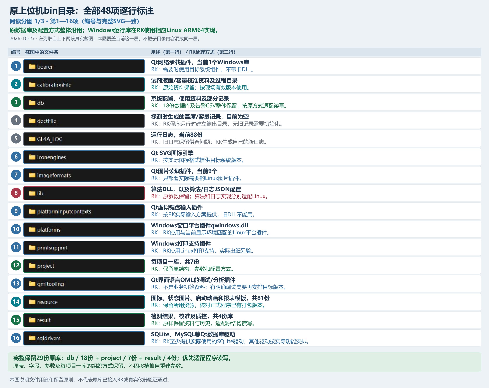
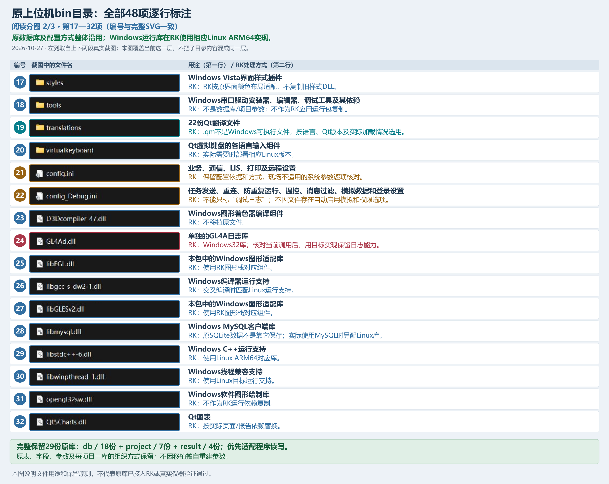
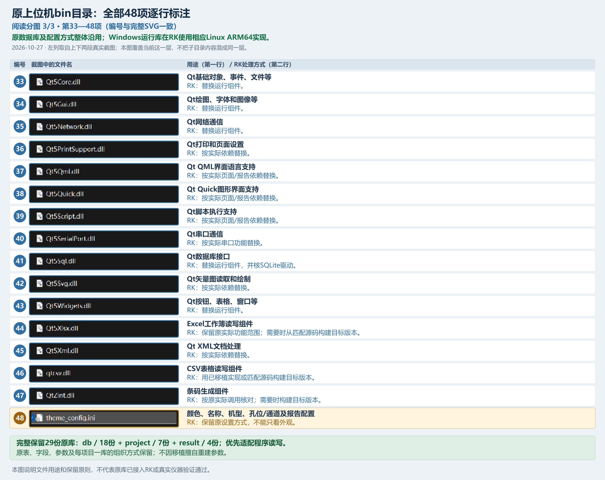

# 原上位机文件用途与RK保留范围

核查日期：2026-10-27。本文更正截图中的红字，说明哪些地方已有大致认识，以及原数据库、配置和运行库应怎样带到RK。

**本接入窗口收尾后停止：**医院原库保存修复已在RK独立匿名后台74/0、退出0，未发布主程序。用户要求只完成最近小项后由新窗口继续；其他接入和半成品保持待办，[停止交接与实际范围](../../02_records/20261022_sn100_host_migration.md#hospital-save-fix-stop-20261027)。

**逐文件查板上是否齐全：**打开[Windows与RK核对清单](sn100_original_files_rk_checklist.md)。2026-10-27 19:19:23（北京时间）实际核对的29份DB、9份配置/规则及1份报表XML共39份，RK全部存在且内容与Windows原件一致，原相对目录和大小写保持；业务仍未全部接入。清单给出两边每份文件的完整路径、用途、接入阶段和人工确认栏，另列3个尚未创建的原空目录。该时点没有主窗口进程，不能再按早先“已停在项目页”的记录判断当前画面。

<a id="all-original-files-20261027"></a>

**最新完整接入要求（2026-10-27）：**用户要求全部原DB和配置文件接入对应业务，保持原目录、原表、原键值及未知字段；“已复制”“能读取”“页面与业务已使用”“RK操作通过”分别记录。Windows专用DLL、接口或工具无法在RK直接运行时，仍须依据原Windows的界面、输出结果和实际源码移植对应能力，不能按平台直接跳过。原版未提供实现、只有声明、原功能本来关闭或缺少认可的输入/结果时，逐项列出准确文件、缺的内容和影响；不得以近似算法、空操作或读取后丢弃冒充完成。下方已验范围保留原批次事实，后续逐业务接入以同一移植记录与计划为准。

**本轮范围补充：**用户随后明确，检测算法暂不实现，留到后续，当前移植过程中不考虑；已有Windows输入和结果样例供后续对照。现阶段继续接入全部DB、配置及对应业务页面；`AlgParam`和`AL4A_config.cfg`等参数保持原样，收到的原始曲线可保存为待计算，不以空实现返回成功或生成检测值。机型已由用户确认是SN100；主控IP已提供为`192.168.100.123`，不能再把这两项列为未提供。原工程对共用容量文件的机型选择存在不一致，须按真实选择或有据配置使用，不能只看450/600文件名推断SN100参数。

**资料整理与执行分开登记：**本文保留原文件用途和用户要求。接入窗口已据此完成本批原样部署、项目/单位配置读写和INI兼容：完整程序`f8c6e73f`部署到原`/home/rkshare/programs/sn100_shell`，141份原资料按原分类放入现有`runtime/data`，29份DB只读完整性通过，4份INI共134个有效项读取一致；RK后端90项、优化后页面114项及正式启动/正常退出/重开已核对。该批测试后曾停在原项目页供用户查看，未连接仪器；后续核查时的进程状态见上方逐文件清单。未知算法键/MDA只读、完整关联复制及其他原库业务仍待实施或验证，不能把文件复制当成整套功能完成。[实际范围与证据](../../02_records/20261022_sn100_host_migration.md#original-db-rk-20261027)及[后续计划](../plans/sn100_host_migration_plan.md#original-database-reuse-20261027)。

**全部48项已逐行标注：**[查看完整PNG](../../03_photos/07_SN100上位机移植/11_原工程文件用途说明/20261027_sn100_original_bin_annotated_01.png)或[可编辑完整SVG](../../03_photos/07_SN100上位机移植/11_原工程文件用途说明/20261027_sn100_original_bin_annotated_01.svg)。本图覆盖`bin`当前这一层的20个文件夹和28个文件，每项都有截图文件名、用途和RK处理方式；下层305个文件仍按各目录及完整清单查阅。左列来自本轮重新截取的[上半段](../../03_photos/07_SN100上位机移植/11_原工程文件用途说明/20261027_sn100_original_bin_all_top_01.jpg)和[下半段](../../03_photos/07_SN100上位机移植/11_原工程文件用途说明/20261027_sn100_original_bin_all_bottom_01.jpg)，逐行裁出真实文件名，没有重绘列表。`theme_config.ini`已作为第48项对应截图框线标注，说明包含外观、机型、孔位/通道及报告配置。

为方便阅读，下面分三段显示，编号与完整SVG一致。







**按用户最新要求：优先完整沿用原数据库及其配置方式，保留表、字段、参数和原有文件组织；不默认转成新库，不以移植为由重建一套参数。**现有RK程序若读写不兼容，应优先适配程序。原库能打开、程序能正确读写、接仪器检测通过，分别验证。

## 1. 本次看了什么

最初收到的[原截图](../../03_photos/07_SN100上位机移植/11_原工程文件用途说明/无标题.png)原在项目根目录，现已按内容归入照片目录；当时未找到单独名为“原图”的文件夹。按截图地址，核查对象为：

```text
06_programs/sn100_host_reference/Seerain450_PC/bin/
```

实际共48个顶层项目：20个文件夹、28个文件；下层共305个文件，包括29个SQLite数据库、73个Windows动态库、3个Windows程序、88个日志，以及图片、翻译和配置文件。SQLite是一种把数据库保存在普通文件中的方式；这些数据库文件本身不按Windows或ARM处理器分别编译。

参考工程目录已由另一项整理工作去掉重复的`Seerain450_PC/`层；上方是现在的实际位置。用户随后明确要求历史清单也改为现路径，本轮同步清单中的位置，并更新清单自身受影响的校验值；原文件内容指纹、历史日期与已验范围保持准确，原源码、数据库及压缩包不改写。

全部305个文件均读取字节并记录SHA-256文件指纹；另外检查了数据库表结构、项目参数名称、配置内容结构、图片格式、报告模板、两份关键动态库的对外函数和相关源码引用。没有导出患者记录、账户口令或连接凭据；动态库只作静态检查，没有运行或逆向还原内部算法。完整清单见[文件及结构清单](../../04_references/sn100_host/original_bin_20261027/inventory.json)，函数依据见[动态库对外函数](../../04_references/sn100_host/original_bin_20261027/exports.json)。这不是整份参考工程全部源码的逐行审查。

## 2. 从图中能看出你已经大概了解哪些

这里以你提供的红字为依据，只判断你已经指出的文件用途，不据此判断你是否掌握了内部代码。

| 图中已有说明的对象 | 从说明可以看出的认识 | 更正或补充 |
| --- | --- | --- |
| `calibrationFile` | 知道与试剂容量校准、探测高度有关 | 方向正确；有校准参数，也预留校准过程记录目录。这里的容量校准与检测项目的校准曲线是两件事。 |
| `db` | 知道上位机很多功能依赖数据库 | 正确；还要区分单位、瓶型、通道等系统资料，与试剂摆放、医院资料、账户、维护记录等使用资料。 |
| `dectFile` | 知道与探测高度记录有关 | 已找到试剂/稀释液孔位探测时追加高度、换算容量、针号、时间的代码；本次未证明样本也使用这个目录。当前目录为空。 |
| `GL4A_LOG` | 知道是上位机日志 | 正确；是运行后产生的记录，不是检测项目的初始参数。 |
| `lib` | 知道这里与算法有关 | 方向正确，格式需改：当前是Windows的`AL4ADLL.dll`及两个配置文件，未发现Linux的`.so`算法库。 |
| `project` | 知道保存项目数据库 | 正确；每个项目一份库，包含加样、稀释、试剂、结果单位、校准选项及大量算法参数。 |
| `resource` | 知道是程序要加载的资源 | 正确；既有启动图片，也有业务按钮、状态图标、报表模板，运行中也会使用。 |
| `result` | 知道与普通、急诊、质控等结果有关 | 需补充：这里还保存校准资料、质控配置，不能把整个目录都叫历史检测结果。 |
| `config.ini` | 知道是上位机配置文件 | 正确；混有业务选项、通信、LIS、打印及远程访问设置，不是只有项目参数。 |
| `GL4Ad.dll` | 已注意到它可能与算法有关 | 应改成日志库；本次看到的9个对外函数都是日志相关。真正的算法库在`lib/AL4ADLL.dll`。 |
| `theme_config.ini` | 知道与界面颜色有关 | 正确但不完整；还包含机型、试剂孔位数、样本位、急诊位、检测通道数和报告类型等设置，不能只当外观文件。 |

因此，图中至少能支持“已大概认识数据库、项目、校准、日志、界面资源和配置这几类”。其余没有红字的Qt插件和系统运行库，只能写成“图中没有说明”，不能判断为你不了解。

<a id="original-files-copy-20261027"></a>
## 3. 哪些可以直接复制，哪些还要适配

用户所说的“直接移植”就是把文件原样复制到RK，作为初始配置和相关资料。DB文件保存参数和记录，不是可执行程序；文件能够复制与当前上位机能够正确读写它，分别确认。原数据库不需要为了ARM64重新编译，也不应被要求先转成JSON或新的`catalog.db`。

### 可以直接复制的原始资料

| 原文件或目录 | 直接复制的范围 | 上位机使用时要做什么 |
| --- | --- | --- |
| `db/` | 全部18份SQLite数据库，以及`systemInfo/abnormal_Config.csv` | 按原表读取和维护系统、单位、瓶型、试剂等资料；保留机型/厂家版本，不默认互相覆盖。 |
| `project/` | `1 PT.db`至`7 AT-III.db`共7份项目库 | 保留每项目一库、原表和全部参数；页面直接读取、修改、保存这些原库。 |
| `result/` | `results.db`、`calibration.db`、`quality.db`、`quality_Data.db`共4份库 | 保留检测历史、校准、质控配置及关联；可编辑范围按原Windows业务，不任意开放历史检测值修改。 |
| `calibrationFile/` | 当前3份容量校准参数文件及原目录组织 | 原件先完整保留，核对现有仪器有效版本和实际读取点；不把试剂容量校准当成项目校准曲线。 |
| `lib/config/` | `AL4A_config.cfg`和`GL4A_config.cfg` | 原算法/日志配置作为原始资料复制；核对实际程序读哪份参数，不代表算法库已经能在RK运行。 |
| `theme_config.ini` | 原外观、名称、机型、孔位/通道和报告配置 | 原配置方式保留，核对机型；Linux路径与显示差异优先由代码适配。 |
| `config_Debug.ini` | 原任务、重连、登录、模拟等选项文件 | 可以原样复制保留配置；实际运行前核对哪些选项应启用，不自动打开模拟造数。 |
| `resource/` | 原图片、图标、动画和报表模板 | 可以复制或随程序原样打包；已有匹配资源不重复换版本。 |
| `translations/` | 实际使用且匹配Qt版本的`.qm`翻译文件 | 按语言和程序实际加载需要选用。 |

**29份数据库全部纳入原库复制和沿用范围：18＋7＋4。**迁移前停止相关写入并关闭连接，或采用能取得完整一致副本的数据库备份方式；不能在仍写入时只随手复制主`.db`就宣称数据完整。参考工程中的唯一原件保持只读，复制后维护RK上的运行数据。复制完成先核对文件内容一致，再做程序读写验证；后续部署覆盖旧版本按下述用户确认执行。

<a id="in-place-update-20261027"></a>

**部署更新约定（2026-10-27用户确认）：沿用之前验收程序的部署位置，不另建程序验证目录或DB部署目录。**修改源码、重新编译并上传后，在原部署位置更新程序；本次更新范围内的DB也允许覆盖旧版本，包括已经修改、保存过的DB，不要求每次保留一套旧程序和旧DB目录。重新编译本身只生成程序，上传部署时才更新RK上的文件。

用户计划通过Windows项目文件和Git历史查找所需版本，不为本次更新额外整理日常版本目录。Git只能恢复实际已提交保存的内容，这项约定不表示这些DB已经纳入Git。清单窗口先记录更新方式，接入窗口现按本约定执行构建、部署与RK验证；实际结果以同一移植记录为准，不自动提交或推送Git。

**目录管理要求（2026-10-27用户再次明确）：DB部署、读取、保存、复制、导入和导出必须保持原本的文件夹管理分类方式，不重新分类。**沿用现有RK部署位置，其下的相对目录层级、文件夹名称、文件名及大小写保持原样，例如`db/systemInfo/`、`db/userSet/`、`project/`和`result/`。不把所有DB平铺到一个目录，不把原库移动或合并到新的`catalog.db`体系，不为了Linux而统一改成小写；路径差异由程序适配。

**INI兼容要求（2026-10-27用户补充）：Qt能读出键值但有格式问题时，必须修复兼容读取，并保证有效配置的键名、值类型和值与原文件一致。**原件保留字节不变，优先由程序处理格式差异。当前发现三份INI使用整行`#`注释；兼容读取仅在私有临时副本中把该注释标记换成Qt识别的`;`，不改配置值中的`#`，不改数字、颜色、中文名称或路径。逐项在RK核对读取结果和原文本、原Qt有效键值，记录相等项数与失败数，不输出口令或连接地址。读取一致与实际应用设置分别验收；原连接、自动造数等开关不因文件能读而自动启用。

原资料根下的组织示例（只说明位置，省略其他原有文件）：

```text
<RK原资料根>/
├── db/
│   ├── systemInfo/option_Unit.db
│   └── userSet/reagent_Information.db
├── project/1 PT.db
├── result/results.db
├── calibrationFile/
├── lib/config/
├── config.ini
├── config_Debug.ini
└── theme_config.ini
```

导出包内部也沿用同一套原相对路径；一致性清单等部署说明不写进原DB表。日常部署按上述约定在原位置更新，不因本次更新另起部署或版本保留目录。验收时同时核对文件指纹与相对路径，文件内容相同但位置被重新整理也不算满足本要求。

### 需要适配的部分

原DB的读取和写入代码必须适配，不能因当前代码读不了就去改变原库结构。`config.ini`保留原格式和业务设置，仅对实际存在的平台差异核对并调整，例如Windows串口名、打印机名、旧连接地址；不是要求重写所有配置。原件可以保留，部署工作副本按实际条件使用。

`lib/AL4ADLL.dll`、日志能力、实际使用的Qt库、数据库/显示/图片/打印等插件，需要Linux ARM64实现或已经具备的等价实现。这里的“适配”包括使用已有Linux组件，不是修改DLL后缀，也不是要求把Qt全部重新开发。`lib/`是混合目录：里面的配置直接复制，Windows算法DLL不能直接使用。

### 当前不需要搬入RK应用的内容

旧运行日志、空的`dectFile`输出目录内容、Windows安装/编辑/调试工具、Windows专用图形库和MinGW运行库，以及Qt调试工具和Windows Vista样式插件，不作为原始配置复制。RK所需图形和编译器运行支持使用目标系统组件；日志和探测记录由RK程序新建。

当前未启用或没有实际依赖的Quick、旧Script、XLSX、条码、MySQL组件，不因参考包里有文件就一并部署。以后确认原版实际需要相应功能时，再列入适配；最终以真实构建和动态依赖核对为准。“不需要移植”不表示可以删除参考原件或取消原版已确认的功能。48项具体归类见第5节。

## 4. 数据库里面具体保存什么

### `project/`：每项目一份库

7份原库分别是`1 PT.db`、`2 APTT.db`、`3 TT.db`、`4 FIB.db`、`5 D-D.db`、`6 FDP.db`、`7 AT-III.db`。这些名称是原检测项目名称，本次不改名。

这7份库都发现以下7张表：

| 原表 | 用途及本次看到的字段 |
| --- | --- |
| `project_base` | 项目基础参数；以`name/value`保存，例如项目编号、波长、采样间隔、检测时间、校准方法、当前试剂批组和系数。 |
| `AlgParam` | 算法的逐项参数；以`key/value`保存，包括滤波、凝血点、检测窗口和异常检查等键。PT库发现91个参数键，不能只用几个系数代替。 |
| `project_sample_rate` | 稀释方案；包含样本量、稀释液量、混匀、加样方式、可选项及默认方案。 |
| `project_reagent` | 试剂动作；包含试剂名、加液量、预温、针选择、混匀和前后清洗。 |
| `project_results` | 结果配置；包含结果类型、单位、小数位、检测/参考范围、启用、主结果、显示及LIS代码。 |
| `project_mda` | 原程序称为MDA的项目及稀释选项；具体启用范围仍按原业务核对，不仅凭表名开放。 |
| `project_quality` | 项目对应质控品、稀释、规则及批号等；表存在不证明所有旧分支都实际启用。 |

你提出“相关项目配置在原库里能找到”有直接依据。下一步应沿着原表补齐页面和读写代码，优先保持原数据组织；不能只导入项目名称后就说原配置完整迁移。

### `db/systemInfo/`：系统资料

| 文件 | 实际表/字段所表示的用途 |
| --- | --- |
| `channel.db` | 缓存、预温和检测通道，包含通道号、是否启用等设置。 |
| `option_Unit.db` | 单位名称、类型和换算倍率。 |
| `reagent_Bottle_Type.db` | 当前默认路径的瓶型、适用区域、瓶高、容量、转接件和底部几何参数。 |
| `reagent_Bottle_Type_450.db` | 另一份瓶型资料，文件名标有450；完整保留，实际采用版本待核。 |
| `reagent_Bottle_Type_600.db` | 文件名标有600的瓶型资料；完整保留，不据名称把它当当前机型配置。 |
| `result_Check.db` | 结果异常标记、中文/英文信息及位编号。 |
| `user.db` | 角色及权限配置；与保存账户口令的`user_Information.db`不同。 |
| `abnormal_Config.csv` | 告警码、说明、处理方法、是否启用及检测状态下的处理规则；它是CSV配置，不是SQLite库。 |

### `db/userSet/`：使用中维护的资料

| 文件 | 实际表/字段所表示的用途 |
| --- | --- |
| `reagent_Information.db` | 试剂清单、条码、批组、厂家、用量及警戒等资料。 |
| `reagent_Information_hongkui.db` | 同结构的另一份试剂资料，保留原件，适用版本待核。 |
| `reagent_Information_liangchen.db` | 同上，不能未经核对覆盖当前试剂库。 |
| `reagent_Information_seerain.db` | 同上，保留以便对照原配置。 |
| `reagent_Setting.db` | 各孔位试剂、批号、瓶型、余量、已用量、有效期和状态；还存在另一机型用的表。 |
| `isi_Value.db` | 按批组保存ISI及正常参考值；ISI是原凝血结果换算所用参数，须保留原含义。 |
| `hospital_Information.db` | 医院及业务字典资料。 |
| `sample_Combination.db` | 样本检测组合与包含项目。 |
| `user_Information.db` | 账户、角色和口令字段；沿用时受控处理，不在文档展示内容，不作为公共示例。 |
| `maintain.db` | 日、周、月维护记录。 |
| `abnormal_Log.db` | 历史告警、时间、处理及操作者记录；与告警规则CSV不同。 |

### `result/`：结果、校准和质控混合保存

| 文件 | 实际表/字段所表示的用途 |
| --- | --- |
| `results.db` | 样本/患者资料、检测结果、报告列、状态和计数；普通/急诊等通过记录类型区分，不是每种类型一份文件。 |
| `calibration.db` | 校准基本信息、原始点、单位、变换、审核标记及试剂批组关联；不能只当无用历史。 |
| `quality.db` | 质控品、批号、项目关联、目标范围和规则配置。 |
| `quality_Data.db` | 按质控品、项目、批号和时间保存的质控结果。 |

原库的29个文件是7份系统资料库、11份使用资料库、7份项目库和4份结果/校准/质控库。此处只核对结构和配置名称，没有输出业务记录。

## 5. 截图中全部48个顶层项目逐项说明

“替换运行组件”表示保留功能，在RK用Linux ARM64版本；不表示删除电脑上的参考原件。

| 名称 | 更正后的用途 | RK处理方式 | 移植分类 |
| --- | --- | --- | --- |
| `bearer/` | Qt网络承载插件，当前1个Windows库 | 当前普通TCP连接不单独搬这组插件；需要时由Linux Qt提供。 | ③不需要移植 |
| `calibrationFile/` | 试剂液面/容量校准资料及过程目录 | 原校准参数及目录原样复制，实际采用版本按仪器核对。 | ①直接复制 |
| `db/` | 系统配置、使用资料及部分记录 | 18份数据库和告警CSV原样复制；程序按原表读写。 | ①直接复制 |
| `dectFile/` | 探测时生成的高度/容量记录，目前为空 | 当前为空，不带旧探测记录；运行时建立输出目录。 | ③不需要移植 |
| `GL4A_LOG/` | 运行日志，当前88份 | 旧日志不是初始配置；RK生成新日志，旧件本机保留。 | ③不需要移植 |
| `iconengines/` | Qt SVG图标引擎 | 使用SVG图标时提供匹配的Linux插件，不复制DLL。 | ②修改或适配 |
| `imageformats/` | Qt图片读取插件，当前9个 | 按实际图片格式提供Linux插件，不复制Windows插件。 | ②修改或适配 |
| `lib/` | 算法DLL，以及算法/日志JSON配置 | config内原参数直接复制；AL4A算法须有Linux ARM64实现。 | ①配置；②算法库 |
| `platforminputcontexts/` | Qt虚拟键盘输入插件 | 采用Qt虚拟键盘时配置Linux输入插件；键鼠阶段按需。 | ②修改或适配 |
| `platforms/` | Windows窗口平台插件`qwindows.dll` | 换为RK显示环境使用的Linux平台插件。 | ②修改或适配 |
| `printsupport/` | Windows打印支持插件 | 使用Linux打印支持；原打印功能和实际出纸分别核对。 | ②修改或适配 |
| `project/` | 每项目一库，共7份 | 7份项目库原样复制，保留每项目一库及所有原参数。 | ①直接复制 |
| `qmltooling/` | Qt界面语言QML的调试/分析插件 | 仅Qt调试分析用途，不作为正式业务运行包移植。 | ③不需要移植 |
| `resource/` | 图标、状态图片、启动动画和报表模板，共81份 | 原图标、图片和报表模板可直接复制或原样打包。 | ①直接复制 |
| `result/` | 检测结果、校准及质控，共4份库 | 4份结果、校准和质控库原样复制，保留数据关联。 | ①直接复制 |
| `sqldrivers/` | SQLite、MySQL等Qt数据库驱动 | 提供Linux SQLite驱动；其他驱动按实际连接需要。 | ②修改或适配 |
| `styles/` | Windows Vista界面样式插件 | 不带Windows Vista样式DLL；沿用原界面颜色布局。 | ③不需要移植 |
| `tools/` | Windows串口驱动安装器、编辑器、调试工具及其依赖 | Windows安装器、编辑器和调试工具不放入RK应用。 | ③不需要移植 |
| `translations/` | 22份Qt翻译文件 | 实际使用且匹配Qt版本的QM翻译文件可直接复制。 | ①直接复制 |
| `virtualkeyboard/` | Qt虚拟键盘的各语言输入组件 | 需要Qt虚拟键盘时部署Linux版本，不移植旧DLL。 | ②修改或适配 |
| `config.ini` | 业务、通信、LIS、打印及远程设置 | 保留原配置方式；部署时核对串口、打印机和地址等差异。 | ②修改或适配 |
| `config_Debug.ini` | 任务发送、重连、防重复运行、温控、消息过滤、模拟数据和登录设置 | 文件可原样复制；启用前核对模拟、登录和任务开关。 | ①直接复制 |
| `theme_config.ini` | 颜色、名称、机型、孔位/通道及报告配置 | 外观、机型和孔位等原配置可复制，核对对应仪器。 | ①直接复制 |
| `GL4Ad.dll` | 单独的GL4A日志库 | 保留日志能力，换为Linux日志实现或已有等价代码。 | ②修改或适配 |
| `D3Dcompiler_47.dll` | Windows图形着色器编译组件 | Windows专用组件；RK不使用这份文件。 | ③不需要移植 |
| `libEGL.dll` | 本包中的Windows图形适配库 | 不搬Windows图形库；图形支持使用RK系统对应组件。 | ③不需要移植 |
| `libGLESv2.dll` | 本包中的Windows图形适配库 | 不搬Windows图形库；图形支持使用RK系统对应组件。 | ③不需要移植 |
| `opengl32sw.dll` | Windows软件图形绘制库 | Windows软件绘图库不带到RK，按RK图形环境运行。 | ③不需要移植 |
| `libgcc_s_dw2-1.dll` | Windows编译器运行支持 | 不搬MinGW运行库；ARM64编译使用Linux对应支持。 | ③不需要移植 |
| `libstdc++-6.dll` | Windows C++运行支持 | 不搬Windows C++库；使用ARM64程序匹配的Linux库。 | ③不需要移植 |
| `libwinpthread-1.dll` | Windows线程兼容支持 | Windows线程兼容库不搬；使用Linux线程运行支持。 | ③不需要移植 |
| `libmysql.dll` | Windows MySQL客户端库 | 当前原库为SQLite，无需MySQL库；另有MySQL业务再配。 | ③不需要移植 |
| `Qt5Core.dll` | Qt基础对象、事件、文件等 | 使用匹配的Linux ARM64 Qt Core组件。 | ②修改或适配 |
| `Qt5Gui.dll` | Qt绘图、字体和图像等 | 使用匹配的Linux ARM64 Qt绘图和字体组件。 | ②修改或适配 |
| `Qt5Widgets.dll` | Qt按钮、表格、窗口等 | 使用匹配的Linux ARM64 Qt窗口控件组件。 | ②修改或适配 |
| `Qt5Network.dll` | Qt网络通信 | 使用Linux Qt网络组件，保留需要的通信功能。 | ②修改或适配 |
| `Qt5Sql.dll` | Qt数据库接口 | 使用Linux Qt数据库接口，并配SQLite驱动。 | ②修改或适配 |
| `Qt5Xml.dll` | Qt XML文档处理 | 报告等使用XML时提供Linux Qt XML组件。 | ②修改或适配 |
| `Qt5PrintSupport.dll` | Qt打印和页面设置 | 报告和打印使用匹配的Linux Qt打印组件。 | ②修改或适配 |
| `Qt5Svg.dll` | Qt矢量图读取和绘制 | 原图标或页面使用SVG时提供Linux Qt SVG组件。 | ②修改或适配 |
| `Qt5SerialPort.dll` | Qt串口通信 | 实际接入串口功能时提供Linux Qt串口组件。 | ②修改或适配 |
| `Qt5Charts.dll` | Qt图表 | 当前报告构建有图表依赖，使用Linux Qt Charts组件。 | ②修改或适配 |
| `Qt5Qml.dll` | Qt QML界面语言支持 | 当前报告脚本使用此组件，提供Linux Qt QML库。 | ②修改或适配 |
| `Qt5Quick.dll` | Qt Quick图形界面支持 | 当前Widgets主程序和报告未直接需要；启用Quick再配。 | ③不需要移植 |
| `Qt5Script.dll` | Qt脚本执行支持 | 当前报告用QJSEngine及Qt QML，不需要旧Script库。 | ③不需要移植 |
| `Qt5Xlsx.dll` | Excel工作簿读写组件 | 当前XLSX入口未启用；确认需要时再构建Linux实现。 | ③不需要移植 |
| `qtcsv.dll` | CSV表格读写组件 | CSV能力由现有代码或匹配源码提供，无需这份DLL。 | ②修改或适配 |
| `QtZint.dll` | 条码生成组件 | 当前报告禁用条码库；确认启用该功能后再配Linux库。 | ③不需要移植 |


## 6. 最容易误判的几个地方

**算法库与日志库并不相同。**`GL4Ad.dll`本次发现9个日志对外函数；`lib/AL4ADLL.dll`发现22个对外函数，同时包含算法和日志接口。原`GL4A_Driver.cpp`也加载`lib/AL4ADLL.dll`，而工程中直接链接`GL4Ad`的行已注释。因此不能仅凭目录里有`GL4Ad.dll`就认定它仍是当前实际加载的后端。

**算法配置不能只盯一份文件。**`AL4A_config.cfg`实际是JSON，包含凝血点、滤波和异常检查等参数；7份项目库的`AlgParam`也保存参数。原`_AL4A_Init_Dll()`接收配置路径却在当前封装中未使用该参数，`AL4A_TotalMethod`则获得项目数据库路径。应保留两类原件、核对实际算法读哪一份，不宣称“拷贝CFG就已恢复全部算法”。

**容量校准两份JSON当前内容相同。**`ReagentAmount_450.json`与`ReagentAmount_450 - TJ.json`本次字节完全一致；源码明确引用的是前者。两份原件都保留，不擅自删；实际启用文件按原引用及现场版本核对。`calibrationFile/face`、`calibrationFile/vol`当前为空，不能说已有完整的校准过程原始数据。

**Linux文件名大小写会影响加载。**原算法封装拼接`.DB`，实际项目文件为`.db`；日志配置写的目录大小写也与现有目录存在差异。原Windows反斜杠路径也需要适配。优先在路径处理和读写代码中解决，不靠改库表、改业务参数掩盖问题。

**配置和库能用，不等于算法已经移植。**本包73个DLL均为Windows32文件，3个EXE中2个为Windows32、1个为Windows64；没有可直接供RK加载的算法`.so`。原数据库保留再完整，也仍需要适合RK的算法实现和真实结果对照。

<a id="original-db-maintenance-20261027"></a>
## 7. 原DB怎样在上位机里读取、输入、保存和导出

### 用户要的操作流程

用途是让RK上位机直接维护原DB配置，使用者按现有Windows上位机的页面和习惯操作，不需要日常另外打开数据库工具。

1. 上位机从明确的数据目录读取原DB，按原项目、试剂、单位等关系显示内容。不是把数据库文件当程序运行。
2. 使用者在原有页面录入或修改参数，尚未保存时只保留界面草稿，取消则恢复数据库中的已保存内容。
3. 点击一次“保存”，程序先锁定本次操作、取得本次输入的固定副本，再校验权限、格式、单位、范围和关联关系。
4. 后台将同一份原DB内的相关修改放进一次数据库事务，即这些修改全部成功，或失败后撤销这次未完成的修改，避免只写了一半。涉及多份库时另行协调提交和恢复，不能默认一次事务就覆盖所有文件。[SQLite事务说明](https://www.sqlite.org/atomiccommit.html)
5. 写入完成后重新读取实际保存值，再向界面报告成功并解除操作保护。若提交成功但重新读取失败，应显示“已写入、读取失败”，不能误报未保存并重复写入；失败前的草稿和实际库状态分别保留。

例如：在“分析项目”中选择PT，修改某个允许编辑的加样或稀释参数，点击保存后写回对应的`project/1 PT.db`；关闭并重新打开仍应读到这个已保存值。**保留原库结构不等于数据库永远只读；正常业务保存本来就应更新原库中的配置值。**

原Windows源码已有`loadProject()`、`on_btnSave_clicked()`，并按顺序保存基础参数、稀释、试剂、结果配置及`AlgParam`。RK版按这些真实业务字段和可编辑范围对照，保留原颜色、布局和按钮习惯，不要求照搬原同步读写方式。原版没有的DB选择或导出入口按本次新增需求补齐，不把所有数据库字段都开放为随意编辑。

### 需要补齐的功能清单

| 功能 | 使用者怎样操作、程序应怎样处理 |
| --- | --- |
| 原DB读取 | 从指定工作目录加载原29库，支持原项目一库一文件；检查文件和所需表/字段，未知字段保留。文件不存在时明确报错，不能偷偷创建空库或改用演示数据。 |
| 界面输入与修改 | 延续原Windows页面、字段、单位、权限和校验；保留只读、引用保护及原本禁用的项目。项目参数不仅是几个系数，还要覆盖原稀释、加样、试剂、结果配置和实际使用的算法参数。 |
| 保存、取消、复制和删除 | 保存写回当前选中的原库；取消不落库；复制和删除按原Windows规则处理文件名、编号和引用。不得误写另一个项目、漏写一组参数或重复生成记录。 |
| DB文件选择/导入 | 能选择适用的原`.db`或原配置目录；先验证来源、结构和关联，再加载或复制到明确工作目录。导入后仍使用原DB格式，不能要求先转JSON；重名/已有库冲突要说明，不静默覆盖。加载现有工作库与复制外部库要区分清楚。 |
| DB导出 | 支持导出选定原库及需要的关联配置，输出仍为可重新读取的DB，不只导出CSV。至少覆盖项目库及整组配置资料；报告CSV/PDF保留原功能，不能代替DB导出。导出到临时目标、验证完整后才发布成功结果，避免留下半份文件被当作完成。 |
| 导出时的数据一致性 | 正在使用的库可采用SQLite在线备份接口获得一致副本；不能只复制仍在写的主文件。多库一起导出时协调暂停相关写入，保留范围和文件清单，不把“每个库都复制成功”当成库之间一定对应。[SQLite备份说明](https://www.sqlite.org/backup.html) |
| 失败、恢复和重开 | 覆盖文件损坏、不匹配、只读、无权限、数据库被占用、空间不足、导入冲突、导出失败等情况。明确实际成功到哪一步，失败可恢复，库结构和无关资料不丢失。 |

文件复制和导出范围以本次选定的业务为准；部署时覆盖旧版本按第3节的用户确认执行，页面保存、导入和导出的失败恢复要求仍须满足。真实患者、口令等不写入说明、截图或Git归档；RK运行数据与只读参考原件分开。

### 当前代码已经有什么、还缺什么

当前正式程序存在新的`catalog.db`、`calibration_local.db`、`quality_control.db`等数据组织。举例：原项目的`project_base`是`name/value`表，当前`ProjectsStore`中的同名表是按项目编号等列保存的一行一项目；两者并不兼容。当前“文件导入”入口也不能未经验证就当成原7份数据库的完整直读入口。

已核对`ProjectsStore::importFile()`：当前只接受`sn100-project-config-v1`格式的JSON，明确拒绝旧数据库；这是当前导入功能和新库结构的实现缺口，**不是RK或SQLite不能接受原DB**。这次需求是补齐原DB兼容，不能继续让用户先转换成JSON。

现有`ProjectPage`已有忙碌状态、按钮启停、当前请求编号、写入回执及重新读取处理；`ProjectsStore`已有后台读写、事务和错误处理的相关代码。后续应核查并复用，不把防重和后台能力全部当成缺失；但它们在新库上的通过结果不能代替原库读写及导入导出的验证。

按用户最新要求，后续应保留原数据库组织，逐项让项目、试剂、样本、校准、质控和报告读写代码兼容原表；新增功能先查原库字段，不先发明新表或删掉原参数。项目参数页尤其应核对`project_base`、`AlgParam`、`project_sample_rate`、`project_reagent`和`project_results`的完整往返读写。已有匿名演示库和历史验证结果保留，不能当成原库已经迁移的证明。

实际执行继续维护在[唯一移植计划](../plans/sn100_host_migration_plan.md#original-database-reuse-20261027)。数据库整包复制前核对来源及完整性；首次使用先只读核对所有原库能打开，再核显示和关联，最后在RK运行目录验证保存、取消、关闭重开和真实检测。测试使用复制到RK的数据库，不直接写参考目录；部署覆盖旧版本按第3节用户确认执行，不为此另起部署目录，含口令/患者资料不进入公开文档或Git归档。

**当前实施范围（2026-10-27）：**已从清单整理进入RK实际接入。141份原资料原样部署到现有`runtime/data`，全部29份原库只读检查、项目/单位配置直接读写、INI兼容、完整主程序部署与正常退出重开已有RK证据；正式页面当前可查看原项目。其余原库业务、原项目完整跨库复制、配置用于真实检测、物理操作/原版完整外观和长稳仍待验证，详见[同一移植记录](../../02_records/20261022_sn100_host_migration.md#original-db-rk-20261027)。

<a id="original-db-responsive-20261027"></a>
### 读写优化：不能因文件操作把界面卡住

用户要求读取、输入、保存和导出时保持界面可用。后台任务耗时与界面无响应是两件事：导出大库可以花时间，但界面必须能继续显示状态、响应适用的操作，不能让使用者误以为程序死掉。

- 文件扫描、DB检查、查询、写入、备份和导出在后台工作线程执行；界面线程只处理输入和展示结果，不在按钮处理里同步等磁盘、睡眠或反复重试。控件仍由界面线程操作，通过消息接收后台结果。[Qt5线程与界面规则](https://doc.qt.io/archives/qt-5.15/threads-qobject.html)
- 使用数据库的连接在对应后台线程创建、使用和关闭，不把界面创建的连接交给其他线程使用；同一库的冲突写入按顺序处理，不能因多开线程反而重复写同一个库。
- 只读取当前需要的数据，较多历史记录分页显示；页面更新分批进行，查询/保存完成后不在界面中一次性重建所有表格。批量写入合理合并到事务中，避免每个字段单独刷新和反复打开库。
- 写入尽量短，数据库被占用时采用有上限的等待和重试，并让界面保持响应；不在界面线程等待锁。不能为提速关闭必要的提交保护、丢失原字段、擅自改表，或默认更换原库日志模式。
- 大文件导入和导出显示进度或“正在处理”，在可安全取消的阶段支持取消；提交阶段不能一边提示取消成功一边实际继续写入。成功、失败和取消后的资源与临时文件均要收尾。
- 在RK分别测“点击到可见反馈”“任务完成时间”和“界面最长无响应”，记录数据规模、重复次数及资源占用。已有保存耗时不等于屏幕反馈延迟，不能混用。响应门槛在实施验收前明确，未测或门槛未确认不能写“已不卡顿”。

### 防重复点击：忙碌状态为主，短时间防抖为辅

**采用“当前操作未结束，就不接受冲突操作”的保护，不能只用固定几秒解锁。**如果写库比定时器更慢，固定时间到了仍可能重复提交；如果写库很快，单纯延时又会无故让界面不可操作。

| 保护层 | 必须满足的行为 |
| --- | --- |
| 点击入口先锁定 | 第一次有效点击后，立即标记“正在读取/保存/导入/导出”，在投递后台任务前完成。把本次选中的库、记录和输入固定下来。 |
| 相关按钮一起保护 | 保存中禁止再次保存，以及会改变本次目标的复制、删除、导入覆盖、切换项目等冲突操作；无关浏览按业务允许继续，不简单锁死整个应用。也覆盖快捷键、其他弹窗和其他页面入口。 |
| 程序入口再检查 | 即使禁用按钮前已排队了一次点击，或通过其他入口触发，处理函数仍检查忙碌状态；同一库的后台写入入口也拒绝冲突任务，不只靠按钮变灰。 |
| 当前请求只处理一次 | 为任务带上请求编号、目标库/记录和当前输入版本，旧回复不能改动新页面。已经保存且没有新修改时，不因迟到的重复点击再写一遍；新增、复制、导入不能因连点多建记录。优先使用现有主键、事务和请求状态，不为防重擅自改原库。 |
| 收到结果再解锁 | 成功提交并完成必要重新读取，或明确失败/取消并完成收尾后，恢复可操作状态。超时不等于后台已停止，不能仅因超时就解锁并允许再写。异常退出后重开要核对实际库状态，不能盲目重放上次请求。 |
| 保留输入并解释状态 | 显示“正在保存”等即时反馈；重复点击不产生新任务、连续弹窗或无上限队列。失败时保留可恢复的草稿，解除保护后可重试；提交后重新读取失败则先恢复读取，不重复写库。 |
| 短时间防抖仅作补充 | 可把极短时间内的重复触发合并为一次，具体时间随实际交互核定；不能替代整个任务生命周期的保护，也不以固定时间结束作为数据库完成的判断。 |

这些是本次业务保护要求，不是Qt自动提供的完整防重复保存保证。接手者要在原库的真实读写链路中实现和验证，不能只给某一个“保存”按钮加计时器就算完成。

<a id="original-db-handoff-20261027"></a>
### 给下一窗口的交接范围与验收要求

本节只列用户需求和核对标准，任务由用户后续另一个窗口读取并派发；实际进度继续记在[同一移植计划](../plans/sn100_host_migration_plan.md#original-database-reuse-20261027)和[同一过程记录](../../02_records/20261022_sn100_host_migration.md)，不在这里建立第二份进度计划。

可按依赖拆为：原DB目录/表结构读写适配、Windows原页面的输入保存接线、原DB选择/导入和导出、读写响应与防重核对。先明确公共读写接口、目标文件和任务状态，再拆分文件归属；多个窗口不能各自修改同一保存入口或同时覆盖RK工作库。

| 核对项 | 后续必须拿到的结果 |
| --- | --- |
| 原文件与参数 | 原29库和配置副本来源清楚，首次复制内容一致；保留原表、字段、文件组织及未编辑的参数，不转新库、不强制JSON、不自动播种演示数据。 |
| 与Windows业务一致 | 原页面可读取对应资料、录入合法值、保存、取消、复制/删除；原有只读项、权限、引用和机型边界保留。查库确认写到了正确的原DB、正确记录和字段，关闭重开一致。 |
| 输入和导出 | 能加载/导入原DB，冲突和错误说清楚；能导出可重新读取的DB及必要关联资料，取消/失败不留下被误用的半份结果。 |
| 不重复执行 | 在任务进行中连续点击保存，并混合点击复制、删除、导入、切换项目及快捷键；只有一个有效的冲突任务，没有重复记录、重复文件或误写。延迟、失败、取消、超时及迟到回复后仍正确。 |
| 保持响应 | 在约定的小库、较大历史库及读写/导出负载下，界面有及时状态且保持响应，等待锁时也不能卡住。给出实际反馈/完成耗时、最长无响应及CPU/内存等结果，按明确门槛验收。 |
| 错误与恢复 | 数据库被占用、只读、空间不足、格式不符、输入非法和导出失败均不破坏原数据；草稿及操作状态可恢复，不误报成功。 |
| 验证环境 | 电脑只编辑、检查源码、ARM64交叉编译和上传；本批功能及防重直接在RK验证，不运行新的Windows/WSL本机产品测试。构建、RK配置维护、真实仪器及资源分别登记；保存配置成功不代表已用于检测。 |

上述表格继续作为后续验收要求。本批项目/单位配置读写、INI兼容及原位置部署重开已经由接入窗口在RK执行；其余原库业务、完整关联复制、仪器和资源门槛继续待验。具体结果统一查看同一移植记录，不将这份清单另作一套完成计划。

## 8. 主要依据从哪里找

以下源码在只读参考工程中保留原样；这些本机链接依赖参考目录仍在本机。

| 要核对什么 | 依据 |
| --- | --- |
| 配置、主题与机型参数的读取 | [原入口main.cpp](../../06_programs/sn100_host_reference/Seerain450_PC/main.cpp)，`getConfig_debug()`、`getConfig()` |
| 原数据库路径及分工 | [all_dal.h](../../06_programs/sn100_host_reference/Seerain450_PC/tool/database/all_dal.h)及本批29库表结构清单 |
| 项目参数读取/保存 | [frmsystemmaterial.cpp](../../06_programs/sn100_host_reference/Seerain450_PC/frmsystem/frmsystemmaterial.cpp)，`AlgParam`、项目基础/稀释/试剂/结果相关处理 |
| 算法和日志加载 | [AL4A_Driver.cpp](../../06_programs/sn100_host_reference/Seerain450_PC/customtools/AL4A_Driver.cpp)、[GL4A_Driver.cpp](../../06_programs/sn100_host_reference/Seerain450_PC/customtools/GL4A_Driver.cpp)、[logger.cpp](../../06_programs/sn100_host_reference/Seerain450_PC/customtools/logger.cpp)及对外函数清单 |
| 算法输入配置和项目库路径 | [algorithmcore.cpp](../../06_programs/sn100_host_reference/Seerain450_PC/customtools/algorithmcore.cpp)，`_AL4A_Init_Dll()`、`AL4A_DIR`及`AL4A_TotalMethod`封装 |
| 容量校准、探测记录 | [wgtreagentpanel.cpp](../../06_programs/sn100_host_reference/Seerain450_PC/frmreagent/wgtreagentpanel.cpp)、[manage_reagentCarlibration.cpp](../../06_programs/sn100_host_reference/Seerain450_PC/frmreagent/manage_reagentCarlibration.cpp) |
| 告警配置CSV | [maskdlgabnormal.cpp](../../06_programs/sn100_host_reference/Seerain450_PC/frmabnormal/maskdlgabnormal.cpp) |
| 原图片加载和报表资源 | [frmmain.cpp](../../06_programs/sn100_host_reference/Seerain450_PC/frmmain/frmmain.cpp)及`resource/report_template/report.xml` |
| 当前新库结构差异 | [projects_store.cpp](../../06_programs/sn100_host/projects/projects_store.cpp)、[calibration_store.cpp](../../06_programs/sn100_host/calibration/calibration_store.cpp)、[qc_store.cpp](../../06_programs/sn100_host/quality_control/qc_store.cpp) |
