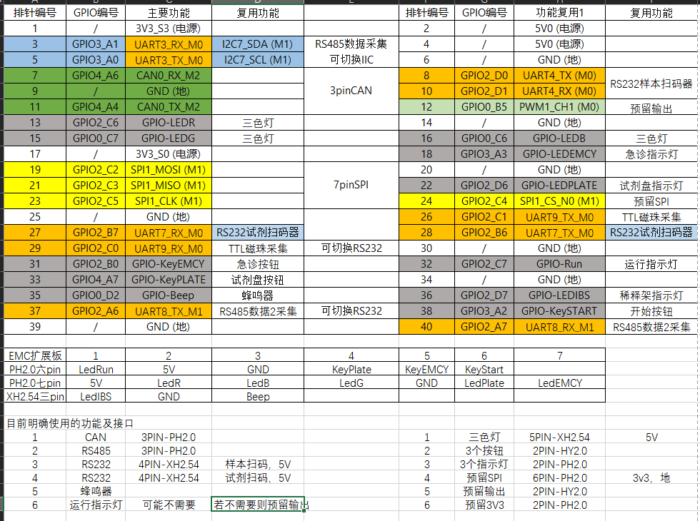

# RK3576 Linux 开发计划

**当前功能补齐（2026-10-27）：**本地资料、样本草稿、单个孔位的质控样本预设、质控历史、报告本地处理及原始结果的数据存取代码已有正式代码。项目结果显示配置已在真正主程序从原菜单保存，关闭后同目录重开能读回四类结果、单位、小数位及独立主结果/选用/显示。正常关闭暴露了页面销毁仍通知主窗口已释放成员的问题，原程序自然异常退出及调用栈已保留；仅两页析构已作最小修正，新固定版本518（2d45ecd8）正在全新编译，修后关闭仍待验。本次未观察到报告自动刷新来源提示，不登记该项通过。报告使用当前已提交配置，四原值不改，不冒检测时保存的单位记录；新原值文件输出仍关。检测调度、完整算法、真实结果、LIS收发、实时告警、正向打印及一致业务备份恢复仍有实现或具体资料缺口。

当前结果显示配置私有后端已通过电脑真实保存后关闭并重新打开、原串保留、隐藏/换源/回滚保护验证；用户配置界面02的保存后关闭并重新打开、草稿/冲突/访客及清除以前暂存的显示配置已实际电脑离线通过；报告页的显示选择、主结果、旧回复与草稿、后台最终状态离页流程也已实际电脑离线通过；整批现已正式合入，新518固定版本后正在全新编译主程序和报告辅助程序，尚未验收整套主程序交互。旧511及更早平台/累计检查点不套新代码。

**当前实现结论：**整套SN100功能还没有做完。医院、项目和试剂等本地资料，样本草稿，单个孔位的质控样本预设，质控历史查看，以及报告本地处理已有正式代码。实际检测任务下发、暂停和恢复，完整校准计算、反求结果、审核和应用，真实质控异常判定，真实结果及单位对应，实验室信息系统（LIS）收发，实时告警及动作保护，以及多份业务数据一起备份和恢复，仍缺部分代码或明确资料。打印按钮已接到报告程序，并在电脑上验证了“没有打印设备时提示失败”的处理；正常确认打印和实际出纸还没验证。离线原始通信消息导入组件，以及主程序新建数据、重开和关闭已通过电脑检查；这还不代表LIS通信完整。代码实现和实际测试分别记录。

更新：2026-10-26。日常操作看[接下来要做的事情](next_steps.md)；SN100实施边界看[移植计划](sn100_host_migration_plan.md)。

**用户当前重点（2026-10-26 18:33）：**先逐项确认功能有没有实现，再优先补有依据、能离线完成的缺口。已实现但待验证、确实未实现、缺资料、只待设备验证分别登记；测试次数和源码数量不当作功能完成度。原三个窗口继续分担，每10分钟检查保持ACTIVE；新功能和修复做必要针对验证，已有通过项不反复跑。

主线仍是：PREEMPT_RT基础→业务需求与接口边界→调度/算法/Qt业务验证→按需接口与系统联调→环境定版。质控、校准、项目高级方案/试剂批组与报告剩余本地业务已接统一程序；上一轮426项输入（固定版本`5123bf14`）的完整35次离线调用、额外4组项目/试剂测试和4个独立界面启动/正常退出均通过。WSL实际运行、Windows32/ARM64主程序与报告辅助程序全量编译、ARM离线依赖及匹配应用/源码归档通过；40次保存操作的响应测量与30秒整程序资源占用初始测量已留证。[本轮结果](../../04_references/sn100_host/qc_local_20261025/final/verification.json)。原Windows完整行为/实际使用的界面主题、RK实屏/输入、仪器/实际LIS/实体打印、真实结果产生、保存和显示流程、临床校准/质控、已确认的资源占用上限/同板实时控制及长时间运行稳定性仍待验；该历史检查点的语言设置仍占位；新中文页状态见上方当前说明，原版未启用的XLSX未开放。旧报告查询、8小时恢复，以及suite05校准引用崩溃和suite07登录1920宽度下位置或尺寸检查失败的直接原因尚未确证，原失败保留。

**447历史检查点已结束。**主程序和报告辅助程序Windows、电脑Linux和RK三个环境、完整累计/运行组件完整性检查、配对恢复、独立启动及短响应资源已留证；不套给后来新源码。当前511原报文辅助功能与主程序Guest从启动、运行到关闭的过程已离线通过，完整算法/语言切换/LIS仍按功能对照清单保留缺口。

**当前可执行批次（2026-10-27）**：组合模式正式专项已通过；原报文正式组件、主入口和关闭操作与处理代码的连接已写，511新快照主程序和报告辅助程序编译、正式原报文组件和主程序从启动、运行到关闭的过程已通过，继续必要输入内容和校验规则与离线功能；结果单位/精度的当前已提交配置读取与显示桥在私有候选中实现。旧497打印缺设备链已通过，正向打印仍待条件，不反复重跑。

### 文中用语说明

下面保留必要的技术名称，便于查代码和原始记录。阅读时可按右侧含义理解。

| 写法 | 这里的意思 |
| --- | --- |
| WSL | Windows电脑中的Linux环境，本项目用它交叉编译RK程序 |
| ARM64 | RK板所用的64位处理器架构，编译时需要生成匹配的程序 |
| LIS | 实验室信息系统，用来接收检测任务、上传检测结果 |
| SHA-256 | 文件指纹，用来比较上传或复制前后的内容是否一致 |
| 两种界面运行方式 | 历史电脑测试使用的无窗口方式（offscreen）和有窗口方式（XCB/WSLg），都不代替RK实际屏幕操作 |
| 基线 | 本次测出的初始对照结果，供以后在相同条件下比较 |
| AL4A | 原Windows程序使用的算法库名称；RK需要能在Linux上运行的对应实现 |

测试中的“13/0”表示13项通过、0项失败；“退出码0”表示该次程序正常结束。它们都只说明所列测试范围，不能代表整套仪器业务通过。

## 一、已完成

- [x] **后续接口开发图已归档并提取需求（2026-10-27）。**保存用户提供的原PNG，副本文件指纹一致；采集、扫码、磁珠、按键、指示灯、蜂鸣器及预留接口安排写入[后续接口计划](#hardware-interface-plan-20261027)。只完成资料整理，接线、驱动及设备功能仍待验证。[来源记录](../../02_records/20261022_system_architecture.md#interface-requirements-20261027)

- [x] 按2026-10-27用户要求移除独立Qt显示示例、专用证据和图片；SN100基础依赖归入`sn100_base_arm64/`，现有依赖恢复不再使用示例路径。[清理范围与核对](../../02_records/20261021_workspace_setup.md#qt-demo-removal-20261027)

- [x] 固定IP/SSH、Samba迁移、UART4回环/调试口及13针GPIO分别有实测；新增内核下所用功能仍按需复测。[记录入口](../../README.md)
- [x] WSL交叉编译、上传、文件内容一致性及所需运行组件检查、板端运行和真实退出码回收跑通。[工作流](../../02_records/20261021_ai_workflow.md)
- [x] RT内核`6.1.99-rt36-tspi`已启动、RT=1；内核/155模块与配置核对，镜像和必要回退输入已归档。[RT记录](../../02_records/20261022_preempt_rt.md)
- [x] 普通/RT内核相同条件各60秒初测；空载最大376→267μs、CPU压力128→143μs，结论仅限该轮。
- [x] SN100所需Qt版本、ARM64基础依赖和WSL工具已有记录及恢复输入。[Qt环境](../../02_records/20261022_qt_environment.md)
- [x] SN100医院/账户/历史查询、统计/CSV及原模板预览/PDF已进入统一窗口，原三页累计及60轮导出通过；通信与算法研究仍是注明范围的可在电脑上单独验证的功能。
- [x] 统一主程序ARM构建/固定版本及部署、启动、停止、取证封装已有离线验证；实际业务RK部署/实屏未关闭。
- [x] 源码/参考工程分开，项目Skill及文件/证据归属已建立。[工程说明](../knowledge/sn100_host_project_guide.md)
- [x] O07/O08本地项目/单位、试剂与样本任务已独立验证后整合，修后统一两种界面运行方式各7/0，累计核心/报告复测、60秒资源占用初始测量与Windows、电脑Linux和RK版主程序与报告辅助程序编译/新ARM已固定版本的程序包通过。[本轮记录](../../02_records/20261022_sn100_host_migration.md#catalog-sample-offline-20261024)
- [x] O09-1显式状态文件回放已接统一状态区：核心30/0、两种界面运行方式专项各5/0，累计/Windows、电脑Linux和RK三个环境的主程序和报告辅助程序及ARM固定版本通过；六个数据存取组件实际60秒回放后空载、正常退出和资源占用初始测量已留证。[结果](../../02_records/20261022_sn100_host_migration.md#o09-status-replay-result-20261024)

- [x] 仪器操作原版8子页及人工维护离线检查点已接入：存储11/0、两种界面运行方式各10/0、相关已有功能的复测/Windows、电脑Linux和RK三个环境的主程序和报告辅助程序/56 Linux程序及所需运行组件的完整性检查通过，七个数据存取组件实际30秒运行退出和资源占用初始测量留证；真实动作仍禁用。[结果](../../02_records/20261022_sn100_host_migration.md#instrument-offline-result-20261024)
- [x] CPU无效重绘修复、O09-2后台自建回环及O02-2本地登录该部分功能的电脑离线测试通过；包含353项输入文件的新版本独立/统一/十组累计、七个数据存取组件30秒基线、Windows、电脑Linux和RK三个环境的主程序和报告辅助程序/56项运行组件完整性检查和主/源恢复归档通过，186项总校验退出0。[结果](../../04_references/sn100_host/password_login_20261024/verification.json)

以上不代表完整业务、原Windows等价、仪器或整机性能验收通过。

## 二、当前需要做

- [ ] **核清新增接口图中的待定项。**确认SPI的“7pin/6PIN”差异、运行灯是否保留、串口与I²C及RS485/RS232/TTL的切换方式、扩展板接线方向及按键/灯的有效电平；具体问题见[待确认清单](#hardware-interface-open-questions-20261027)。本项先明确需求，后续实现按实际业务需要启动；SN100继续按原Windows功能完成移植和一致性核对。

- [ ] **按2026-10-27新约定直接在RK验证每项改动。**电脑只编辑、源码检查、ARM64交叉编译和上传；不再安排Windows/WSL本机运行测试或Windows测试构建。每项功能/修复在RK核操作、数据和恢复，适用时再接真实仪器；RK不可达就登记待验。历史电脑结果保留原范围，旧阶段的测试队列不作为本轮任务。[执行约定](../../02_records/20261021_ai_workflow.md#rk-direct-verification)

- [ ] **2026-10-27最新主线：补齐原上位机全部实际功能。**用户确认RK可接现有仪器，现场参数暂不清楚，先列后续材料，当前优先实现有依据的软件功能；新增真实连接方式、补完整配置入口、任务/算法/结果和其余业务，连接/算法等特定资料缺口单列，实机验证按模块补做。当前脱机发布的显示/鼠标首验不代表仪器已连接；小屏/分辨率适配仍后排。[唯一实施卡及所需信息](sn100_host_migration_plan.md#full-function-next-20261027)
- [ ] **当前功能续做：**本地结果后端、空白库入口及未知单位输出限制已实现，旧494的主程序和报告辅助程序构建与三个入口启动退出已有电脑验证。当前正式打印按钮到报告程序的调用和结果反馈已写，497新版本电脑主程序和报告辅助程序已全新编译通过，打印操作仍待验证；并行准备离线原始通信消息导入查看和多瓶弹窗单次诊断，候选未冒正式完成。完整结果来源/单位映射、检测调度与真实LIS等仍有缺口，旧488/478/447证据不套新源。

### 2026-10-26：旧偶发排查及剩余离线功能继续推进

- [ ] **通信恢复偶发（本聊天）。**回读旧8小时计划在19分10秒的实际Qk超时及25分钟未复现证据；先核截止时序、写入/对端读取和事件循环，做有界可重复实验。没有新证据不放宽120ms/一次重试或声称旧直接原因已知，不重新盲跑小时级测试。
- [ ] **旧报告查询偶发（报告窗口）。**核原legacy.query首轮失败的匿名输入、焦点/查询条件/异步状态和真实SQL结果；建立受控复现与最小修复，未复现不算修复。
- [ ] **原引用崩溃和登录窗口位置和尺寸（校准窗口）。**在准确旧源和原始失败上补最短因果证据；保留已修测试线程/宿主准备与尚未知的历史直接原因之间的区别。
- [ ] **剩余范围与样本本地业务（项目窗口）。**逐项核F01–F18/43操作及当前交付，拆开已迁本地功能部分、仍可离线实现、需资料和需设备；优先准备样本错误/完成复位与复测草稿规则依据和实现，不实际下发。
- [ ] **整合与验证。**图形界面/编译排队，最多-j2；新修复各做针对复测，涉及正式源码/接口后再建立独立新固定版本和相关已有功能的复测/平台证据。旧426/5123发布和失败记录不覆盖，数据及认证材料不归档，实际结论仍追加同一移植记录。

前置及当前状态：用户已明确继续授权，sn100-10原生计划已恢复ACTIVE；三个既有聊天已派发上述工作，先审查/准备后申请运行槽。真实RK和仪器只在设备、参数具备事后复核证。上一轮通过只是一个本地检查点，语言/样本/配置/告警/运行恢复/日志等仍须逐项盘点，完整结果/临床链另待真实依据。

### O07/O08完成后的离线接续

- [x] 另一窗口O07/O08本地交付、最终三目标主程序和报告辅助程序与新ARM包已独立核对；已有未提交成果保留，未自动提交或推送。
- [x] 原固定版本报告两项用例连续5轮各4/0；偶发旧查询失败尚无故障原因，保留原失败，不按重试通过关闭。
- [x] O05默认关闭的有界时序、120ms/一次重试受控实验与既有相关功能短时复测通过；长测工具Windows、电脑Linux和RK版编译、开关/环覆盖/两类失败检查完成，资源占用初始测量已留存。
- [x] 25分钟同协议负载恢复诊断及全部wire/固定版本SHA独立核对通过；尾部仅留29.19秒详细时序，旧故障原因仍未知，不计8h通过。[审计](../../04_references/sn100_host/protocol_timing_20261024/recovery_probe_25m/terminal_audit.json)
- [x] O09-2离线核心13/0及两种界面运行方式统一各5/0，主图形界面透明的按钮光晕动画无效重绘已定位修复，相同条件短观测CPU约18.5%→0.86%；综合353源Windows、电脑Linux和RK三个环境/资源与O02-2交付已通过，真实端点/动作待验。[当前卡](sn100_host_migration_plan.md#o09-loopback-card)
- [x] O02-2本地登录独立两种界面运行方式各12/0、统一各5/0及十组累计通过；当前源Windows、电脑Linux和RK三个环境/恢复包及总校验已完成，生产凭据安全/实物另验。[当前卡](sn100_host_migration_plan.md#o02-password-login-card)
- [x] O10-1本地页/保存、独立各14/0、统一各5/0及原累计通过；361源Windows、电脑Linux和RK三个环境的主程序和报告辅助程序、56项运行组件完整性检查/双包和单次响应/资源已核。Windows主原独立make执行结果记录/prehash缺口真实保留，RK/打印/预算待验。[结果](../../04_references/sn100_host/printer_settings_20261024/verification.json)
- [x] O10-2 LIS本地页/9键保存与隐藏键保留、双草稿/失败恢复已接统一子页4；独立各17/0、统一各5/0、累计及371Windows、电脑Linux和RK三个环境的主程序和报告辅助程序/运行组件完整性检查/配对恢复/单次响应资源通过。[结果](../../04_references/sn100_host/lis_settings_20261024/verification.json)
- [x] O11-1质控本地管理及本轮校准、项目高级/批组、报告本地功能部分已接统一入口，上一轮426项输入的35次完整调用、4组专项、4独立界面、Windows、电脑Linux和RK三个环境的主程序和报告辅助程序/ARM恢复和短基线通过。[结果](../../04_references/sn100_host/qc_local_20261025/final/verification.json)。完整临床业务与实物不在此勾选范围。

### 本轮成果与文档核对

- [x] 三个窗口均结束，报告整合、中文输入和PDF修复的实际交付、失败/待验已核对，正式成果纳入本次版本。
- [x] README/计划已精简，日常清单及最终完成/待验状态已同步。
- [ ] 临时文件实际删除受工具策略限制：167个文件已逐项核验，递归/逐文件删除均遭拒绝，实际未删；保留在本机并排除Git，来源/依赖/证据继续保留。

### SN100：本地业务已接入，设备链与完整规则另验

- [x] O03-4统一窗口预览/PDF、原三页新旧功能一起复测和60轮报告导出通过，已打开原模板预览。[实际结果](../../02_records/20261022_sn100_host_migration.md#o03-4-offline)
- [x] O07项目/单位和试剂基础独立通过，统一集成offscreen/WSLg各5/0及60秒混合负载通过。[本轮记录](../../02_records/20261022_sn100_host_migration.md#catalog-sample-offline-20261024)
- [x] O08样本本地预设/任务独立两种界面运行方式各14/0，修后统一各7/0，按原版定位普通/急诊当前架与草稿。[当前卡](sn100_host_migration_plan.md#catalog-sample-card)
- [ ] 继续定位报告累计首轮`legacy.query()`UI用例失败，保留相同源码/产物复测4/0及原失败；后续长时间运行稳定性观察，不冒称已修复。
- [x] 用户真实键盘拼音候选确认、测试医院保存与SQLite核对通过；新版读回该名称，旧窗口空白科室草稿保留；完整关闭后重开、RK/整机重启输入仍待验。
- [x] O03-4历史WSL、Windows32与ARM64主程序和报告辅助程序构建及ARM运行组件完整性检查/固定版本通过，保留旧指纹；O07/O08新产物与新旧功能一起复测单独登记，板端加载/运行另验。[整合卡](sn100_host_migration_plan.md#o03-4-card)
- [ ] 独立推进原Windows发行版同输入/同状态的行为、实际使用的界面主题与视觉基线，核对权限/查询/统计疑点。
- [ ] 定位通信8h恢复在19分10秒失败的问题；有界时标、短受控实验与25分钟恢复已通过且回收，旧故障原因未知，取得充分时序后决定修复/复测，不盲目放宽期限。[O05卡](sn100_host_migration_plan.md#o05-3-card)
- [ ] 实际曲线、参数和已确认的允许误差齐全后评估凝血点原型；完整AL4A缺口只阻断相关链路，不阻止无关离线开发。

设备具备后按[RK离线首验](sn100_host_migration_plan.md#rk-offline-card)逐模块验证；上一轮426项输入四窗口检查点ARM主/源码恢复包就绪待上板，旧361/353/348及O09-1/O07/O08保留；后续源变更再重新固定版本。仪器V01另需协议/参数与外部Transport，先只读、隔离自动联动，再逐模块实物补验。

### PREEMPT_RT实时补丁与验证

- [x] 当前RT启动与短测已有板端证据；沿用已有内核和Qt，不重复烧录。
- [ ] 新内核下复核Windows共享实际双向读写、CH340调试输出和实际使用的外设；服务active/节点存在不算功能通过。
- [ ] 明确业务必须完成控制动作的时间限制、持续负载与温度条件，重复长测；保留5线程对照与单线程业务摸底的区别。
- [ ] 按故障原因逐项做可恢复的调频/亲和性等A/B，需要时再准备ftrace；每次保留配置、负载和恢复结果。
- [ ] 补额外重启、必要回退恢复及完整串口启动证据；现有recovery/backup分区名不能证明可恢复。

验收须同时有正确启动、必要功能、可比较时延、明确门槛与恢复依据；60秒数据不能推断长期上界。[镜像/恢复与原始证据](../../02_records/20261022_preempt_rt.md)

## 三、未完成即将执行

### 明确业务流程与接口边界

- [ ] 按[架构记录](../../02_records/20261022_system_architecture.md)确认PC/RK职责、同板控制、8张轴卡/采集/扫码/Input边界及算法位置。
- [ ] 确认TCP角色/报文、CAN、RS485/RS232与实际所需引脚；按资源表检查电平、复用和占用。
- [ ] 明确任务量/消息速率/曲线长度/历史保存期、响应与资源占用上限、允许数据丢失范围和控制必须完成控制动作的时间限制。
- [ ] SN100按项目/单位与试剂→样本/任务→设备通信→算法/校准/质控→其余功能实施；每个可在电脑上单独验证的功能完成即接统一程序。[详细顺序](sn100_host_migration_plan.md#integration-next-steps)

### 调度、算法和Qt业务最小验证

- [ ] 调度：在`06_programs/<program>/`实现单台下位机一次命令、应答与状态更新，显示真实TX/RX及序号。
- [ ] 验证该业务所需接口及超时、异常、有限重试、停止/恢复；硬件动作限本次范围。
- [ ] 算法：使用真实实现与同一金样本核对单位、结果、错误及已确认的允许误差，测耗时/内存，再交叉编译部署。
- [ ] Qt：核对业务后端、数据变化、资源、弹窗/字体/键鼠/中文；源码断点按需补，不把Debug用于性能结论。
- [ ] RK业务屏幕先HDMI/USB逐模块，再新旧功能一起复测；原Windows行为/视觉、板端与仪器分别登记。

接口只在业务实际需要时验证，不把所有串口/引脚或RT最终长测当作离线页面开发的前提。

## 四、将来需要做

### 按新增开发图接入采集、扫码、按键和指示灯

用途：把RK与轴卡、采集模块、扫码器及面板操作接起来。来源是用户2026-10-27提供的下图；本节保存后续开发需求和图上拟分配的位置，当前尚未按此图核对电路、驱动占用或接线。

**启动条件与顺序：**先核清接口和对应业务，再准备所需电路、设备及通信资料，按当前主线逐项接入。原Windows功能、命令和配置读写先完整移植并核对；本图中的后续接口安排不直接改变现有业务规则，也不把全部引脚验证变成当前上位机移植的前置条件。编译、RK收发/输入输出、接真实设备验证分别记录。

表中“排针”是板上40针接口的物理位置；`GPIO`是芯片引脚名称；`UART`是串口控制器名称。`M0/M1/M2`保留图中的复用组标记，表示该引脚选用哪组功能，尚未确认对应的Linux设备节点。

#### 通信和采集需求

| 后续用途 | 排针位置与GPIO | 图中功能及可选安排 |
| --- | --- | --- |
| CAN轴卡通信 | 7：`GPIO4_A6`；11：`GPIO4_A4`；9：地 | `CAN0_RX_M2`、`CAN0_TX_M2`；图中为3针CAN接口。原架构含8张轴卡，节点与控制协议仍需确认。 |
| 第一组RS485数据采集 | 3：`GPIO3_A1`；5：`GPIO3_A0` | `UART3_RX_M0`、`UART3_TX_M0`；图注可切换IIC，即I²C总线，对应`I2C7_SDA (M1)`、`I2C7_SCL (M1)`。按实际电路选择模式。 |
| 第二组RS485数据采集 | 37：`GPIO2_A6`；40：`GPIO2_A7` | `UART8_TX_M1`、`UART8_RX_M1`；原图名称为“RS485数据2采集”，标注可切换RS232。 |
| RS232样本扫码 | 8：`GPIO2_D0`；10：`GPIO2_D1` | `UART4_TX (M0)`、`UART4_RX (M0)`。 |
| RS232试剂扫码 | 27：`GPIO2_B7`；28：`GPIO2_B6` | `UART7_RX_M0`、`UART7_TX_M0`。 |
| TTL磁珠采集 | 26：`GPIO2_C1`；29：`GPIO2_C0` | `UART9_TX_M0`、`UART9_RX_M0`；图注可切换RS232。 |
| 预留SPI外设通信 | 19：`GPIO2_C2`；21：`GPIO2_C3`；23：`GPIO2_C5`；24：`GPIO2_C4` | `SPI1_MOSI (M1)`、`SPI1_MISO (M1)`、`SPI1_CLK (M1)`、`SPI1_CS_N0 (M1)`；保留时钟、收发和片选信号，接口针数待核对。 |

#### 面板输入、提示和预留输出

| 后续用途 | 排针位置与GPIO | 图中的名称与要求 |
| --- | --- | --- |
| 三色灯 | 13：`GPIO2_C6`；15：`GPIO0_C7`；16：`GPIO0_C6` | `GPIO-LEDR`、`GPIO-LEDG`、`GPIO-LEDB`，分别为红、绿、蓝控制信号；颜色对应什么业务状态尚未给出。 |
| 急诊指示灯 | 18：`GPIO3_A3` | `GPIO-LEDEMCY`。 |
| 试剂盘指示灯 | 22：`GPIO2_D6` | `GPIO-LEDPLATE`。 |
| 稀释架指示灯 | 36：`GPIO2_D7` | `GPIO-LEDIBS`。 |
| 运行指示灯，可选 | 32：`GPIO2_C7` | `GPIO-Run`；原图注明“可能不需要，若不需要则预留输出”，目前不作为必装项。 |
| 急诊、试剂盘、开始三个按键 | 31：`GPIO2_B0`；33：`GPIO4_A7`；38：`GPIO3_A2` | `GPIO-KeyEMCY`、`GPIO-KeyPLATE`、`GPIO-KeySTART`。按钮触发的实际动作、允许状态及长按含义按原业务核对后确定。 |
| 蜂鸣器 | 35：`GPIO0_D2` | `GPIO-Beep`；提示原因、持续时间和开关电平待明确。 |
| 预留输出 | 12：`GPIO0_B5` | `PWM1_CH1 (M0)`；图中只注明预留，不据此确定输出波形或接入负载。 |

#### 接插件和扩展板接线

下表按原图下半部分提取。`PH2.0/XH2.54/HY2.0`保留图中的连接器标注；具体型号、线序方向及板上针号需结合实物确认。这里的接口针数与上表40针排针位置分别记录。

| 用途 | 图中接插件要求 | 图中补充说明 |
| --- | --- | --- |
| CAN、RS485 | 各`3PIN-PH2.0` | 下方只列一项RS485，而上方分配两组采集，实际引出数量待确认。 |
| 样本扫码、试剂扫码 | 各`4PIN-XH2.54` | 两项均标注5V供电。 |
| 三色灯 | `5PIN-XH2.54` | 标注5V供电。 |
| 三个按键 | `2PIN-HY2.0` | 确认是否每个按键各一个接口。 |
| 三个指示灯 | `2PIN-PH2.0` | 与急诊、试剂盘、稀释架信号对应关系待接线核对。 |
| 预留SPI | `6PIN-PH2.0` | 标注`3v3、地`；上方同时写“7pinSPI”，针数尚有差异。 |
| 预留输出 | `2PIN-HY2.0` | 具体信号与接线待确认。 |
| 预留3V3电源 | `2PIN-PH2.0` | 确认取自3V3_S3还是3V3_S0，以及用电要求。 |
| 蜂鸣器 | 下方列为需要的功能，未单列外接接口型号 | 扩展板3针一行包含`Beep`。 |

图中的“EMC扩展板”按原名称保留；以下为截图从左到右的信号顺序，尚未确认插头观看方向：

| 图中接口 | 从左到右的信号 |
| --- | --- |
| `PH2.0六pin` | `LedRun`、`5V`、`GND`、`KeyPlate`、`KeyEMCY`、`KeyStart` |
| `PH2.0七pin` | `5V`、`LedR`、`LedB`、`LedG`、`GND`、`LedPlate`、`LedEMCY` |
| `XH2.54三pin` | `LedIBS`、`GND`、`Beep` |

40针排针的供电标注：1为`3V3_S3`，17为`3V3_S0`，2和4为`5V0`；6、9、14、20、25、30、34、39为`GND`。供电电压与GPIO信号电平分别核对，图中的5V标注不能替代信号电平资料。

#### 开始实现前需要核清

- [ ] **确认版本及实际接线。**对照现有40Pin资源表、板卡引脚图和新开发图，确认板卡/扩展板版本、针1方向和实际线序；保留旧图来源，不直接覆盖旧资源表。
- [ ] **确认预留和数量。**解决SPI的7针/6针差异；明确运行指示灯是否需要，不需要时如何保留输出；明确两组RS485是否均引出，蜂鸣器与三个按键/指示灯的接口安排。
- [ ] **确认复用及电气切换。**明确UART3与I²C7、RS485与RS232、TTL与RS232各自是通过电路、跳线还是软件选择；核对所需收发电路、GPIO方向/有效电平、供电和已有占用。
- [ ] **补齐设备与业务资料。**确认轴卡节点、通信速率和报文，扫码器输出格式、磁珠数据格式/采样频率、采集模块参数，以及按键动作、灯光/蜂鸣器状态规则。原Windows已经实现的分支先保持一致，新增规则单独确认。

#### 实施与可验收任务

- [ ] **接口准备。**仅对本批实际需要的引脚配置复用和驱动，列出与现有串口、指示灯及其他控制的占用关系；有配置改动时按影响范围准备恢复输入。
- [ ] **通信与采集。**按业务顺序逐项完成CAN、两组采集串口、两路扫码和磁珠采集，在RK记录实际发送/接收内容、数据格式、超时/断线恢复，并接对应真实设备核对。
- [ ] **面板操作与提示。**在RK逐个核对三个按键、三色灯、三个指示灯和蜂鸣器；一次有效按键对应一次业务事件，去抖、重复按下及忙时处理按已确认业务规则验收。运行灯是否实现取决于前述选择。
- [ ] **预留接口。**确认SPI、PWM/预留输出与3V3接口的引出和初始状态；没有指定外设时只验已确认范围，不标记外设业务已完成。
- [ ] **同板联调。**在界面和设备通信同时工作时核对响应、数据完整性、处理器/内存占用和实时控制影响；保存重启后的复测与恢复结果。每项区分ARM64编译、RK接口、真实设备和整机验证。

### 接口扩展与系统联调

- [ ] 按需逐项验证UART、GPIO输入/输出、CAN、PWM、SPI、I²C等，核对真实数据/电平/动作和重启复测。
- [ ] 单台扩到多台，验证任务依赖、取消、重试/去重、异常恢复和真实设备状态对账。
- [ ] 打通配置→样本任务→检测/算法→结果→报告→LIS/打印，覆盖无效输入、权限、断线、磁盘/DB异常。
- [ ] 在约定最大业务负载下验资源、日志/存储增长、温度/降频、UI响应及RT同板控制。
- [ ] 依阶段完成2h/8h和24–72h持续混合负载；时长、预算与门槛先确认，失败保留原始证据。
- [ ] **全部约定功能实现后，再调整分辨率和适配小屏幕（用户2026-10-27确认）。**功能实现和检查完成、HDMI版稳定并确认目标屏尺寸/接口/分辨率/触摸规格后，核字体和控件可读性、触摸命中、弹窗/滚动及软键盘，保留原主题和布局分组；当前不启动尺寸布局改造。开机自启另按需求验收。

### 开发环境备份、镜像制作与新板快速部署

启动条件：运行环境、约定业务及更新/回退方式已稳定；本阶段先保留每次实际变更及其必要恢复输入。

- [ ] 固定内核/Qt/依赖/配置/schema及硬件范围，整理来源、SHA和部署/更新/回退说明。
- [ ] 按实际写入范围制作一致可恢复镜像与初始化脚本，材料放`07_backups/<事项>/`，二进制镜像/压缩备份用Git LFS。
- [ ] 源码、WSL工具链、Windows项目分别纳入恢复范围；新板单独初始化网络和系统身份。
- [ ] 在第二块兼容板恢复、重启并逐项验证实际纳入环境的网络、共享、接口、业务、显示与结果。

只有镜像文件而没有新板恢复验证，仍保持未完成；不为无影响的文档或可重建产物额外备份。每阶段更新同一事项记录，阶段结果与硬件通过分开写。
