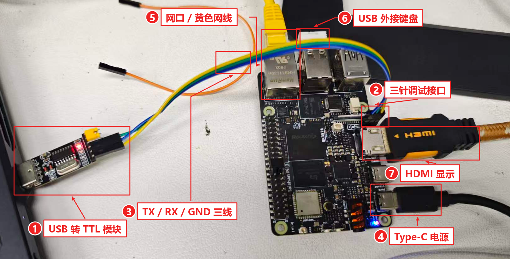
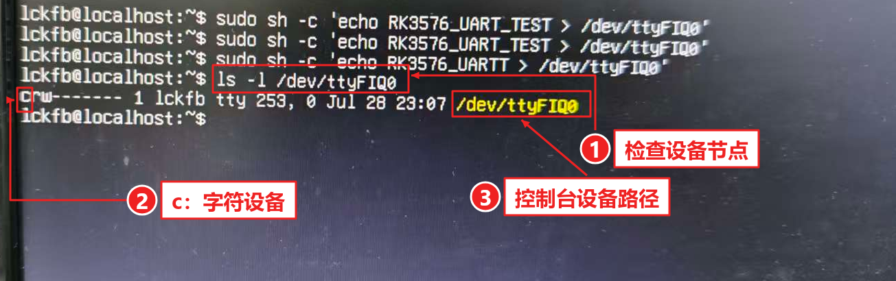
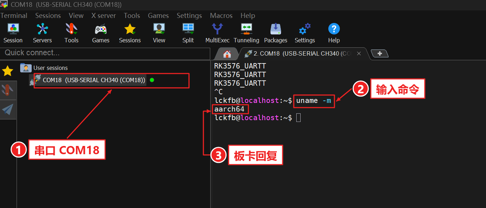
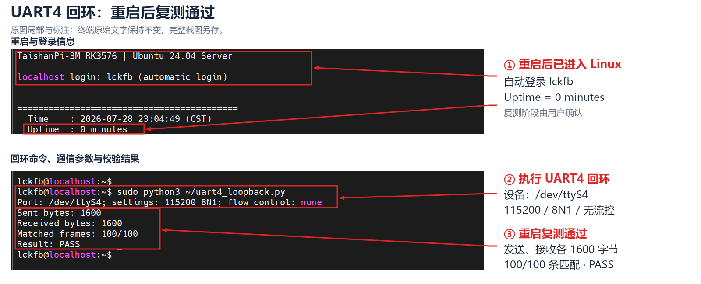

# TTL 串口调试验证

**适用：第1—6节及第9节为板A，第7—8节为板B。**

2026-10-21｜泰山派 3M RK3576 / Ubuntu 24.04、Linux 6.1.99 / aarch64｜**调试串口与 UART4 回环、重启复测通过**

**接线 → 确认设备 → 模块回环 → 接收启动日志 → 双向命令 → UART4 硬件回环 → 重启后复测。** 同一件事的后续验证继续追加到本文。

## 1. 接线与参数



[接线原图](../03_photos/02_串口接线与收发验证/20261021_TTL串口接线_01.jpg)｜[可编辑圈注](../03_photos/02_串口接线与收发验证/20261021_TTL串口接线_圈注_01.svg)。圈框、箭头与说明叠加在照片上，原始照片单独保留。

**TX → RXD；RX → TXD；GND → GND。** 板卡独立供电，模块 VCC 不接；断电接线，按接口资料核对电平。

本次使用 **CH340 / COM18，1500000、8N1、无流控**。COM 号以设备管理器为准，识别出 COM 口不等于板卡接线正确。

## 2. 确认板端设备，发送测试文字



[设备检查原图](../03_photos/02_串口接线与收发验证/20261021_TTL设备节点验证_01.jpg)｜`/dev/ttyFIQ0` 以 **c** 开头，是字符设备；FIQ 大写，最后数字 0。

在**板卡 HDMI 终端**执行，Windows 打开 COM18 接收：

```bash
cat /sys/class/tty/console/active
ls -l /dev/ttyFIQ0
sudo sh -c 'echo UART_OK_3576 > /dev/ttyFIQ0'
```

本次活动控制台为 `ttyFIQ0`。板端命令未报错后，还需检查电脑是否实际收到数据。

## 3. 空白时怎样排查

| 顺序 | 关键操作 | 本次结果 |
| --- | --- | --- |
| ① 模块回环 | 断开板卡，只短接 CH340 自身 TXD—RXD，以相同参数收发；完成后拆掉短接线再接回板卡 | 3 次各 59 字节，合计 177 字节逐字节一致 |
| ② 启动日志 | 退出 MobaXterm，PowerShell 先监听 COM18，再在 HDMI 执行 `sudo reboot` | 收到 **102831 字节**，启动信息与命令提示符清晰 |
| ③ 双向命令 | PowerShell 经 COM18 发送测试标记、`tty` 和 `uname -m` | 返回标记、`/dev/ttyFIQ0`、`aarch64`，验证通过 |

PowerShell 与 MobaXterm **轮流占用 COM18**。本次[原始输出及历史脚本](../04_references/uart/20261021/)已归档：[启动接收原始二进制](../04_references/uart/20261021/20261021_131740_215_COM18_1500000.rx.bin)、[启动接收日志](../04_references/uart/20261021/20261021_131740_215_COM18_1500000.log)、[双向验证实际接收文本](../04_references/uart/20261021/20261021_132005_609_COM18_two_way.rx.txt)。[当时的 Windows 采集脚本](../04_references/uart/20261021/serial_receive.ps1)、[双向命令原稿](../04_references/uart/20261021/serial_two_way.ps1)和[历史 Python 回环原稿](../04_references/uart/20261021/uart4_loopback_legacy.py)只用于追溯当时方法，未在本次整理中执行；后续板端接口测试使用本文 C 版源码。

## 4. MobaXterm 最终验收

**Session → Serial → COM18 → 手动输入 Speed `1500000`**；串口设置为 8 数据位、无校验、1 停止位、无流控。



红框和箭头仅叠加标注，原始文字不重绘；[查看未标注原图](../03_photos/02_串口接线与收发验证/20261021_TTL串口命令验证_01.png)。

在 **COM18 黑色窗口**按 Ctrl+C 清除未完成输入，再执行 `uname -m`。图中清晰返回 **`aarch64`** 并回到 `lckfb@localhost:~$`。

**验收结论：电脑输入 → 开发板执行 → 电脑收到清晰回复，双向通信成功。**

曾遇到端口占用、空白和乱码；先释放端口，再核对当前连接的全部参数。磁盘保存的 Speed 不代表当前会话一定已按该值生效；本次未单独定位初始空白与乱码的唯一原因。

## 5. UART4 回环与重启复测

**用户确认：下图为重启后复测的成功结果。** 图中包含开机后的自动登录、`Uptime: 0 minutes` 和随后运行回环程序的结果。



[完整未修改原图](../03_photos/02_串口接线与收发验证/20261021_UART4回环重启复测_01.png)｜[可编辑矢量标注](../03_photos/02_串口接线与收发验证/20261021_UART4回环重启复测_圈注_01.svg)。标注版提取截图的相关区域并叠加圈框、箭头与说明，终端原始文字未重绘。

### 接线与测试数据

| 用途 | 接口与参数 |
| --- | --- |
| 操作板卡、查看结果 | 原侧边三针调试口 → CH340 → Windows MobaXterm **COM18，1500000、8N1、无流控** |
| 被测试的 UART4 | **`/dev/ttyS4`，115200、8N1、无流控**；40Pin **8 针 TX（GPIO2_D0）与 10 针 RX（GPIO2_D1）短接** |

针号依据[官方 40Pin 引脚图](../04_references/泰山派3M_40Pin引脚图.png)。按 Pin 1 标记定位，关机断电后接线；不接电源脚，同板回环不另接地线。`/dev/ttyS6` 本轮被蓝牙程序占用，保持原状。

测试数据为 `UART_TEST_0001\r\n` 至 `UART_TEST_0100\r\n`，每条 16 字节，合计 **100 条、1600 字节**；`\r\n` 是实际回车和换行。

### 已完成的历史验收

上方截图使用的是当时的 Python 版本，实际输出如下；保留原始命令和结果作为重启复测证据。

```text
Port: /dev/ttyS4; settings: 115200 8N1; flow control: none
Sent bytes: 1600
Received bytes: 1600
Matched frames: 100/100
Result: PASS
```

**验收结论：UART4 本地硬件回环及重启后复测通过，本批 100 条数据全部匹配。** 此结果覆盖所测 UART4 本地链路；外设通信、多路并发和长期运行按后续计划另行验收。

截图中的板端日期与工作日期不同，本文完成日期按本次工作日 2026-10-21 记录。

### 后续复现：C 程序与 GCC 编译

按已确认的开发习惯，板端程序改用 [uart4_loopback.c](../05_tools/tests/uart/uart4_loopback.c)，默认 GCC 编译。C 版关闭回显、逐字节比较，并逐帧显示实际 TX/RX 原文与十六进制字节；**C 版尚未完成 RK 板端编译和硬件验证，上述 PASS 属于历史版本。**

在**项目根目录的 Windows PowerShell** 中上传 C 源码：

```powershell
scp .\05_tools\tests\uart\uart4_loopback.c lckfb@192.168.100.123:uart4_loopback.c
```

该命令从 Windows 读取本地文件；不要在 `lckfb@localhost:~$` 后输入 Windows 的 `C:\...` 路径。密码在终端输入，不写入记录。

在**开发板终端**检查 GCC 并编译，命令成功后再运行生成的程序：

```bash
cd ~
gcc --version
gcc -std=c11 -O2 -Wall -Wextra -Wpedantic uart4_loopback.c -o uart4_loopback
sudo ./uart4_loopback
```

若没有 GCC，先在板端准备 GCC，或使用 AArch64 Linux GCC 工具链在其他 Linux 环境编译后上传；Windows MinGW 生成的程序不能直接在 RK 的 Linux 上运行。

第一帧应能直接看到以下内容（**格式示例，非本次实测输出**）：

```text
TX [0001] 16 bytes: "UART_TEST_0001\r\n"  HEX: 55 41 52 54 5F 54 45 53 54 5F 30 30 30 31 0D 0A
RX [0001] 16 bytes: "UART_TEST_0001\r\n"  HEX: 55 41 52 54 5F 54 45 53 54 5F 30 30 30 31 0D 0A
```

先核对每帧实际收发内容，再查看末尾字节数、匹配帧数和结果。默认 100 帧；需要先观察单帧时运行 `sudo ./uart4_loopback --frames 1`。

若后续需要验证 C 版重启后的表现，保持 8—10 短接线，在**开发板终端**执行：

```bash
sudo reboot
```

等待启动完成，重新登录后运行已编译的程序：

```bash
sudo ~/uart4_loopback
```

新版本结果继续追加到本节，不覆盖本次已通过的重启复测截图。

## 6. 通过后能做什么

- **操作板卡：**在串口命令行执行 Linux 命令，不依赖网络连接。
- **看启动日志：**电脑先打开串口，再重启板卡，观察启动过程。
- **排查故障：**网络或 SSH 不通但板卡仍有响应时，通过串口检查和调整配置。
- **调试程序：**运行程序、看打印和报错，辅助后续 GPIO、I²C、SPI、CAN 等开发。

在 MobaXterm 的 COM18 窗口看到 `lckfb@localhost:~$` 后，电脑键盘输入的 Linux 命令就在 RK3576 上执行，日常命令行操作无需再给板卡外接键盘或 HDMI 显示器；图形桌面操作另用相应方式连接。

本记录已完成**三针调试控制台与 UART4 本地回环、重启复测**。后续通过 CH340 与 Windows 交换实际数据，两个方向均需显示并核对内容；相关 UART、GPIO 和其他工程任务见[开发计划](../01_docs/plans/development_plan.md)。

资料：[立创 Ubuntu24 串口调试教程](https://wiki.lckfb.com/zh-hans/tspi-3-rk3576/system-usage/ubuntu24-usage/serial-debug.html)。

<a id="uart-five-board-b-20261102"></a>
## 7. 另一块同型号板B：五组串口与引脚占用只读检查（2026-11-02）

用户要求按后续接口开发图检查UART3、4、7、8、9是否启用、引脚是否冲突和还需哪些配置，并确认当前连接的是另一块同型号板子。此前开发用的记为板A，当前记为板B，日志分开保存；上文UART4历史回环通过结果不套用到板B。[板卡身份与分开记录规则](../04_references/uart/README.md)。

板B实际硬件序列号`8314b1e8ffd0321f`，有线网卡地址`f6:ff:fb:6c:79:a1`，SSH ED25519主机指纹`SHA256:S4ihaw0V/Z8w7v3VlJOQEFLEH3Hp6nr3KjiUTxanwPg`；当前运行Ubuntu 24.04.5 LTS、`6.1.99-rt36-tspi`。旧免密方式在板B未通过认证；用户在独立SSH窗口现场登录后，脚本只读采集，密码未写入脚本或日志，电脑和WSL原有主机信任记录未覆盖。

实际结果如下：

| 串口 | 启用情况 | 对照图中引脚的实际占用 |
| --- | --- | --- |
| UART3 M0，第一组RS485 | 未启用，无`/dev/ttyS3` | 3、5脚当前被I²C7占用。 |
| UART4 M0，样本扫码 | 已启用，`/dev/ttyS4`，`dw-apb-uart`驱动 | 8、10脚已分配给UART4，采集时未发现打开它的进程。 |
| UART7 M0，试剂扫码 | 未启用，无`/dev/ttyS7` | 27、28脚当前被I²C8占用。 |
| UART8 M1，第二组RS485 | 未启用，无`/dev/ttyS8` | 37、40脚未被驱动或GPIO使用者申请。 |
| UART9 M0，TTL磁珠采集 | 未启用，无`/dev/ttyS9` | 26脚当前被SPI1第二路片选占用，29脚未申请。 |

五组收发引脚定义与图一致，没有彼此重叠。后续需核清现存I²C/SPI用途后释放上述三处占用、启用四组串口，并保留UART4。两组RS485的转换电路和收发方向另核：源码中的UART3 M0 RTS在18脚，与急诊指示灯重叠；UART8 M1 RTS在28脚，与UART7发送重叠。不能未经电路核对就加入这些方向信号。

当前`lckfb`会话不在`dialout`组，而串口节点是`root:dialout`、`0660`，还需处理普通用户访问权限。板端时钟当时是`2026-10-12T07:56:22Z`，原输出保留，归档日期使用电脑端2026-11-02北京时间；本轮不改时钟。

本轮SSH退出0，采集原文含`audit_exit=0`。板上缺少`dtc`，已用实时设备树属性、设备节点和内核引脚占用交叉核对；可选的`ovtree --help`未取得管理员权限，仅该查询没有结果。完整原始输出、执行脚本副本、整理结果和SHA-256清单在[板B独立证据目录](../04_references/uart/board_b/20261102_initial_audit/README.md)，临时登录与采集文件在`temp/uart/board_b/20261102_initial_audit/`。

本轮完成板B状态检查与待配置项整理，没有打开串口、发送数据、扫描总线或修改设备树、服务、权限、时钟和接线；没有新的编译、回环、真实外设或仪器通信通过结论。[后续逐项配置计划](../01_docs/plans/development_plan.md#board-b-uart-config-20261102)。

<a id="uart-config-board-b-20261102"></a>
## 8. 板B按开发图配置五组串口，root访问通过，实际收发待接线（2026-11-02）

用户后续要求直接以root账户连接并进行相关配置。本轮Windows现有认证可直接登录`root@192.168.100.123`，实际读到`uid=0(root)`，硬件序列号仍为板B的`8314b1e8ffd0321f`；没有修改SSH认证方式、`lckfb`用户组或应用启动用户。普通用户流程中的用户组变更本轮没有执行。

配置前检查未发现I²C7/8登记的外设，也未发现进程打开这两条总线和SPI1第二路片选设备。保存本轮将修改的`overlays.ini`、`.ubootenv`，其中已经包含另一个聊天刚启用的CAN0；备份放[板B串口恢复目录](../07_backups/uart/board_b_20261102/README.md)，不复用CAN修改前更早的空白清单。

[串口配置源码](../06_programs/rk3576_system/configs/uart_header_five.dts)编译成`tspi-3m-uart-header-five.dtbo`，与本次从板B读取的实际设备树合并检查通过，共8处预期属性变化：关闭I²C7/8，移除SPI1第二路片选引脚并停用其设备，启用UART3/7/8/9；UART4、SPI第一路和CAN设置保留。首轮电脑命令传递路径失败，未部署旧产物，原失败保留；直接调用编译器后配置及ARM64访问检查程序均编译通过。

上传后核对SHA-256与动态库，以root写入新增叠加文件及两个启动设置；实际配置退出0。等待CAN本轮测试结束、接口关闭后才重启板B。重启前标识`72b43693-95d9-4b7e-8620-63f56dfacbc4`，重启后`2c8da208-9c8a-4b69-98e8-29d2ea1d460a`，内核仍为`6.1.99-rt36-tspi`、实时标志1。

重启后UART3/4/7/8/9均为`okay`，`/dev/ttyS3/4/7/8/9`齐全，10根收发引脚的内核占用逐根与开发图核对一致。root实际打开五路并读参数，输出`PORTS=5 PASSED=5 FAILED=0`，SSH退出0，核对脚本输出`verify_exit=0`。这次没有收发业务数据，驱动计数五路均为`tx:0 rx:0`；读到的9600、8N1、无硬件流控只是系统当前默认值，不作为真实外设参数。RS485启用位未设置，方向控制仍等实际转换电路核对。

用户随后明确要求不仅配置，还要按图逐路验证通信及其实际引脚关系。此项需要将3—5、8—10、27—28、37—40、26—29分别接成排针回环；用户回复当前暂时不方便接线，因此**五路实际排针收发全部保持待验，没有运行收发程序**。已准备ARM64回环工具并上传，板端与电脑SHA-256一致，动态库检查通过；新版本关闭软件回显和内部回环，逐帧核对真实TX/RX，准备按每路100条、1600字节进行。编译首轮缺少C库导出的内部回环标记，按匹配内核公开定义补充后通过；原失败保留，新版本RK收发仍待验证。

配置及root打开证据在[本次配置目录](../04_references/uart/board_b/20261102_configuration/README.md)，实际引脚对应表和待验步骤在[排针收发准备目录](../04_references/uart/board_b/20261102_header_loopback_pending/README.md)。本次未修改整机镜像、内核、时钟或其他板卡配置；CAN文件指纹未变，重启后接口仍存在且关闭，没有新增CAN收发结论。配置备份已核对，回退未实际执行。下一步等用户具备接线条件后逐路实测，再按真实设备资料验RS485/RS232转换及扫码/采集，不能把设备节点、打开成功、板A历史结果或准备好的程序当作板B通信通过。

<a id="uart-config-board-a-20261102"></a>
## 9. 板A重新接入：沿用板B的五组串口配置（2026-11-02）

用户要求把刚完成的板B串口和CAN配置在板A重做。先核对SSH主机指纹与原板A一致，再实读序列号`3bf8222fe1417f6a`；板B的`8314b1e8ffd0321f`没有套用。配置前只有UART4启用，没有发现I²C7/8登记的外设或相关接口被进程打开。

本次同时应用与板B相同的CAN0和五组串口叠加文件，与板A实际设备树合并只有9处预期属性变化。两个原启动设置单独保存到[板A有限恢复目录](../07_backups/interfaces/board_a_20261102/README.md)；板A缺少配置工具，另安装官方SDK已有的ARM64静态`ovtree`，没有烧录镜像或更换内核。登录由用户现场输入密码建立临时连接，重启核对期间使用的临时root公钥已移除，未改SSH服务设置或保存认证凭据。

重启前标识`42f798fc-e78c-4d67-8c9e-a8064e6ddb0a`，重启后`046347e9-a651-4392-af42-61fc37d00bcd`；内核仍为`6.1.99-rt36-tspi #1`，实时标志1。五组设备入口和10根引脚全部匹配：UART3发送5/接收3，UART4发送8/接收10，UART7发送28/接收27，UART8发送37/接收40，UART9发送26/接收29。这里均为40针排针物理针号。I²C7/8、SPI第二路片选释放，SPI第一路保留。

root打开并读取五路参数，实际输出`PORTS=5 PASSED=5 FAILED=0`，SSH及核对脚本均退出0；串口业务读写为0，五路驱动计数`tx:0 rx:0`。当前读到9600、8N1、无硬件流控，不是已确认的外设参数。RS485未启用，收发方向和转换电路仍待确认。用户确认未接外设，因此本轮没有排针回环或真实串口通信；历史UART4回环保留原范围，不计作本轮复测。

[板A独立证据、引脚表与未验范围](../04_references/interfaces/board_a/20261102_configuration/README.md)，CAN同批结果见[CAN记录板A节](20261102_can.md#can-board-a-20261102)，后续接线及真实设备任务见[实施卡](../01_docs/plans/development_plan.md#board-a-interfaces-20261102)。

<a id="board-a-configuration-process-20261102"></a>
### 9.1 这次重新配置板A，是按什么顺序完成的

本节把同日操作串起来，便于以后看懂原因和核对结果；各事项的原始输出、配置文件和恢复输入仍保存在原位置。**这里的“重新配置”是把板B已经采用的串口、CAN引脚安排应用到板A自己的系统中；本次没有重新烧录系统。**

#### 第一步：确认当前接的是板A

两块板都使用过`192.168.100.123`，因此先比较SSH主机指纹，再读取硬件序列号。板A读到`3bf8222fe1417f6a`，与板B的`8314b1e8ffd0321f`不同，原Qt板的SSH指纹也相符，才继续写入。以后换板仍要先做这一步，不能仅凭地址相同判定板卡。

#### 第二步：查清原来的接口状态和引脚占用

读取内核的硬件说明、设备入口和每根引脚当前由谁使用。板A原来只有UART4可用，另外四组串口和CAN0关闭；计划中的UART3、UART7、UART9部分引脚分别被I²C7、I²C8、SPI1第二路片选占用。进一步检查没有相应外设登记或进程使用这些接口，才按开发图释放占用。没有扫描总线或向外设发送命令。

#### 第三步：只保存这次要改的原设置

修改前，从板A取回`/boot/overlays/overlays.ini`和`/boot/overlays/.ubootenv`，比较文件指纹确认复制一致。这两个文件分别用于登记小配置、告诉开机程序加载哪些小配置。板A原件放在[板A恢复目录](../07_backups/interfaces/board_a_20261102/README.md)，没有用板B文件代替，也没有因为只改这几项就备份整个系统。

#### 第四步：准备两份小配置，先检查改动范围

设备树是Linux用来识别板上硬件及引脚安排的说明；本次使用启动时叠加的小配置，不替换原设备树和内核。

| 配置源码 | 编译后的文件 | 用途 |
| --- | --- | --- |
| `06_programs/rk3576_system/configs/uart_header_five.dts` | `tspi-3m-uart-header-five.dtbo` | 启用UART3/4/7/8/9的收发脚，释放I²C7/8及SPI第二路片选，保留SPI第一路。 |
| `06_programs/rk3576_system/configs/can0_m2.dts` | `tspi-3m-can0-m2.dtbo` | 启用CAN0，将40针排针7脚用于接收、11脚用于发送。 |

在电脑的Linux编译环境中，用`dtc -@`编译两份配置，再用`fdtoverlay`与刚从板A读取的硬件说明合并检查。`dtc`用于把文字配置编成板子可加载的文件；`fdtoverlay`用于检查小配置能否正确叠加。结果只有9处预期属性变化，两个编译文件也与板B使用的文件指纹相同。这里只检查文件，没有在电脑运行串口或CAN功能测试。

#### 第五步：上传并启用，完成第一次重启

上传两份小配置和为RK编译的检查程序，逐文件比较SHA-256指纹，并确认检查程序所需的运行库齐全。板A缺少管理小配置的`ovtree`工具，因此补入官方开发包已有的ARM64程序；ARM64是板A处理器所用的程序架构。配置工具放在`/usr/local/bin/ovtree`，两份小配置放在`/boot/overlays/`。

本次实际以管理员身份启用两项，最后重启：

```bash
ovtree --lang zh enable tspi-3m-can0-m2.dtbo
ovtree --lang zh enable tspi-3m-uart-header-five.dtbo
sync
systemctl reboot
```

`ovtree`同步更新上述两个启动设置。重启编号变化后，才采集后续结果，避免把重启前的输出当成开机生效证据。本次写入的配置、执行脚本及输出见[板A证据目录](../04_references/interfaces/board_a/20261102_configuration/README.md)。这些是本次已经完成的操作顺序，当前无需为了阅读记录再次执行。

#### 第六步：逐路核对串口和CAN引脚

| Linux入口 | 40针发送脚 | 40针接收脚 | 本轮实际核对 |
| --- | --- | --- | --- |
| `/dev/ttyS3` | 5 | 3 | 设备入口、内核引脚分配、root打开与读取参数通过。 |
| `/dev/ttyS4` | 8 | 10 | 同上。 |
| `/dev/ttyS7` | 28 | 27 | 同上。 |
| `/dev/ttyS8` | 37 | 40 | 同上。 |
| `/dev/ttyS9` | 26 | 29 | 同上。 |
| `can0` | 11 | 7 | 控制器启用、设备入口和引脚分配通过；9脚为地。 |

这里是排针的物理针号。五个串口实际打开结果为5项通过、0项失败；五路没有收发业务数据。读取到的9600、8N1和关闭硬件流控只是当时默认值，其中8N1表示8位数据、无奇偶校验、1位停止位；真实外设需要什么参数，仍须按设备资料另设。

#### 第七步：在没有外设的情况下检查CAN，并保留未通过项

用户确认排针没有连接收发器、轴卡或其他外设后，才运行本机CAN检查。临时使用500000 bit/s普通CAN，三帧发送确认的内容逐条一致，程序退出0；关闭软件本机回送后，第一帧接收等待1秒超时，退出1，清理退出0。发送确认表示驱动确认发送，不能证明数据已从外部接收通道返回。

测试结束后停止CAN接口、关闭回环。500000只是当时测试速率，没有设置为真实轴卡速率，也没有安装开机自动收发服务。实际TX/RX原文及接收待验说明见[CAN记录](20261102_can.md#can-board-a-20261102)。

#### 第八步：按用户后续要求设置root登录，再完成第二次重启

接口配置完成后，用户又要求本地开机和WindTerm都直接进入root。于是另加两份登录服务补充配置，使屏幕终端和三针调试口自动登录root；远程连接则使用本电脑已有密钥，进入`/root`。第二次重启后，读取两个本地终端真实登录进程，账户均为root、用户编号0、当前目录和HOME均为`/root`；按WindTerm保存的参数连接也得到相同结果。

WindTerm会话创建时叫“板A-root”，随后只按用户要求改名为**“lckfb-板A”**，连接参数和其余会话保持原值。接口配置阶段使用的临时root公钥已经清除；后续用户明确要求长期root连接时，又单独新增并保留授权。两次操作目的不同，分别有记录，当前长期root连接以[登录记录第8.1节](20261021_workspace_setup.md#board-a-root-login-20261102)为准。

第二次重启另核对五个串口入口、CAN0和接口启动文件指纹仍保留，没有重复发送通信数据。root登录的[原始证据](../04_references/workspace_setup/root_session_board_a_20261102/README.md)和[恢复输入](../07_backups/root_session/board_a_20261102/README.md)与串口/CAN分开保存。

**后续登录方式更新：**用户随后要求开机输入root账户和密码，本地自动登录已取消，指定密码已设置并通过系统登录程序验证；WindTerm密钥连接保留。[当前登录方式](20261021_workspace_setup.md#board-a-password-login-20261102)。上方第八步保留初次自动登录的历史过程。

#### 做到哪里，下一步怎样验收

**已完成配置、编译、两次相应用途的RK重启核对、串口打开检查、CAN本机发送确认及root真实登录核对。**本轮没有串口排针实际收发结果；CAN独立接收超时，真实收发器和轴卡尚未验证；RS485方向控制、真实设备速率和协议仍待确认。下一步有接线条件后先逐路核对串口排针收发，再按收发器和轴卡资料验证CAN实际发送应答与接收数据。

本节只是补全已经执行的过程说明，没有再次修改板A或板B，没有新增通信测试，也没有把待验项改成通过。
