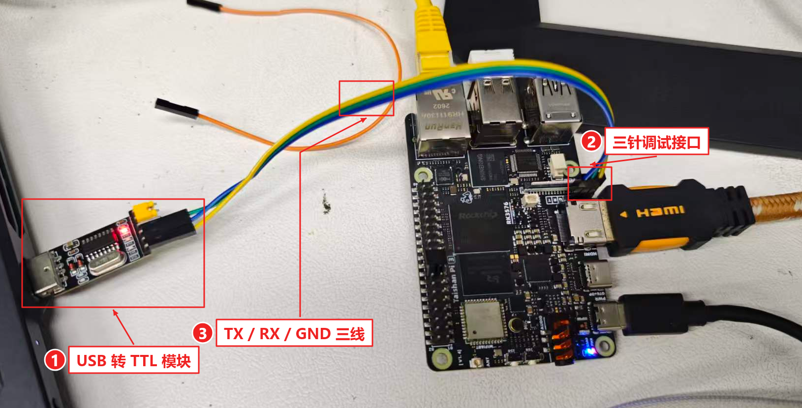
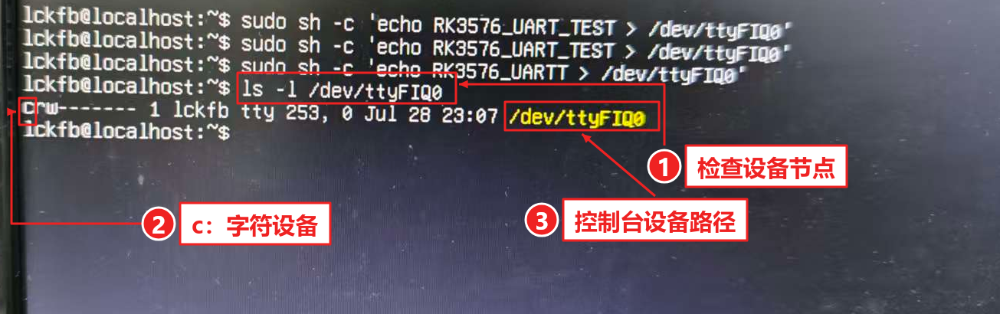
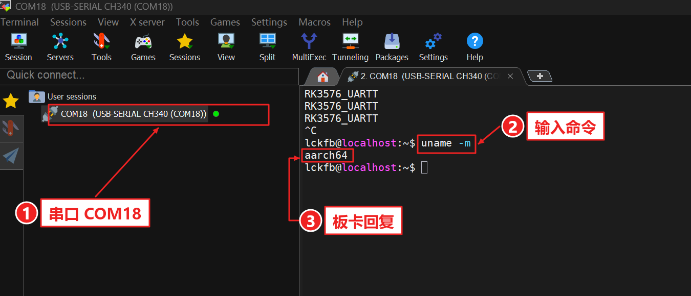
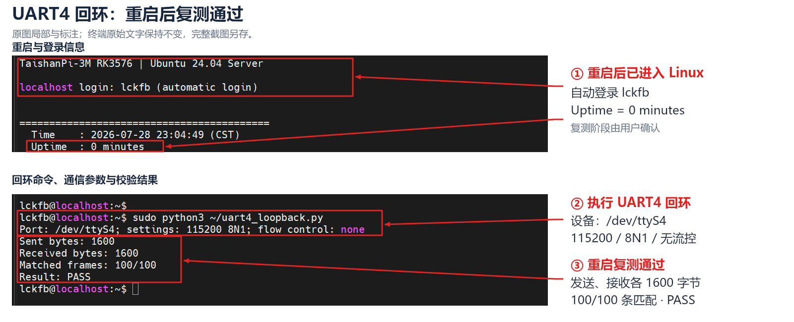

# TTL 串口调试验证

2026-10-21｜泰山派 3M RK3576 / Ubuntu 24.04、Linux 6.1.99 / aarch64｜**调试串口与 UART4 回环、重启复测通过**

**接线 → 确认设备 → 模块回环 → 接收启动日志 → 双向命令 → UART4 硬件回环 → 重启后复测。** 同一件事的后续验证继续追加到本文。

## 1. 接线与参数



[接线原图](../03_photos/20261021_TTL串口接线_01.jpg)｜**TX → RXD；RX → TXD；GND → GND。** 板卡独立供电，模块 VCC 不接；断电接线，按接口资料核对电平。

本次使用 **CH340 / COM18，1500000、8N1、无流控**。COM 号以设备管理器为准，识别出 COM 口不等于板卡接线正确。

## 2. 确认板端设备，发送测试文字



[设备检查原图](../03_photos/20261021_TTL设备节点验证_01.jpg)｜`/dev/ttyFIQ0` 以 **c** 开头，是字符设备；FIQ 大写，最后数字 0。

在**板卡 HDMI 终端**执行，Windows 打开 COM18 接收：

```bash
cat /sys/class/tty/console/active
ls -l /dev/ttyFIQ0
sudo sh -c 'echo UART_OK_3576 > /dev/ttyFIQ0'
```

本次活动控制台为 `ttyFIQ0`。板端命令未报错后，还需检查电脑是否实际收到数据。

## 3. 空白时怎样排查

| 顺序 | 关键操作 | 本次结果 |
| --- | --- | --- |
| ① 模块回环 | 断开板卡，只短接 CH340 自身 TXD—RXD，以相同参数收发；完成后拆掉短接线再接回板卡 | 3 次各 59 字节，合计 177 字节逐字节一致 |
| ② 启动日志 | 退出 MobaXterm，PowerShell 先监听 COM18，再在 HDMI 执行 `sudo reboot` | 收到 **102831 字节**，启动信息与命令提示符清晰 |
| ③ 双向命令 | PowerShell 经 COM18 发送测试标记、`tty` 和 `uname -m` | 返回标记、`/dev/ttyFIQ0`、`aarch64`，验证通过 |

PowerShell 与 MobaXterm **轮流占用 COM18**。本次一次性脚本和原始输出仍放在项目 `temp/`。

## 4. MobaXterm 最终验收

**Session → Serial → COM18 → 手动输入 Speed `1500000`**；串口设置为 8 数据位、无校验、1 停止位、无流控。



红框和箭头仅叠加标注，原始文字不重绘；[查看未标注原图](../03_photos/20261021_TTL串口命令验证_01.png)。

在 **COM18 黑色窗口**按 Ctrl+C 清除未完成输入，再执行 `uname -m`。图中清晰返回 **`aarch64`** 并回到 `lckfb@localhost:~$`。

**验收结论：电脑输入 → 开发板执行 → 电脑收到清晰回复，双向通信成功。**

曾遇到端口占用、空白和乱码；先释放端口，再核对当前连接的全部参数。磁盘保存的 Speed 不代表当前会话一定已按该值生效；本次未单独定位初始空白与乱码的唯一原因。

## 5. UART4 回环与重启复测

**用户确认：下图为重启后复测的成功结果。** 图中包含开机后的自动登录、`Uptime: 0 minutes` 和随后运行回环程序的结果。



[完整未修改原图](../03_photos/20261021_UART4回环重启复测_01.png)｜[可编辑矢量标注](../03_photos/20261021_UART4回环重启复测_圈注_01.svg)。标注版提取截图的相关区域并叠加圈框、箭头与说明，终端原始文字未重绘。

### 接线与测试数据

| 用途 | 接口与参数 |
| --- | --- |
| 操作板卡、查看结果 | 原侧边三针调试口 → CH340 → Windows MobaXterm **COM18，1500000、8N1、无流控** |
| 被测试的 UART4 | **`/dev/ttyS4`，115200、8N1、无流控**；40Pin **8 针 TX（GPIO2_D0）与 10 针 RX（GPIO2_D1）短接** |

针号依据[官方 40Pin 引脚图](../04_references/泰山派3M_40Pin引脚图.png)。按 Pin 1 标记定位，关机断电后接线；不接电源脚，同板回环不另接地线。`/dev/ttyS6` 本轮被蓝牙程序占用，保持原状。

程序：[uart4_loopback.py](../05_tools/uart4_loopback.py)，使用 Python 3 标准库，关闭终端回显并逐字节比较。发送 `UART_TEST_0001\r\n` 至 `UART_TEST_0100\r\n`，每条 16 字节，合计 **100 条、1600 字节**；`\r\n` 是实际回车和换行。

### 复现命令与验收结果

首次准备程序时，在**项目根目录的 Windows PowerShell** 中执行文件传输：

```powershell
scp .\05_tools\uart4_loopback.py lckfb@192.168.100.123:uart4_loopback.py
```

该命令从 Windows 读取本地文件；不要在 `lckfb@localhost:~$` 后输入 Windows 的 `C:\...` 路径。密码在终端输入，不写入记录。

保持 8—10 短接线，在**开发板终端**正常重启：

```bash
sudo reboot
```

等待启动完成，重新进入 `lckfb@localhost:~$` 后运行：

```bash
sudo python3 ~/uart4_loopback.py
```

本次截图的实际输出：

```text
Port: /dev/ttyS4; settings: 115200 8N1; flow control: none
Sent bytes: 1600
Received bytes: 1600
Matched frames: 100/100
Result: PASS
```

**验收结论：UART4 本地硬件回环及重启后复测通过，本批 100 条数据全部匹配。** 此结果覆盖所测 UART4 本地链路；外设通信、多路并发和长期运行按后续计划另行验收。

截图中的板端日期与工作日期不同，本文完成日期按本次工作日 2026-10-21 记录。

## 6. 通过后能做什么

- **操作板卡：**在串口命令行执行 Linux 命令，不依赖网络连接。
- **看启动日志：**电脑先打开串口，再重启板卡，观察启动过程。
- **排查故障：**网络或 SSH 不通但板卡仍有响应时，通过串口检查和调整配置。
- **调试程序：**运行程序、看打印和报错，辅助后续 GPIO、I²C、SPI、CAN 等开发。

在 MobaXterm 的 COM18 窗口看到 `lckfb@localhost:~$` 后，电脑键盘输入的 Linux 命令就在 RK3576 上执行，日常命令行操作无需再给板卡外接键盘或 HDMI 显示器；图形桌面操作另用相应方式连接。

本记录已完成**三针调试控制台与 UART4 本地回环、重启复测**。与单片机或传感器交换自定义数据时，仍需按目标外设验证通信；扩展口、业务自启动和长期稳定性见[开发计划](../01_docs/开发计划.md)。

资料：[立创 Ubuntu24 串口调试教程](https://wiki.lckfb.com/zh-hans/tspi-3-rk3576/system-usage/ubuntu24-usage/serial-debug.html)。
