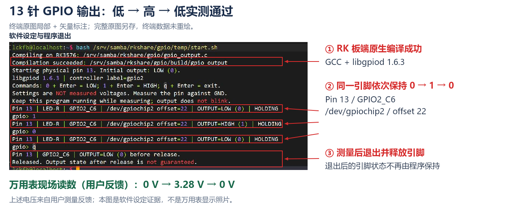

# 单引脚 GPIO 输出与万用表实测

**适用：第1—5、7节为板A，第5节含电脑交叉编译；第6、8节为板B的指示灯核查及一次受控内核崩溃观察。两板结果分别记录。**

2026-10-21｜泰山派 3M RK3576 / Ubuntu 24.04、Linux 6.1.99 / aarch64｜**13 针验证通过：0 V → 3.28 V → 0 V。**

本次先验证单引脚输出方法。程序在 RK 板端用 GCC 编译，经 WindTerm 操作；用户用万用表测量并反馈读数。**通过范围为物理 13 针，其他规划输出引脚按后续实际使用需求分别验证。**

同日补充：已在 WSL 交叉编译同一源码并上传 RK，依赖解析与 `--help` 启动通过；用户随后确认板端功能验证成功，并反馈本次实际低、高电平仍为 **0 V / 3.28 V**。交叉编译与部署流程已验证通过，见第 5 节。

## 1. 接线与测量结果

| 项目 | 本次配置 |
| --- | --- |
| 被测引脚 | 40Pin 物理 **13 针**，`GPIO2_C6`，工程规划名称 LED-R |
| Linux 定位 | `/dev/gpiochip2`，标签 `gpio2`，控制器内偏移 **22** |
| 测量接线 | 红表笔插 VΩ、接 13 针；黑表笔插 COM、接 **14 针 GND** |
| 仪表档位 | 直流电压 V⎓，自动量程或 20 V 档 |
| 软件接口 | libgpiod **1.6.3**；输出不使用 active-low 反相，单引脚持续保持 |

关机断电后按 Pin 1 标记确认排针位置并引线，避免探针短接相邻针脚；上电后运行程序，在保持状态下测量。针号依据[官方引脚图](../04_references/泰山派3M_40Pin引脚图.png)，用途依据[工程资源表](../04_references/RK3576_40Pin工程资源分配表.jpg)。

| 顺序 | 程序设定与操作 | 万用表现场读数 | 核对结果 |
| --- | --- | --- | --- |
| ① | 启动，`OUTPUT=LOW (0)` 并保持 | **0 V** | 一致 |
| ② | 在 `gpio>` 输入 `1` 并回车，`OUTPUT=HIGH (1)` 并保持 | **3.28 V** | 一致 |
| ③ | 输入 `0` 并回车，再次 `OUTPUT=LOW (0)` 并保持 | **0 V** | 一致 |

**电压来自用户现场测量反馈，尚未提供万用表显示及实物接线照片。** 下图证明程序的编译、设定、保持和退出过程；软件输出或读回值不替代电压实测。本次高电平实测为 3.28 V，不预设为 5 V，也不据此推定所有引脚的 IO 电源域。



[完整未修改终端原图](../03_photos/03_引脚电平与接线实验/20261021_gpio_pin13_exit_01.jpg)｜[可编辑矢量标注](../03_photos/03_引脚电平与接线实验/20261021_gpio_pin13_annotated_01.svg)。标注版从原图截取关键区域，叠加圈框、箭头及说明，终端文字未重绘。各阶段原图另存：[首次低电平](../03_photos/03_引脚电平与接线实验/20261021_gpio_pin13_low_01.jpg)、[高电平](../03_photos/03_引脚电平与接线实验/20261021_gpio_pin13_high_01.jpg)、[恢复低电平](../03_photos/03_引脚电平与接线实验/20261021_gpio_pin13_return_low_01.jpg)。

本轮未记录 LED 亮灭及有效极性，LED-R 仅表示工程规划用途；未进行重启复测。

## 2. 准备系统与源码

初次检查存在 `/dev/gpiochip0`～`gpiochip5`，但 `gpiodetect`、`gpioset`、`gpioinfo` 提示找不到命令。在 **RK 的 Linux 终端**安装工具及 C 开发依赖：

```bash
sudo apt install gpiod libgpiod-dev gcc
```

实际安装成功，`gpioset --version` 返回 `v1.6.3`；GCC 已安装。查看控制器：

```bash
sudo gpiodetect
```

实际包含 `gpiochip2 [gpio2] (32 lines)`。复现时可仅查看目标控制器的 GPIO 占用：

```bash
sudo gpioinfo gpiochip2
```

本轮安装后的完整检查中，`gpiochip2` 的 line 22 为 `unnamed unused input active-high`。`unused` 是申请占用状态；`active-high` 是软件极性描述，不能据此判定当前物理电压。

正式源码：[gpio_output.c](../05_tools/tests/gpio/gpio_output.c)。它支持物理针号 13、15、16、18、22、36、38，每次只操作指定的一针；**本次仅 13 针完成板端实测**。

在 Windows 文件资源管理器打开 `\\192.168.100.123\rkshare`，进入 `gpio` 子文件夹，将源码复制为 `gpio/gpio_output.c`。迁移后对应板端文件为 `/home/rkshare/gpio/gpio_output.c`。本次初始传输已比对 SHA-256，源文件与目标一致；[共享迁移记录](20261021_Samba共享文件夹.md)。

## 3. 板端编译与运行

以下命令在 **WindTerm 已登录的 RK Linux 终端**中执行，已按迁移后的路径更新。原编译与电压实测发生在迁移前；新路径重新编译运行尚未确认。源码放在共享目录、编译产物放在 `build/`，临时脚本及编译日志放在 `temp/`。

创建编译产物目录：

```bash
mkdir -p /home/rkshare/gpio/build
```

在 RK 上用 GCC 编译：

```bash
gcc -std=c11 -O2 -Wall -Wextra -Wpedantic /home/rkshare/gpio/gpio_output.c -o /home/rkshare/gpio/build/gpio_output -lgpiod
```

迁移前实际编译成功，无编译诊断。复现时运行 13 针测试：

```bash
sudo /home/rkshare/gpio/build/gpio_output 13
```

上方迁移前的实测截图中执行的是临时辅助命令 `bash /srv/samba/rkshare/gpio/temp/start.sh`，其依次创建目录、执行 GCC 编译并启动程序，编译日志保存于共享目录 `gpio/temp/compile.log`。日后复现使用本节的新路径命令。

程序启动时原子申请输出并设为低电平，校验控制器标签；每次设定成功后打印具体针号、GPIO、设备、偏移量和电平，并等待下一条输入。`0`、`1`、`q` 都是在程序的 `gpio>` 提示符后输入并回车，分别表示低电平、高电平、退出。

**测量期间保持程序运行。** 本次使用的是 GPIO 字符设备申请，退出后不再保证该引脚维持原设定。三次测量完成后，已输入 `q` 退出；终端确认退出前设低电平并释放引脚，回到 Linux shell。

## 4. 本次结论与后续范围

**13 针的输出控制通过：设定低、高、低分别对应万用表 0 V、3.28 V、0 V。** 源码传输、板端编译、程序打印和实际电压已形成可复现的验证过程。

无需为了学会单引脚输出方法立即测完所有排针。后续实际启用 LED-G（15）、LED-B（16）、LED-E（18）、LED-P（22）、LED-D（36）、Run（38）等输出时，再逐个核对映射、占用、复用、电源域及实测电压；13 针的结果不替代其他针的验收。后续 GPIO 输出补充继续追加本文。

资料：[立创 libgpiod C 编程说明](https://wiki.lckfb.com/zh-hans/tspi-3-rk3576/system-development-compilation/gpio-libgpiod/libgpiod-c.html)。

## 5. WSL 交叉编译与部署补充（2026-10-21）

**已通过：源码复制、ARM64 交叉编译、产物检查、免密上传、RK 依赖解析、帮助命令启动，以及交叉编译产物的板端 GPIO 功能验证。** 构建、部署和启动结果来自实际工具输出；用户随后明确确认验证成功，并反馈本次实测低电平 **0 V**、高电平 **3.28 V**。本阶段尚未提供新的终端截图和万用表照片，电压依据为本次用户现场反馈。

| 项目 | 本次实际环境或结果 |
| --- | --- |
| 构建环境 | Windows 上 WSL 2 / Ubuntu 24.04 / x86_64，用户 qyq |
| 交叉编译器 | aarch64-linux-gnu-gcc 13.3.0 |
| 目标环境 | RK Linux / aarch64 / glibc 2.39，SSH 用户 lckfb |
| WSL 源码 | `~/rk3576-linux-dev/05_tools/tests/gpio/gpio_output.c`，与 Windows 正式源码一致，未修改 |
| WSL 依赖与产物 | `~/rk3576-linux-dev/temp/gpio_cross/`，include/ 为板端头文件，lib/ 为板端 ARM64 库 |
| RK 上的产物 | `/home/lckfb/gpio_output_cross`，保留原生编译版本 |
| 编译结果 | 成功，无编译诊断；ARM64 ELF 动态链接程序 |
| 依赖检查 | 加载器 `/lib/ld-linux-aarch64.so.1`；libgpiod.so.2、libc.so.6 及加载器依赖均在 RK 解析成功 |
| GLIBC 符号需求 | 2.17 / 2.34；本次实际在板端 glibc 2.39 上启动通过 |
| 板端功能验证 | 用户确认物理 13 针输出验证成功；本次低电平 0 V、高电平 3.28 V |

### 5.0 开发环境准备与核对

2026-10-22 整理计划表时，将原计划中的环境准备结果归并到本文。以下均为 2026-10-21 已有操作与输出的整理，本次未重新安装或复测。

| 项目 | 已有准备与核对结果 |
| --- | --- |
| WSL 安装 | 在线安装遇到 403 后改用官方 x64 MSI；实际版本为 WSL 3.0.3.0、内核 6.18.54.1-1，Windows 10.0.26200.9711 |
| Ubuntu 初始化 | 完成 Windows 重启、WSL 2 配置及 Ubuntu 24.04 的 `--web-download` 安装；用户 `qyq` 初始化成功，发行版为 Running / VERSION 2，本机架构 x86_64，软件源更新成功 |
| 账号保存 | 按用户要求保存在 `%USERPROFILE%\.rk3576-local\wsl_ubuntu_account.txt`，访问限当前用户与 SYSTEM；密码未写入项目 |
| 交叉工具链 | GCC 13.3.0（13.3.0-6ubuntu2~24.04.1），目标 `aarch64-linux-gnu`；ARM64 C 开发文件、binutils、file、openssh-client 已安装并用于实际构建与传输 |
| 目标依赖 | RK 为 aarch64 / glibc 2.39；`gpiod.h` 为 64107 字节，`libgpiod.so.2.2.2` 为 67512 字节；复制到 WSL 后大小一致，链接时库文件命名为 `libgpiod.so` |
| 免密连接 | WSL 用户 `qyq` 使用 Ed25519 密钥，私钥位于 `~/.ssh/id_ed25519`、权限 600；公钥安装后，`ssh -o BatchMode=yes` 实际返回 `lckfb`，SCP 上传通过 |
| 源码一致性 | 本次 GPIO C 源码复制到 WSL 历史构建目录后，SHA-256 与 Windows 正式源码一致，源码未修改 |

上述首次安装中的 localhost 代理提示未阻止软件源更新；后续以实际编译、上传和板端功能结果为依据。当前项目工作目录与自动化入口另见 [工作目录记录](20261021_workspace_setup.md)和 [AI 工作流记录](20261021_ai_workflow.md)。

### 5.1 在 WSL 准备本次源码和依赖

前置工具为 `gcc-aarch64-linux-gnu`、`libc6-dev-arm64-cross`、`binutils-aarch64-linux-gnu`、`file` 和 `openssh-client`；已安装并用于本次构建。SSH 密钥登录已配置并验证，准备说明见[基础知识第 8 节](../01_docs/knowledge/linux_basics.md)。

以下在 **WSL Ubuntu** 执行。实际使用时先确认各目标位置是否有需要保留的文件，再按本次路径复现。

```bash
mkdir -p ~/rk3576-linux-dev/05_tools/tests/gpio ~/rk3576-linux-dev/temp/gpio_cross/include ~/rk3576-linux-dev/temp/gpio_cross/lib
```

从当前 Windows 工程复制正式源码；换电脑或移动工程时调整该源路径：

```bash
cp /mnt/c/Users/52400/Desktop/internship/seerain/20260907_RK3576_Linux/05_tools/tests/gpio/gpio_output.c ~/rk3576-linux-dev/05_tools/tests/gpio/gpio_output.c
```

从 RK 取得实际使用的头文件：

```bash
scp -B lckfb@192.168.100.123:/usr/include/gpiod.h ~/rk3576-linux-dev/temp/gpio_cross/include/
```

从 RK 复制 ARM64 实际库，在 WSL 中命名为 `libgpiod.so` 供链接搜索；库内容中的 SONAME 仍为 libgpiod.so.2：

```bash
scp -B lckfb@192.168.100.123:/usr/lib/aarch64-linux-gnu/libgpiod.so.2.2.2 ~/rk3576-linux-dev/temp/gpio_cross/lib/libgpiod.so
```

### 5.2 在 WSL 构建并检查

进入 WSL 的项目目录：

```bash
cd ~/rk3576-linux-dev
```

用 AArch64 Linux GCC 编译：

```bash
aarch64-linux-gnu-gcc -std=c11 -O2 -Wall -Wextra -Wpedantic 05_tools/tests/gpio/gpio_output.c -Itemp/gpio_cross/include -Ltemp/gpio_cross/lib -o temp/gpio_cross/gpio_output_cross -lgpiod
```

实际编译成功，诊断日志为空。检查产物类型：

```bash
file temp/gpio_cross/gpio_output_cross
```

实际结果包含 `ELF 64-bit LSB pie executable, ARM aarch64`，解释器为 `/lib/ld-linux-aarch64.so.1`。继续查看架构、动态依赖和版本需求：

```bash
aarch64-linux-gnu-readelf -h -l -d -V temp/gpio_cross/gpio_output_cross
```

实际 `NEEDED` 包含 libgpiod.so.2、libc.so.6、ld-linux-aarch64.so.1；GLIBC 版本需求见上表。Linux 编译日志、ELF 信息和工具版本保存在 WSL 本次 `temp/gpio_cross/` 内，不作为正式源码。

### 5.3 上传并在 RK 验证启动

从 **WSL 项目目录**上传；`-B` 使用批处理认证，本次已通过密钥免密传输：

```bash
scp -B temp/gpio_cross/gpio_output_cross lckfb@192.168.100.123:gpio_output_cross
```

WSL 与 RK 两端实测 SHA-256 一致，当前产物为：

```text
016982ddb98874091b525c216c784082e61bb011c7dc8cd24e8cc0d435e18449
```

从 WSL 登录 RK：

```bash
ssh lckfb@192.168.100.123
```

随后在 **RK Linux** 执行：

```bash
chmod u+x ~/gpio_output_cross
```

```bash
ldd ~/gpio_output_cross
```

实测 libgpiod.so.2 和 libc.so.6 均解析到板端 `/lib/aarch64-linux-gnu/` 下的库，动态加载器存在，无缺失项。检查帮助输出：

```bash
~/gpio_output_cross --help
```

实际显示 `Usage: /home/lckfb/gpio_output_cross PHYSICAL_PIN`、支持的物理针号及初始输出为低电平的说明，退出状态为 0。`--help` 分支在打开 GPIO 设备之前返回，此步骤确认新产物能够在 RK 启动；后续实际引脚验证见第 5.4 节。

### 5.4 交叉编译产物的电压复测（已通过）

按第 1 节接线与测量方法，在 **RK Linux** 运行交叉编译产物：

```bash
sudo ~/gpio_output_cross 13
```

复现操作：保持程序运行，先测初始低电平；在 `gpio>` 输入 `1` 并回车，测高电平；再输入 `0` 并回车，测恢复后的低电平，最后输入 `q` 退出。

**2026-10-21 用户确认本次验证成功，并补充“实际的读数还是 0 伏和 3.28 伏”。** 本次交叉编译产物的现场测量结果如下：

| 程序设定 | 本次用户反馈的万用表读数 | 结果 |
| --- | --- | --- |
| LOW（0） | 0 V | 低电平验证通过 |
| HIGH（1） | 3.28 V | 高电平验证通过 |

本次反馈是交叉编译产物的新实测依据，与第 1 节的板端原生编译结果分别记录。未提供本阶段新增截图或测量照片，也未声称进行重启复测。

**结论：WSL 交叉编译 → ARM64 产物检查 → 免密上传 → RK 直接执行 → 实际 GPIO 高低电平验证，整套流程已完成。** 后续 RK Linux 应用沿用构建与部署方法，按各自功能单独验证。

<a id="board-b-status-led-20261103"></a>
## 6. 2026-11-03：板B的G0A0指示灯为何闪烁、接在哪里

用户观察到Power灯常亮，另一个读作“GOAO”的灯闪烁，要求查资料确认原理和连接引脚。厂家公开板卡照片中对应印字为`G0A0`，两个圆形字符为数字0；照片用于核对同型号设计，本次没有新增用户实物照片。Power按名称为电源指示，本轮没有取得其完整电路，不能据此指定它监测哪一路电压。

**已确认：板B的板载工作灯接`GPIO0_A0`，当前由Linux内核的`heartbeat`（心跳）功能控制，低电平点亮。** 它的典型节奏为“亮两下、停一下”，最近一分钟的系统负载越高，重复这一组节奏的间隔越短。这里的负载是系统统计的待运行任务和部分等待输入输出的任务情况，不等于CPU使用百分比，也不是逐个检查上位机、主控或仪器是否正常。

### 6.1 连接与板上实际设置

操作前核对专用SSH主机指纹`SHA256:S4ihaw0V/Z8w7v3VlJOQEFLEH3Hp6nr3KjiUTxanwPg`，并实读硬件序列号`8314b1e8ffd0321f`，确认为板B。2026-11-03 16:03:32（北京时间）再次读取成功，内核为`6.1.99-rt36-tspi`。

| 核对内容 | 实际结果与含义 |
| --- | --- |
| 系统里的灯名称 | `/sys/class/leds/work`；`work`是这只板载工作灯的名称。 |
| 实际闪烁方式 | `trigger`中`[heartbeat]`被方括号选中；`invert=0`，未反转心跳亮灭节奏。 |
| 实际设备树 | `/proc/device-tree/leds/work/gpios`的三个数值为`0x14d, 0, 1`。设备树是内核实际使用的板级硬件说明。 |
| 第一个数值的归属 | `gpio0`自身的`phandle`为`0x14d`，表示上行引用的是第0组GPIO控制器。 |
| 后两个数值 | 控制器内第0根线，即`GPIO0_A0`；标志1表示低电平有效，即输出低时点亮。 |
| 驱动实际占用 | `gpioinfo gpiochip0`显示line 0由`work`占用，方向`output`，极性`active-low`，状态`[used]`。 |

`GPIO0_A0`是芯片信号名称，不是40针排针的“第0针”。它也不是工程资源图中另行规划的外接三色灯或运行灯。当前已经由内核灯驱动管理，不另行申请同一根线。

完整再次读取输出、来源摘录和指纹清单见[本次资料与证据](../04_references/gpio/board_b/20261103_status_led/README.md)。中途有线和无线SSH各出现连接超时；随后有线恢复并取得上述成功输出。本轮没有重启、修改网络或追查该临时超时的原因。

### 6.2 为什么系统越忙，节奏会变

厂家开发包的`tspi-3m-rk3576.dts`第139—151行把`work`配置为`GPIO0_A0`、低电平有效，默认触发方式为`heartbeat`，与板B实读结果一致。内核`drivers/leds/trigger/ledtrig-heartbeat.c`根据最近一分钟平均负载计算闪烁周期，每轮安排两次约70毫秒的点亮，其余时间熄灭。源码中负载为0、1、5时，一整组节奏的理论周期约为1260、860、510毫秒；这些是源码计算值，本轮没有用仪器测量实际灯光时序。

所以，“根据整个系统的运行情况闪烁”可以作为初步理解，更准确的说法是：**内核按系统负载产生心跳灯节奏。** 上位机卡住、主控退出或仪器通信失败时，只要内核仍能运行这项功能，灯仍可能继续闪，不能把闪烁当作整套业务健康检查。停闪也需要结合供电、灯的当前设置和系统状态判断。

### 6.3 资料来源与本轮验证范围

- [厂家开源硬件入口](https://wiki.lckfb.com/zh-hans/tspi-3-rk3576/open-source-hardware/)指向[泰山派3M公开工程](https://oshwhub.com/li-chuang-kai-fa-ban/project_gzzvrwqn)。本轮取得工程介绍及板卡照片，公开页面未提供可直接核对的电路预览或附件；未完成电阻、LED器件位号及电源灯供电路径的原理图核查。
- 本地[Rockchip RK3576 TRM V1.2 Part1](../04_references/Rockchip%20RK3576%20TRM%20V1.2%20Part1.pdf)第886页、第21章说明GPIO由软件配置输出方向和输出数据，已提取文字并渲染核对。这是芯片通用输入输出机制的依据，板上灯的具体连接仍以板级配置和实际驱动占用核对。
- 厂家开发包的设备树摘录和心跳源码已保存；[Linux 6.1原始心跳源码](https://github.com/torvalds/linux/blob/v6.1/drivers/leds/trigger/ledtrig-heartbeat.c)可交叉查阅相同的两次闪亮及负载计算规则。

**本轮通过范围：资料查阅、板B身份及实际GPIO/驱动/触发方式的只读核查。** 未修改板端文件、灯的设置或其他程序，未编译程序，未做压力试验、电压测量或故障注入；板A未连接核查，真实仪器业务正常与否不在本轮结论内。

<a id="board-a-pin12-gpio-20261103"></a>
## 7. 板A排针12脚改为普通GPIO，预留485方向控制（2026-11-03）

用户先选定开发图中预留的12脚`GPIO0_B5`，要求给出流程，随后明确要求在已经接入的板A实际配置。本轮只释放该脚原来的PWM功能，让程序能够申请输入或输出；没有接入485自动方向切换，没有收发串口业务数据。

**已通过：配置编译、ARM64工具编译与上传、一次板A重启生效、输出低→高→低的内核数字读回、输入模式及读回0。** 末态为空闲输入、下拉，没有后台程序持续占用。万用表电压测量、外部输入高低变化、收发器使能电平和485真实通信仍待验证；本节结果不能套用到板B。

### 7.1 先确认板卡和修改范围

起初有线`192.168.100.123`返回板B主机指纹，随后连接超时，因此没有向该地址写入。通过板A已有无线地址`192.168.3.38`，沿用电脑已信任的板A主机密钥校验后登录，实读硬件序列号`3bf8222fe1417f6a`，ED25519指纹`SHA256:xLQv5sqzTRvKbfD2fNQQLYjCbPN6WOXgkXEoUqV8Yy4`与原板A记录一致。没有关闭主机密钥校验，也没有修改电脑的`known_hosts`、板卡网络或登录设置。无线地址可能变化，后续仍先核身份。

| 项目 | 本次实际对应 |
| --- | --- |
| 40针排针物理位置 | 12脚，芯片名称`GPIO0_B5` |
| GPIO软件入口 | `/dev/gpiochip0`，标签`gpio0`，控制器内偏移13；这里的13不是物理13脚 |
| 原可复用功能 | `PWM1_CH1_M0`，设备树节点`pwm1_6ch_1`，实际路径`/pwm@2add1000` |
| 配置前占用 | GPIO未被程序申请，原PWM节点为`okay`；没有PWM使用者申请此通道，未输出波形 |
| 本次配置 | 仅将上述PWM节点的`status`从`okay`改成`disabled`，不设置固定占用GPIO的驱动 |

只新增`/boot/overlays/tspi-3m-uart3-485-gpio-pin12.dtbo`，并由`ovtree`更新同目录的`overlays.ini`和`.ubootenv`。修改前两个启动文件已从板A取回并比较文件指纹；[本次有限恢复输入](../07_backups/interfaces/board_a_pin12_gpio_20261103/README.md)不包含整机镜像、密码或私钥。UART3默认RTS所在18脚仍保留原急诊指示灯安排。

### 7.2 实际配置过程

1. 只读检查板A身份、原配置、GPIO及PWM占用；确认没有SN100或主控进程运行，保存这次受影响的两个启动设置。
2. 新增[12脚配置源码](../06_programs/rk3576_system/configs/uart3_485_gpio_pin12.dts)，仅停用`pwm1_6ch_1`。在电脑的`RK3576-Build-22.04`中用`dtc -@`编成小叠加配置，再用`fdtoverlay`与板A实际硬件说明合并；文字对比只有该PWM节点的一处状态变化。这里没有运行电脑功能测试。
3. [GPIO输出工具](../05_tools/tests/gpio/gpio_output.c)增加12脚映射，保留原有引脚。在`Ubuntu-24.04`用`aarch64-linux-gnu-gcc`编成RK可执行程序；上传到新目录`/home/rkshare/programs/gpio_pin12_board_a_20261103/`，程序和配置指纹逐项一致，板端运行库均能找到。没有覆盖已有程序。
4. 在板A安装该小配置、登记中文用途，并启用后重启。实际启用命令如下；这是本次已执行过程，阅读记录无需再次运行。

   ```bash
   ovtree --lang zh enable tspi-3m-uart3-485-gpio-pin12.dtbo
   sync
   systemctl reboot --no-block
   ```

5. 重连并再次核对板A身份，确认PWM节点关闭、相应驱动没有绑定；在板A运行工具，依次保持低、高、低，同时检查GPIO输出方向和内核读到的数字电平。工具退出0，退出前先设低电平。
6. 用`gpioget gpiochip0 13`切成输入并读到0；末态无占用、输入、下拉。再次比较原四份串口/CAN/显示叠加文件指纹，均保持；五组串口入口和12根串口/CAN引脚分配仍正确，CAN保持关闭。本轮没有运行串口或CAN通信。

重启标识从`5d98c436-a8ae-4a42-a4af-7921c20f4182`变为`da1d6357-7389-4cd3-8b0c-bc0c92fc52ac`，内核仍是`6.1.99-rt36-tspi`，实时标志1。配置、重启请求和最终验证的SSH退出码均为0。[固定日志及范围](../04_references/interfaces/board_a/20261103_pin12_gpio/README.md)。

### 7.3 现在如何手动使用

在板A终端运行已部署的工具，参数12是排针物理位置：

```bash
sudo /home/rkshare/programs/gpio_pin12_board_a_20261103/gpio_output 12
```

启动先保持低电平。在`gpio>`后输入`1`并回车保持高电平，输入`0`并回车恢复低电平，输入`q`并回车退出。测量时保持程序运行：万用表红笔接12脚，黑笔接地；本次未进行这项实际电压测量。工具退出后释放GPIO，不保证继续保持输出电平。

需要输入模式时，先退出输出工具，再执行：

```bash
sudo gpioget gpiochip0 13
```

这里的13是`GPIO0_B5`在控制器内的偏移。不要同时运行两个程序申请同一根线。输入模式目前只读取过当时的低电平，没有验证外部接入高电平后的变化。

接485时，还需确认收发器的DE（发送使能）和接收使能接法及有效电平，再由通信程序实现“发送前切换方向→UART3发送→等最后一字节实际发完→恢复接收”。本次普通GPIO配置不会自动完成这些动作，也没有把该脚固定为只能输入或只能输出。按需停用或恢复的方法见[恢复说明](../07_backups/interfaces/board_a_pin12_gpio_20261103/README.md)。

### 7.4 按用户要求持续保持高电平（同日后续）

用户随后要求“现在把它输入成高”，结合前述输出操作，按排针12脚输出高电平执行。再次读取板A硬件序列号确认身份，检查GPIO空闲及PWM已关闭后，用临时服务`gpio-pin12-output.service`运行`gpioset -m signal gpiochip0 13=1`。服务状态为`active`，GPIO由`gpioset`申请为输出，内核数字读回为1，SSH退出0。

**本次结束时12脚持续输出高电平**，由临时服务保持，断开SSH不结束；没有设置开机自启，重启后不保证继续输出高。此前7.2节的输入/下拉是配置检查结束时的历史状态，不再作为当前状态。未测万用表电压，也未新增485通信结论。[本次操作日志](../04_references/interfaces/board_a/20261103_pin12_high/set_high.log)。

保持期间其他程序不能重复申请同一根线。需要改回手动交互时，先在板A运行`sudo systemctl stop gpio-pin12-output.service`释放临时占用，再运行7.3节工具；该工具启动时会先设低电平。单独停止临时服务后不保证继续保持原电平。

<a id="board-b-panic-led-20261103"></a>
## 8. 板B一次内核崩溃与心跳灯恢复实验（2026-11-03）

**已完成一次实板实验并恢复：用户确认“崩了就没闪了”，重启后确认“已经重新闪烁”。** 崩溃记录证明触发的是Linux内核停止运行的`panic`，并非只关闭某个应用或直接把灯关掉。恢复后SSH连接、心跳模式和系统运行状态通过；七份业务配置指纹及所选程序版本与实验前一致。本次结果只说明这一次受控内核崩溃的现象，不代表每一种卡死都具有相同灯态。

### 8.1 授权、板卡与操作前状态

用户要求使板上Linux崩溃以观察指示灯，确认没有连接正在动作的设备，并明确授权先联系“接管RK3576并推进SN100移植”聊天协调。总管理聊天确认保留本次板B窗口，电脑编译继续，其间不部署、启停或恢复业务。实验结束后已通知交还；本聊天不再继续操作板卡，公共README和计划由总管理统一补入口。

- 目标仅为板B：硬件序列号`8314b1e8ffd0321f`，沿用已确认的专用SSH主机指纹校验；板A未操作。
- 实验前内核`6.1.99-rt36-tspi`，启动标识`cb8ff2fd-b5b1-4fe3-9d17-7ad75fcd51f4`，`work`灯为`[heartbeat]`。启动标识是每次系统启动都会变化的编号。
- 没有SN100上位机、ACA主控或串口业务运行，5000端口未监听，系统无进行中的服务任务；因此没有结束业务程序，也没有实验后重开业务程序。
- 原`kernel.panic=0`、`panic_on_oops=0`、`sysrq=176`。只临时将`kernel.panic`设为60，表示内核崩溃后等待约60秒再尝试重启；没有写永久设置或改变启动文件。
- 崩溃前执行日志同步和`sync`，让已有缓存先写入磁盘。业务文件没有计划中的改写，未额外复制整机或业务库。原来的持久崩溃日志可能被新日志替换，故先按原字节保存旧`console-ramoops-0`，本地与板端指纹一致。

### 8.2 实际过程与用户看到的现象

以下为北京时间，完整输出见[本次独立证据](../04_references/gpio/board_b/20261103_panic_led/README.md)。

| 时间 | 操作或实际结果 |
| --- | --- |
| 16:16:30 | 保存身份、启动标识、七份INI/CFG配置指纹、当前程序指针及进程状态，SSH退出0。 |
| 16:16:52 | 再核板号、启动标识、心跳模式及无业务进程，设置临时`kernel.panic=60`，日志与磁盘同步完成，留10秒供用户准备观察。 |
| 约16:17:03 | 仅向`/proc/sysrq-trigger`写一次`c`，调用内核提供的崩溃入口。源码为`drivers/tty/sysrq.c`中的`sysrq_handle_crash()`，实际调用`panic("sysrq triggered crash\n")`。 |
| 16:17:12 | SSH因服务器停止响应退出255，这是崩溃后的连接中断，不是正常程序退出。 |
| 崩溃期间 | 用户现场反馈“崩了就没闪了”。用户没有明确区分停在常亮还是熄灭，也没有反馈此时Power灯状态，本记录不补猜。 |
| 16:18:27 | 首次重新SSH成功，新启动标识为`0cdf9f3f-bf8d-4697-9835-38b2bba7e563`；期间未再发送复位、重启或崩溃命令。临时`kernel.panic`已恢复为0。 |
| 16:18:49起 | 再核身份、七份配置指纹、当前版本、系统和挂载状态；读取恢复后的崩溃日志，随后30次灯亮度状态读取出现0和1交替变化。用户另行确认“已经重新闪烁”。 |

恢复后保存的持久内核日志包含`sysrq: Trigger a crash`、`Kernel panic - not syncing: sysrq triggered crash`和`SMP: stopping secondary CPUs`，证明本次确实发生内核崩溃。这些日志由板上的保留内存日志功能在重启后取回，原文件已下载并逐项核对SHA-256。原有旧日志也独立保留，不能将此次人为崩溃混入此前重启原因的排查。

### 8.3 恢复结果与范围

- 板B身份保持，内核仍为`6.1.99-rt36-tspi`；系统状态`running`，根目录和`/userdata`的文件系统为可写。没有新增磁盘输入输出错误或EXT4错误的读取结果；本轮未做全盘文件系统检查。
- `kernel.panic=0`、`panic_on_oops=0`、`sysrq=176`均与实验前一致，未留下永久崩溃开关或重启配置。
- `work`仍为`[heartbeat]`，`invert=0`；软件亮度状态有0/1变化，用户也确认实体灯重新闪烁。
- 上位机三份INI与主控三份INI、一份CFG共七文件的SHA-256逐份一致。当前程序指针仍为`releases/08bc43a73a9e8e4826a559f501829355357a46a999799e8b662ebd1feae1a0ef`。这只证明所列配置和版本指针保持，不能扩大为整盘所有文件都未变化。
- 上位机、主控在实验前均未运行，本聊天没有重启它们；没有新增业务或真实仪器验证结论。仅完成一次受控内核崩溃、用户灯态观察及系统恢复，未进行其他卡死方式或重复崩溃试验。
