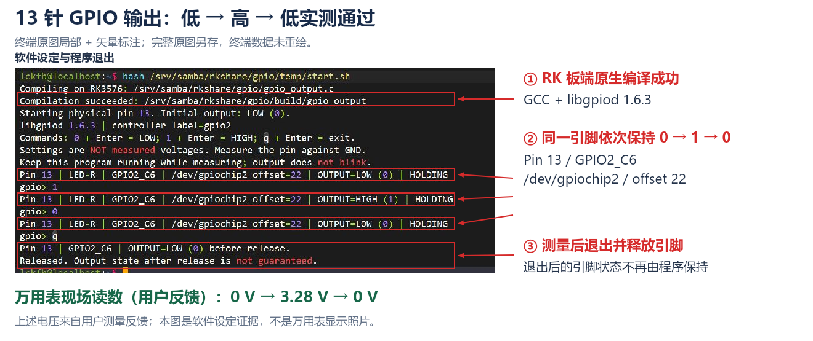

# 单引脚 GPIO 输出与万用表实测

2026-10-21｜泰山派 3M RK3576 / Ubuntu 24.04、Linux 6.1.99 / aarch64｜**13 针验证通过：0 V → 3.28 V → 0 V。**

本次先验证单引脚输出方法。程序在 RK 板端用 GCC 编译，经 WindTerm 操作；用户用万用表测量并反馈读数。**通过范围为物理 13 针，其他规划输出引脚按后续实际使用需求分别验证。**

同日补充：已在 WSL 交叉编译同一源码并上传 RK，依赖解析与 `--help` 启动通过；用户随后确认板端功能验证成功，并反馈本次实际低、高电平仍为 **0 V / 3.28 V**。交叉编译与部署流程已验证通过，见第 5 节。

## 1. 接线与测量结果

| 项目 | 本次配置 |
| --- | --- |
| 被测引脚 | 40Pin 物理 **13 针**，`GPIO2_C6`，工程规划名称 LED-R |
| Linux 定位 | `/dev/gpiochip2`，标签 `gpio2`，控制器内偏移 **22** |
| 测量接线 | 红表笔插 VΩ、接 13 针；黑表笔插 COM、接 **14 针 GND** |
| 仪表档位 | 直流电压 V⎓，自动量程或 20 V 档 |
| 软件接口 | libgpiod **1.6.3**；输出不使用 active-low 反相，单引脚持续保持 |

关机断电后按 Pin 1 标记确认排针位置并引线，避免探针短接相邻针脚；上电后运行程序，在保持状态下测量。针号依据[官方引脚图](../04_references/泰山派3M_40Pin引脚图.png)，用途依据[工程资源表](../04_references/RK3576_40Pin工程资源分配表.jpg)。

| 顺序 | 程序设定与操作 | 万用表现场读数 | 核对结果 |
| --- | --- | --- | --- |
| ① | 启动，`OUTPUT=LOW (0)` 并保持 | **0 V** | 一致 |
| ② | 在 `gpio>` 输入 `1` 并回车，`OUTPUT=HIGH (1)` 并保持 | **3.28 V** | 一致 |
| ③ | 输入 `0` 并回车，再次 `OUTPUT=LOW (0)` 并保持 | **0 V** | 一致 |

**电压来自用户现场测量反馈，尚未提供万用表显示及实物接线照片。** 下图证明程序的编译、设定、保持和退出过程；软件输出或读回值不替代电压实测。本次高电平实测为 3.28 V，不预设为 5 V，也不据此推定所有引脚的 IO 电源域。



[完整未修改终端原图](../03_photos/03_引脚电平与接线实验/20261021_gpio_pin13_exit_01.jpg)｜[可编辑矢量标注](../03_photos/03_引脚电平与接线实验/20261021_gpio_pin13_annotated_01.svg)。标注版从原图截取关键区域，叠加圈框、箭头及说明，终端文字未重绘。各阶段原图另存：[首次低电平](../03_photos/03_引脚电平与接线实验/20261021_gpio_pin13_low_01.jpg)、[高电平](../03_photos/03_引脚电平与接线实验/20261021_gpio_pin13_high_01.jpg)、[恢复低电平](../03_photos/03_引脚电平与接线实验/20261021_gpio_pin13_return_low_01.jpg)。

本轮未记录 LED 亮灭及有效极性，LED-R 仅表示工程规划用途；未进行重启复测。

## 2. 准备系统与源码

初次检查存在 `/dev/gpiochip0`～`gpiochip5`，但 `gpiodetect`、`gpioset`、`gpioinfo` 提示找不到命令。在 **RK 的 Linux 终端**安装工具及 C 开发依赖：

```bash
sudo apt install gpiod libgpiod-dev gcc
```

实际安装成功，`gpioset --version` 返回 `v1.6.3`；GCC 已安装。查看控制器：

```bash
sudo gpiodetect
```

实际包含 `gpiochip2 [gpio2] (32 lines)`。复现时可仅查看目标控制器的 GPIO 占用：

```bash
sudo gpioinfo gpiochip2
```

本轮安装后的完整检查中，`gpiochip2` 的 line 22 为 `unnamed unused input active-high`。`unused` 是申请占用状态；`active-high` 是软件极性描述，不能据此判定当前物理电压。

正式源码：[gpio_output.c](../05_tools/tests/gpio/gpio_output.c)。它支持物理针号 13、15、16、18、22、36、38，每次只操作指定的一针；**本次仅 13 针完成板端实测**。

在 Windows 文件资源管理器打开 `\\192.168.100.123\rkshare`，进入 `gpio` 子文件夹，将源码复制为 `gpio/gpio_output.c`。迁移后对应板端文件为 `/home/rkshare/gpio/gpio_output.c`。本次初始传输已比对 SHA-256，源文件与目标一致；[共享迁移记录](20261021_Samba共享文件夹.md)。

## 3. 板端编译与运行

以下命令在 **WindTerm 已登录的 RK Linux 终端**中执行，已按迁移后的路径更新。原编译与电压实测发生在迁移前；新路径重新编译运行尚未确认。源码放在共享目录、编译产物放在 `build/`，临时脚本及编译日志放在 `temp/`。

创建编译产物目录：

```bash
mkdir -p /home/rkshare/gpio/build
```

在 RK 上用 GCC 编译：

```bash
gcc -std=c11 -O2 -Wall -Wextra -Wpedantic /home/rkshare/gpio/gpio_output.c -o /home/rkshare/gpio/build/gpio_output -lgpiod
```

迁移前实际编译成功，无编译诊断。复现时运行 13 针测试：

```bash
sudo /home/rkshare/gpio/build/gpio_output 13
```

上方迁移前的实测截图中执行的是临时辅助命令 `bash /srv/samba/rkshare/gpio/temp/start.sh`，其依次创建目录、执行 GCC 编译并启动程序，编译日志保存于共享目录 `gpio/temp/compile.log`。日后复现使用本节的新路径命令。

程序启动时原子申请输出并设为低电平，校验控制器标签；每次设定成功后打印具体针号、GPIO、设备、偏移量和电平，并等待下一条输入。`0`、`1`、`q` 都是在程序的 `gpio>` 提示符后输入并回车，分别表示低电平、高电平、退出。

**测量期间保持程序运行。** 本次使用的是 GPIO 字符设备申请，退出后不再保证该引脚维持原设定。三次测量完成后，已输入 `q` 退出；终端确认退出前设低电平并释放引脚，回到 Linux shell。

## 4. 本次结论与后续范围

**13 针的输出控制通过：设定低、高、低分别对应万用表 0 V、3.28 V、0 V。** 源码传输、板端编译、程序打印和实际电压已形成可复现的验证过程。

无需为了学会单引脚输出方法立即测完所有排针。后续实际启用 LED-G（15）、LED-B（16）、LED-E（18）、LED-P（22）、LED-D（36）、Run（38）等输出时，再逐个核对映射、占用、复用、电源域及实测电压；13 针的结果不替代其他针的验收。后续 GPIO 输出补充继续追加本文。

资料：[立创 libgpiod C 编程说明](https://wiki.lckfb.com/zh-hans/tspi-3-rk3576/system-development-compilation/gpio-libgpiod/libgpiod-c.html)。

## 5. WSL 交叉编译与部署补充（2026-10-21）

**已通过：源码复制、ARM64 交叉编译、产物检查、免密上传、RK 依赖解析、帮助命令启动，以及交叉编译产物的板端 GPIO 功能验证。** 构建、部署和启动结果来自实际工具输出；用户随后明确确认验证成功，并反馈本次实测低电平 **0 V**、高电平 **3.28 V**。本阶段尚未提供新的终端截图和万用表照片，电压依据为本次用户现场反馈。

| 项目 | 本次实际环境或结果 |
| --- | --- |
| 构建环境 | Windows 上 WSL 2 / Ubuntu 24.04 / x86_64，用户 qyq |
| 交叉编译器 | aarch64-linux-gnu-gcc 13.3.0 |
| 目标环境 | RK Linux / aarch64 / glibc 2.39，SSH 用户 lckfb |
| WSL 源码 | `~/rk3576-linux-dev/05_tools/tests/gpio/gpio_output.c`，与 Windows 正式源码一致，未修改 |
| WSL 依赖与产物 | `~/rk3576-linux-dev/temp/gpio_cross/`，include/ 为板端头文件，lib/ 为板端 ARM64 库 |
| RK 上的产物 | `/home/lckfb/gpio_output_cross`，保留原生编译版本 |
| 编译结果 | 成功，无编译诊断；ARM64 ELF 动态链接程序 |
| 依赖检查 | 加载器 `/lib/ld-linux-aarch64.so.1`；libgpiod.so.2、libc.so.6 及加载器依赖均在 RK 解析成功 |
| GLIBC 符号需求 | 2.17 / 2.34；本次实际在板端 glibc 2.39 上启动通过 |
| 板端功能验证 | 用户确认物理 13 针输出验证成功；本次低电平 0 V、高电平 3.28 V |

### 5.0 开发环境准备与核对

2026-10-22 整理计划表时，将原计划中的环境准备结果归并到本文。以下均为 2026-10-21 已有操作与输出的整理，本次未重新安装或复测。

| 项目 | 已有准备与核对结果 |
| --- | --- |
| WSL 安装 | 在线安装遇到 403 后改用官方 x64 MSI；实际版本为 WSL 3.0.3.0、内核 6.18.54.1-1，Windows 10.0.26200.9711 |
| Ubuntu 初始化 | 完成 Windows 重启、WSL 2 配置及 Ubuntu 24.04 的 `--web-download` 安装；用户 `qyq` 初始化成功，发行版为 Running / VERSION 2，本机架构 x86_64，软件源更新成功 |
| 账号保存 | 按用户要求保存在 `%USERPROFILE%\.rk3576-local\wsl_ubuntu_account.txt`，访问限当前用户与 SYSTEM；密码未写入项目 |
| 交叉工具链 | GCC 13.3.0（13.3.0-6ubuntu2~24.04.1），目标 `aarch64-linux-gnu`；ARM64 C 开发文件、binutils、file、openssh-client 已安装并用于实际构建与传输 |
| 目标依赖 | RK 为 aarch64 / glibc 2.39；`gpiod.h` 为 64107 字节，`libgpiod.so.2.2.2` 为 67512 字节；复制到 WSL 后大小一致，链接时库文件命名为 `libgpiod.so` |
| 免密连接 | WSL 用户 `qyq` 使用 Ed25519 密钥，私钥位于 `~/.ssh/id_ed25519`、权限 600；公钥安装后，`ssh -o BatchMode=yes` 实际返回 `lckfb`，SCP 上传通过 |
| 源码一致性 | 本次 GPIO C 源码复制到 WSL 历史构建目录后，SHA-256 与 Windows 正式源码一致，源码未修改 |

上述首次安装中的 localhost 代理提示未阻止软件源更新；后续以实际编译、上传和板端功能结果为依据。当前项目工作目录与自动化入口另见 [工作目录记录](20261021_workspace_setup.md)和 [AI 工作流记录](20261021_ai_workflow.md)。

### 5.1 在 WSL 准备本次源码和依赖

前置工具为 `gcc-aarch64-linux-gnu`、`libc6-dev-arm64-cross`、`binutils-aarch64-linux-gnu`、`file` 和 `openssh-client`；已安装并用于本次构建。SSH 密钥登录已配置并验证，准备说明见[基础知识第 8 节](../01_docs/knowledge/linux_basics.md)。

以下在 **WSL Ubuntu** 执行。实际使用时先确认各目标位置是否有需要保留的文件，再按本次路径复现。

```bash
mkdir -p ~/rk3576-linux-dev/05_tools/tests/gpio ~/rk3576-linux-dev/temp/gpio_cross/include ~/rk3576-linux-dev/temp/gpio_cross/lib
```

从当前 Windows 工程复制正式源码；换电脑或移动工程时调整该源路径：

```bash
cp /mnt/c/Users/52400/Desktop/internship/seerain/20260907_RK3576_Linux/05_tools/tests/gpio/gpio_output.c ~/rk3576-linux-dev/05_tools/tests/gpio/gpio_output.c
```

从 RK 取得实际使用的头文件：

```bash
scp -B lckfb@192.168.100.123:/usr/include/gpiod.h ~/rk3576-linux-dev/temp/gpio_cross/include/
```

从 RK 复制 ARM64 实际库，在 WSL 中命名为 `libgpiod.so` 供链接搜索；库内容中的 SONAME 仍为 libgpiod.so.2：

```bash
scp -B lckfb@192.168.100.123:/usr/lib/aarch64-linux-gnu/libgpiod.so.2.2.2 ~/rk3576-linux-dev/temp/gpio_cross/lib/libgpiod.so
```

### 5.2 在 WSL 构建并检查

进入 WSL 的项目目录：

```bash
cd ~/rk3576-linux-dev
```

用 AArch64 Linux GCC 编译：

```bash
aarch64-linux-gnu-gcc -std=c11 -O2 -Wall -Wextra -Wpedantic 05_tools/tests/gpio/gpio_output.c -Itemp/gpio_cross/include -Ltemp/gpio_cross/lib -o temp/gpio_cross/gpio_output_cross -lgpiod
```

实际编译成功，诊断日志为空。检查产物类型：

```bash
file temp/gpio_cross/gpio_output_cross
```

实际结果包含 `ELF 64-bit LSB pie executable, ARM aarch64`，解释器为 `/lib/ld-linux-aarch64.so.1`。继续查看架构、动态依赖和版本需求：

```bash
aarch64-linux-gnu-readelf -h -l -d -V temp/gpio_cross/gpio_output_cross
```

实际 `NEEDED` 包含 libgpiod.so.2、libc.so.6、ld-linux-aarch64.so.1；GLIBC 版本需求见上表。Linux 编译日志、ELF 信息和工具版本保存在 WSL 本次 `temp/gpio_cross/` 内，不作为正式源码。

### 5.3 上传并在 RK 验证启动

从 **WSL 项目目录**上传；`-B` 使用批处理认证，本次已通过密钥免密传输：

```bash
scp -B temp/gpio_cross/gpio_output_cross lckfb@192.168.100.123:gpio_output_cross
```

WSL 与 RK 两端实测 SHA-256 一致，当前产物为：

```text
016982ddb98874091b525c216c784082e61bb011c7dc8cd24e8cc0d435e18449
```

从 WSL 登录 RK：

```bash
ssh lckfb@192.168.100.123
```

随后在 **RK Linux** 执行：

```bash
chmod u+x ~/gpio_output_cross
```

```bash
ldd ~/gpio_output_cross
```

实测 libgpiod.so.2 和 libc.so.6 均解析到板端 `/lib/aarch64-linux-gnu/` 下的库，动态加载器存在，无缺失项。检查帮助输出：

```bash
~/gpio_output_cross --help
```

实际显示 `Usage: /home/lckfb/gpio_output_cross PHYSICAL_PIN`、支持的物理针号及初始输出为低电平的说明，退出状态为 0。`--help` 分支在打开 GPIO 设备之前返回，此步骤确认新产物能够在 RK 启动；后续实际引脚验证见第 5.4 节。

### 5.4 交叉编译产物的电压复测（已通过）

按第 1 节接线与测量方法，在 **RK Linux** 运行交叉编译产物：

```bash
sudo ~/gpio_output_cross 13
```

复现操作：保持程序运行，先测初始低电平；在 `gpio>` 输入 `1` 并回车，测高电平；再输入 `0` 并回车，测恢复后的低电平，最后输入 `q` 退出。

**2026-10-21 用户确认本次验证成功，并补充“实际的读数还是 0 伏和 3.28 伏”。** 本次交叉编译产物的现场测量结果如下：

| 程序设定 | 本次用户反馈的万用表读数 | 结果 |
| --- | --- | --- |
| LOW（0） | 0 V | 低电平验证通过 |
| HIGH（1） | 3.28 V | 高电平验证通过 |

本次反馈是交叉编译产物的新实测依据，与第 1 节的板端原生编译结果分别记录。未提供本阶段新增截图或测量照片，也未声称进行重启复测。

**结论：WSL 交叉编译 → ARM64 产物检查 → 免密上传 → RK 直接执行 → 实际 GPIO 高低电平验证，整套流程已完成。** 后续 RK Linux 应用沿用构建与部署方法，按各自功能单独验证。
