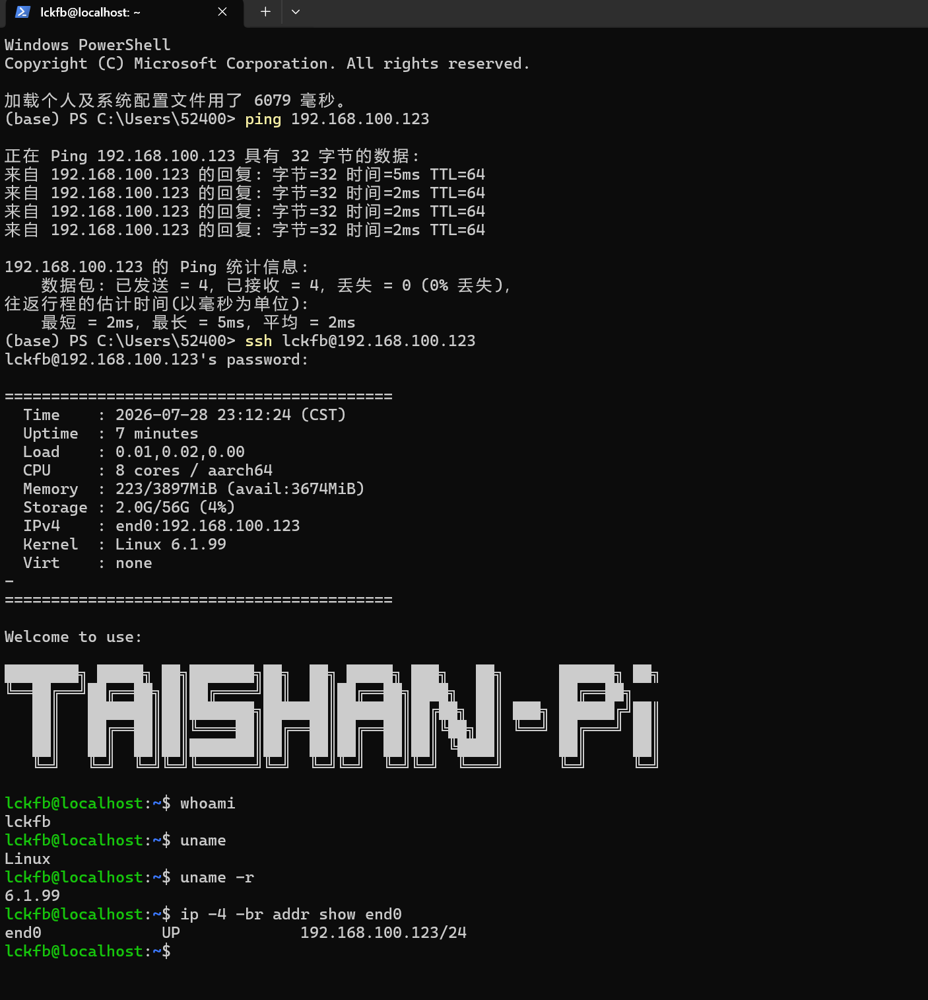

# 固定 IP 地址：配置、重启与 Windows SSH 验证

完成日期：2026-10-21。状态：**已完成**。

目标：让泰山派通过网线直连 Windows，固定使用 `192.168.100.123`，重启后保持地址，并能够从 Windows 通过 SSH 登录、执行命令。

本次闭环已验证：**配置固定 IP → 重启后地址保留 → Windows ping 连通 → SSH 登录 → 远程命令确认系统和地址**。本文集中保存这件事的环境、步骤、结果和原始证据，后续复现只需阅读本文件。

## 1. 环境与接线

```text
Windows 有线网口 ── 网线 ── 泰山派 end0
192.168.100.200/24          192.168.100.123/24
```

| 项目 | 本次实际值 |
| --- | --- |
| 开发板 | 立创泰山派 3M RK3576 |
| 系统标识 | `/etc/os-release` 显示 Ubuntu 24.04.5 LTS / noble；欢迎信息标识 Server |
| 运行内核 / 架构 | Linux 6.1.99 / aarch64（64 位 ARM） |
| 板端有线接口 / MAC | `end0` / `3e:c3:c5:4e:c4:22` |
| 板端固定 IPv4 | **`192.168.100.123/24`** |
| Windows 有线地址 | `192.168.100.200/24`，Realtek PCIe GbE 网口，链路 Up / 1 Gbps |
| 子网掩码 | `255.255.255.0`，对应 `/24` |
| 网络管理工具 | NetworkManager |
| 原连接 / 本次连接 | `netplan-end0` / **`rk3576-direct`** |
| 登录账号 | `lckfb`；密码在终端本地输入，不写入记录 |
| SSH | 22/TCP；检测到 OpenSSH_9.6p1 Ubuntu-3ubuntu13.19 |

`/24` 表示 IPv4 共 32 位中的前 24 位为网络前缀。本次两端网络部分都是 `192.168.100`，设备地址分别为 `.200`、`.123`，属于 `192.168.100.0/24` 同一网段。

本阶段只需两端直连通信，未为这个接口配置默认网关、DNS 或 Windows 网络共享。配置已保存后，拔网线不会删除配置；通过有线 SSH 访问时仍需接线。未接线时连接可能不激活，插回后由 NetworkManager 自动连接。

## 2. 配置前检查

在开发板 HDMI 显示器的本地终端逐条执行：

```bash
cat /etc/os-release
uname -a
ip link show end0
ip -br addr
nmcli device status
```

本次初查无 IPv4；接线后 `end0` 显示 `UP,LOWER_UP`，表明接口已启用、物理链路建立。NetworkManager 使用原连接 `netplan-end0`，显示正在获取 IP 配置，确认可采用 `nmcli` 方案。

注意接口名末尾是数字 `0`。曾输入 `ip link show end` 并提示设备不存在，补全为 `end0` 后正常。

## 3. 创建并启用固定地址

以下是在**开发板 Linux 终端**执行的首次配置命令，每行单独执行：

```bash
sudo nmcli connection add save yes type ethernet ifname end0 con-name rk3576-direct ipv4.method manual ipv4.addresses 192.168.100.123/24
sudo nmcli connection modify rk3576-direct connection.autoconnect yes connection.autoconnect-priority 100 ipv4.never-default yes ipv6.method link-local
sudo nmcli connection up rk3576-direct
```

第一条创建并持久保存静态地址连接；第二条启用自动连接、提高优先级，并让该接口不承担 IPv4 默认路由；第三条立即激活。IPv6 保留链路本地通信。

`sudo` 提示密码时输入板端登录密码，屏幕可能不显示输入字符。这三条用于首次配置；本项目已完成，不需要再次添加同名连接。后续调整可先用 `nmcli connection show rk3576-direct` 查看，再修改已有配置。

## 4. 重启验证

先检查地址，再重启：

```bash
ip -4 -br addr show end0
sudo reboot
```

重新登录本地终端后执行：

```bash
ip -4 -br addr show end0
nmcli device status
```

本次重启后实际看到：

```text
end0    UP          192.168.100.123/24
end0    ethernet    connected    rk3576-direct
```

因此本次重启后固定地址和自动连接均已生效。完整证据见 [重启后的板端照片](../03_photos/20261021_重启后固定IP验证_01.jpg)。

## 5. Windows 连通性及 SSH 登录

在 **Windows PowerShell** 中执行：

```powershell
ping 192.168.100.123
ssh lckfb@192.168.100.123
```

本次 ping 发送 4、收到 4、丢失 0，丢包率 0%；照片中汇总最短 2 ms、最长 5 ms、平均 2 ms。ping 中的 TTL=64 是 IP 报文的跳数限制字段，与后续 TTL 电平串口不同。

首次 SSH 连接确认目标主机密钥后继续；按提示在终端输入 `lckfb` 账号密码。登录成功后，同一个窗口中输入的 Linux 命令就在开发板上运行。

## 6. SSH 中执行命令，完成闭环

登录后在同一窗口执行：

```bash
whoami
uname -r
ip -4 -br addr show end0
```

用户提供的 Windows SSH 截图中实际输出：

```text
lckfb@localhost:~$ whoami
lckfb
lckfb@localhost:~$ uname -r
6.1.99
lckfb@localhost:~$ ip -4 -br addr show end0
end0    UP    192.168.100.123/24
```

这证明 Windows 已成功以 `lckfb` 登录目标开发板，远程命令可执行，且板端地址仍为指定值。输入 `exit` 可结束 SSH 并返回 Windows PowerShell。



截图中板端欢迎摘要的日期与本次实际记录日期不同，板端时钟仍待核实；本文完成日期按本次工作日期 2026-10-21 记录。

## 7. 验收结果与原图

| 检查项 | 实际结果 | 结论 |
| --- | --- | --- |
| 板端固定 IP | end0 为 192.168.100.123/24 | 通过 |
| 重启后保留 | 地址不变，连接 rk3576-direct 为 connected | 通过 |
| Windows ping | 4/4 回复，0% 丢包 | 通过 |
| 目标身份与 SSH 服务 | Windows 邻居表 MAC 与板端一致，22/TCP 返回 OpenSSH 标识 | 通过 |
| Windows SSH 登录 | 进入 lckfb@localhost 的远程 shell | 通过 |
| 远程命令 | whoami、uname -r、地址查询均得到预期结果 | 通过 |

各阶段原图统一保留在 `03_photos/`，未压缩、裁剪或转换格式：

| 阶段 | 原图 |
| --- | --- |
| 首次本地登录 | [HDMI 登录终端](../03_photos/20261021_HDMI登录终端_01.jpg) |
| 系统与网络初查 | [系统与网络参数](../03_photos/20261021_系统与网络参数_01.jpg) |
| 接线及网络管理工具确认 | [直连网口与网络管理状态](../03_photos/20261021_直连网口与网络管理状态_01.jpg) |
| 重启后固定地址 | [重启后固定 IP 验证](../03_photos/20261021_重启后固定IP验证_01.jpg) |
| Windows ping | [Windows 连通性验证](../03_photos/20261021_Windows连通性验证_01.jpg) |
| Windows SSH 与远程命令 | [Windows SSH 登录验证](../03_photos/20261021_WindowsSSH登录验证_01.png) |

固定 IP 和远程访问这一件事已完成。后续串口工作见 [开发计划](../01_docs/开发计划.md)，不在本记录中继续追加其他事情。

## 8. 恢复原连接与资料来源

需要恢复原连接时，可在板端本地执行：

```bash
sudo nmcli connection modify rk3576-direct connection.autoconnect no
sudo nmcli connection up netplan-end0
```

原连接若使用自动取址，在电脑直连环境仍可能没有 IPv4；恢复后应重新检查实际地址。

- [立创 Ubuntu24 网口教程](https://wiki.lckfb.com/zh-hans/tspi-3-rk3576/system-usage/ubuntu24-usage/ethernet-internet.html)：介绍路由器 LAN 与自动获取 IP。本次电脑直连的固定地址命令依据 NetworkManager 官方文档并按实机适配。
- [NetworkManager nmcli 手册](https://networkmanager.pages.freedesktop.org/NetworkManager/NetworkManager/nmcli.html)、[连接属性](https://networkmanager.pages.freedesktop.org/NetworkManager/NetworkManager/nm-settings-nmcli.html)：保存连接、手动地址、自动连接及优先级。
- [Microsoft OpenSSH 入门](https://learn.microsoft.com/zh-cn/windows-server/administration/openssh/openssh_install_firstuse)：Windows 客户端登录。
