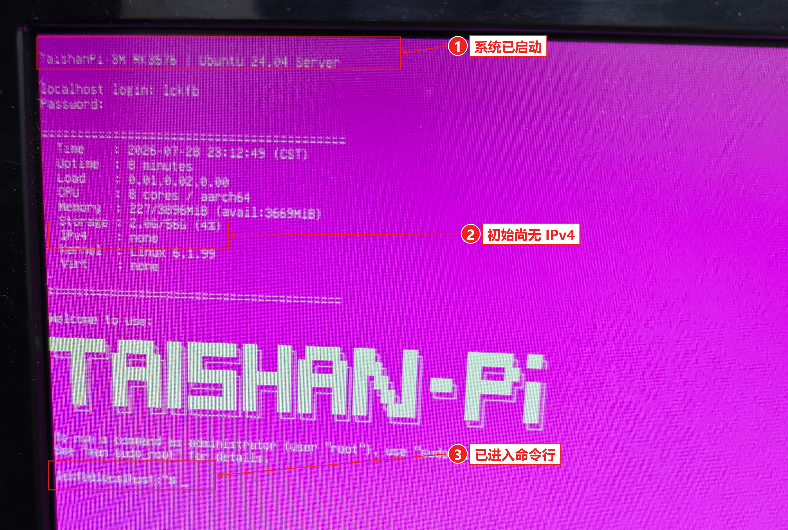
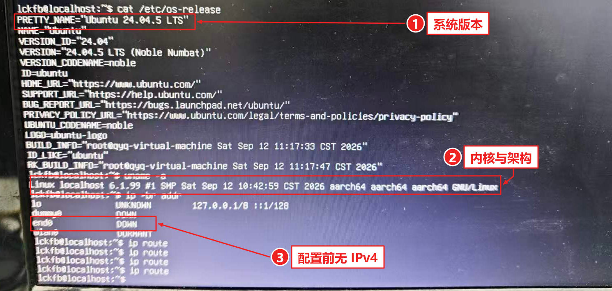
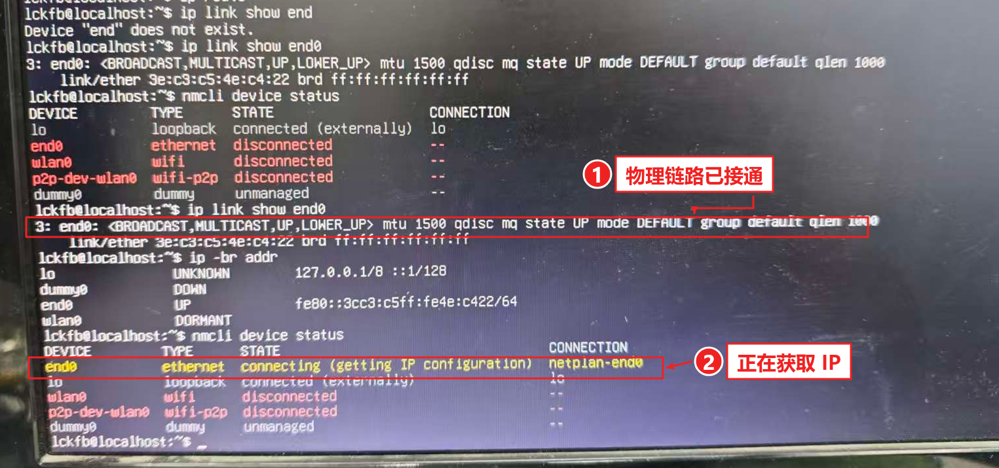
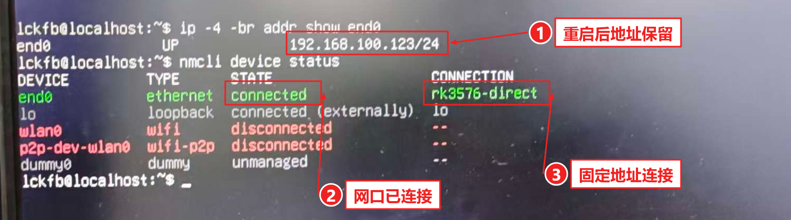
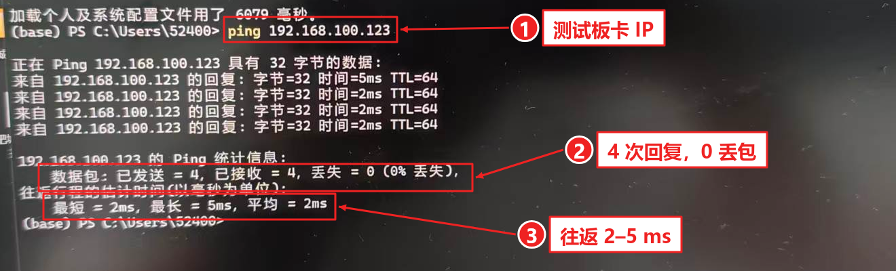
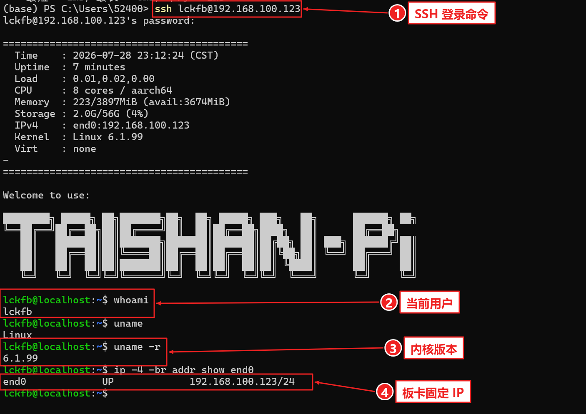

# 固定 IP 地址与 Windows SSH 验证

2026-10-21｜泰山派 3M RK3576 / Ubuntu 24.04｜**验证成功**

**Windows `192.168.100.200/24` ── 网线 ── 板卡 end0 `192.168.100.123/24`。**

红框和箭头叠加在原图上，标出关键信息；未标注原图可点击各图下方链接查看。

## 1. HDMI 登录，确认板卡已启动



[原图](../03_photos/01_系统登录与网络共享/20261021_HDMI登录终端_01.jpg)｜本地登录账号 `lckfb`；密码不写入记录。照片中的板端时间尚未校准，本文日期按实际操作日期记录。

## 2. 配置前检查系统与有线网口



[原图](../03_photos/01_系统登录与网络共享/20261021_系统与网络参数_01.jpg)｜Ubuntu 24.04.5 LTS，Linux 6.1.99 / aarch64；初查 end0 尚无 IPv4。



[原图](../03_photos/01_系统登录与网络共享/20261021_直连网口与网络管理状态_01.jpg)｜接线后 `UP,LOWER_UP`；NetworkManager 原连接为 `netplan-end0`。接口名是 **end0，末尾数字 0**。

## 3. 在板卡上保存固定 IP

在 **HDMI 的 Linux 终端**首次配置时逐行执行：

```bash
sudo nmcli connection add save yes type ethernet ifname end0 con-name rk3576-direct ipv4.method manual ipv4.addresses 192.168.100.123/24
sudo nmcli connection modify rk3576-direct connection.autoconnect yes connection.autoconnect-priority 100 ipv4.never-default yes ipv6.method link-local
sudo nmcli connection up rk3576-direct
```

**创建并保存连接 → 开机自动连接 → 立即启用。** 当前已配置完成，不重复添加同名连接。电脑直连用于本地通信，此接口不设置 IPv4 默认路由。

## 4. 重启，检查地址仍然保留

在**板卡终端**执行 `sudo reboot`；重新登录后检查：

```bash
ip -4 -br addr show end0
nmcli device status
```



[原图](../03_photos/01_系统登录与网络共享/20261021_重启后固定IP验证_01.jpg)｜**`192.168.100.123/24` 未变，`rk3576-direct` 已连接。**

## 5. Windows ping，确认两端连通

在 **Windows PowerShell** 执行：

```powershell
ping 192.168.100.123
```



[原图](../03_photos/01_系统登录与网络共享/20261021_Windows连通性验证_01.jpg)｜**发送 4、接收 4、丢失 0**；最短 2 ms、最长 5 ms。这里的 `TTL=64` 是网络报文字段，与 TTL 电平串口不同。

## 6. Windows SSH 登录并执行命令

在 **Windows PowerShell** 输入，按提示在本地输入板卡账号密码：

```powershell
ssh lckfb@192.168.100.123
```

登录后，同一窗口内执行的是**开发板 Linux 命令**：

```bash
whoami
uname -r
ip -4 -br addr show end0
```



[原图](../03_photos/01_系统登录与网络共享/20261021_WindowsSSH登录验证_01.png)｜返回 **`lckfb`、`6.1.99`、`192.168.100.123/24`**；输入 `exit` 可结束 SSH。

**验收：固定地址保存、重启保留、ping 连通、SSH 登录和远程命令全部通过。**

<details>
<summary>需要时恢复原连接</summary>

在板卡本地终端执行：

```bash
sudo nmcli connection modify rk3576-direct connection.autoconnect no
sudo nmcli connection up netplan-end0
```

原连接若自动取址，在电脑直连环境可能没有 IPv4；恢复后重新检查地址。

</details>

资料：[立创网口教程](https://wiki.lckfb.com/zh-hans/tspi-3-rk3576/system-usage/ubuntu24-usage/ethernet-internet.html)｜[NetworkManager nmcli](https://networkmanager.pages.freedesktop.org/NetworkManager/NetworkManager/nmcli.html)｜[Microsoft OpenSSH](https://learn.microsoft.com/zh-cn/windows-server/administration/openssh/openssh_install_firstuse)。后续见[开发计划](../01_docs/plans/development_plan.md)。
