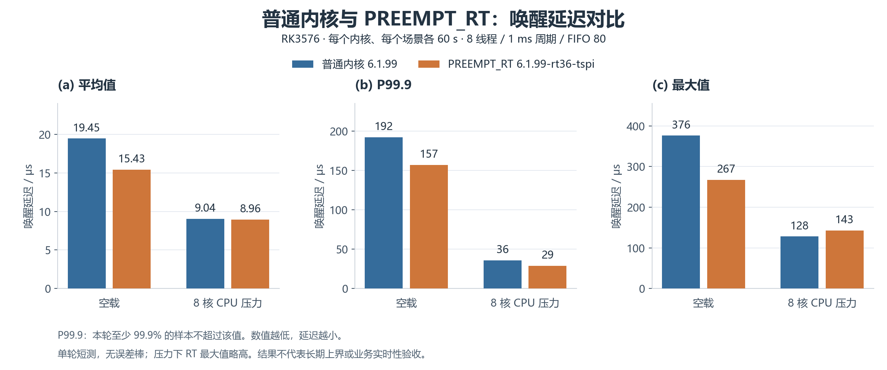
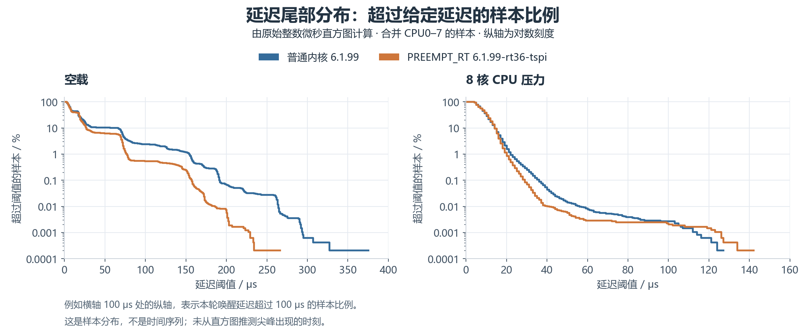

# PREEMPT_RT 实时内核适配与验证

2026-10-22｜泰山派 3M RK3576｜Ubuntu 24.04 / AArch64

**当前结果：实时内核已启动，镜像、配置与模块核对通过；普通/实时内核的 60 秒延迟对比已完成。外设功能、重复长测及恢复验证尚未完成。** [开发计划](../01_docs/plans/development_plan.md)

## 1. 当前板端状态

| 核查项 | RK 返回的关键信息 |
| --- | --- |
| 运行内核 | `6.1.99-rt36-tspi`，`SMP PREEMPT_RT` |
| 实时标志 | `/sys/kernel/realtime = 1`；`CONFIG_PREEMPT_RT=y`、`CONFIG_PREEMPT_LAZY=y` |
| 定时配置 | `CONFIG_HIGH_RES_TIMERS=y`、`CONFIG_HZ=250` |
| 镜像与完整配置 | boot 有效镜像与 RT `boot.img` 一致；运行配置与构建配置逐字节一致 |
| 配套模块 | 155 个 `.ko` 校验通过；已加载的 Wi-Fi 模块来自 RT 版本目录，vermagic 匹配 |
| 系统与网络 | 根分区 `/dev/mmcblk0p8`；有线地址 `192.168.100.123/24`；SSH 可用 |
| 配置保留 | 原模块、`/boot` 内文件及选定系统配置共 175 项校验一致；`ssh`、`smbd` 为 active |
| 内核状态 | taint 为 0，无 failed systemd 单元；本轮未检出内核 BUG、Oops、panic 或锁死提示，测试期间 dmesg 无新增行 |

2026-10-22 随后按用户要求将账号主目录登记为 `/home/rkshare/lckfb`，移除旧 `/home/lckfb` 兼容链接；独立免密 SSH、`HOME`、`cd`/`~` 和板端文件读写核查通过，Samba 与 SSH 配置及授权公钥校验不变，具体范围与回退资料见[共享记录第 7 节](20261021_Samba共享文件夹.md#7-账号主目录统一到共享目录2026-10-22已完成)。Windows 共享双向读写仍待复测。串口、GPIO、DRM 节点存在，尚不代表物理接口通过；DMA `Bad Desc(2)`、HDMI 音频和摄像头等提示保留在原始日志中，相关功能未专项验收。

## 2. 测试方法与原文件

实际测量程序为 **cyclictest 2.50**（Ubuntu `rt-tests 2.5-1` / arm64），CPU 压力工具为 `stress-ng 0.17.06`。两版内核使用同一 cyclictest 文件，除结果目录外的测量参数一致。

| 参数 | 本次设置 |
| --- | --- |
| 线程与绑核 | 8 个线程，分别绑定 CPU0–7 |
| 周期与优先级 | 每线程 1000 μs；SCHED_FIFO 80；锁定内存 |
| 时长与场景 | 每个内核各测空载 60 秒、CPU 压力下 60 秒 |
| CPU 压力 | 8 个 CPU worker，`--cpu-method all`；预热 5 秒，总运行 70 秒 |
| 系统设置 | `--default-system`，未设置 cpu_dma_latency 或持久调优；两版 CPU governor、最小/最大频率策略一致 |

**实际执行的 5 份 shell 原稿已逐字节保存**，不再只留在临时目录。原稿保留了当次版本、目录和防覆盖检查；复测应设置新的结果目录，不能覆盖既有数据。

| 文件 | 用途 |
| --- | --- |
| [prepare_rt_tests.sh](../05_tools/tests/preempt_rt/prepare_rt_tests.sh)、[check_rt_tests.sh](../05_tools/tests/preempt_rt/check_rt_tests.sh) | 当次工具下载、解包、依赖与参数检查 |
| [measure_normal_baseline.sh](../05_tools/tests/preempt_rt/measure_normal_baseline.sh) | 普通内核空载与 CPU 压力基线 |
| [validate_rt_startup.sh](../05_tools/tests/preempt_rt/validate_rt_startup.sh) | RT 版本、镜像、完整配置、模块及启动检查 |
| [measure_rt_latency.sh](../05_tools/tests/preempt_rt/measure_rt_latency.sh) | RT 内核空载与 CPU 压力测试 |
| [plot_latency.py](../05_tools/tests/preempt_rt/plot_latency.py) | 在电脑本机读取原始数据、重算指标并生成 PNG / SVG 对比图，不在板端运行 |
| [源码 SHA256SUMS](../05_tools/tests/preempt_rt/SHA256SUMS)、[工具与原稿清单](../04_references/preempt_rt/test_method_manifest.json) | 原稿与工具版本、来源和校验值 |

当次使用的 [rt-tests 安装包](../07_backups/preempt_rt/test_tools/rt-tests_2.5-1_arm64.deb)已读回归档，与板端原包 SHA-256 一致。原始结果完整保存在 [普通内核数据](../04_references/preempt_rt/normal_baseline.zip)和 [RT 启动与测试数据](../04_references/preempt_rt/rt_validation.zip)，包含 JSON、直方图、条件、退出码和日志。

在本机项目根目录重新出图：

```powershell
python 05_tools/tests/preempt_rt/plot_latency.py
```

需要本机 Python、NumPy、Matplotlib 及中文字体；脚本只读取已归档结果，不连接板卡或重跑测试。

## 3. 结果对比



[可编辑 SVG](../03_photos/20261022_rt_latency_comparison_01.svg)｜[绘图数据 CSV](../04_references/preempt_rt/latency_comparison.csv)｜[数据来源与计算清单](../04_references/preempt_rt/plot_manifest.json)

| 场景 | 内核 | 平均（μs） | P99.9（μs） | 最大（μs） | 有效周期数 |
| --- | --- | ---: | ---: | ---: | ---: |
| 空载 | 普通 `6.1.99` | 19.45 | 192 | 376 | 479855 |
| 空载 | RT `6.1.99-rt36-tspi` | 15.43 | 157 | 267 | 479803 |
| 8 核 CPU 压力 | 普通 `6.1.99` | 9.04 | 36 | 128 | 479777 |
| 8 核 CPU 压力 | RT `6.1.99-rt36-tspi` | 8.96 | 29 | 143 | 479672 |

平均值为各线程已报告平均值按周期数加权；P99.9 从全部线程合并直方图计算，表示本轮至少 99.9% 的样本不超过该值。四轮 cyclictest 及两轮压力工具均正常退出。RT 两轮共 959475 个有效周期，直方图无溢出，未观察到超过 1000 μs 的唤醒延迟。



纵轴为对数刻度，表示延迟**超过横轴阈值**的样本比例；图中是样本分布，不是时间序列。[可编辑 SVG](../03_photos/20261022_rt_latency_tail_01.svg)

**结论：**空载最大值降低约 29.0%；压力下最大值由 128 升到 143 μs，增加 15 μs，而平均值和 P99.9 略低。因此不能认定所有指标均改善，也不能据单次最大值判断长期提升或退化。

每种条件仅有一轮 60 秒样本；RT 测试前温度快照最高 49.0 °C，测试后最高 76.7 °C，普通内核无对应温度记录。当前结果衡量唤醒延迟，不能作为完整业务响应、外设动作时延或长期最坏时延的保证；业务截止时间尚待明确。

测试时间（UTC+8）：普通内核 11:34:02–11:36:07；RT 空载 13:23:26–13:24:26，CPU 压力下 13:24:31–13:25:31。板端 RT 结果目录为 `/home/rkshare/programs/rt_validation/rt_20261022_132319`；[完整摘要](../04_references/preempt_rt/rt_summary.json)和[阶段状态](../04_references/preempt_rt/stage_status.json)保留各线程数据与验收范围。

## 4. 内核来源与构建

| 项目 | 固定信息与结果 |
| --- | --- |
| 原 SDK | VM `/home/qyq/rk3576/TaishanPi-3-Linux`；内核提交 `bf3e03f69e6a3b766dc6356a7475e8ad64a48a98` |
| 板级配置 | `tspi_3m_rk3576_ubuntu_noble_server_defconfig`；设备树 `tspi-3m-rk3576-panfrost` |
| RT 构建目录 | VM `/home/qyq/rk3576/preempt_rt_6.1.99_rt36_20261022/`，与原 SDK 分开 |
| 工具链 | 原 SDK `aarch64-none-linux-gnu-gcc` 10.3.1；构建退出码 0 |
| RT 配置 | `PREEMPT_RT=y`、`PREEMPT_LAZY=y`、`HIGH_RES_TIMERS=y`、`HZ=250`，目标 `6.1.99-rt36-tspi` |
| 产物核对 | boot 45330944 字节，小于分区 64 MiB；FIT payload 哈希、内嵌配置和模块版本一致，DTB 与原版一致；未做签名认证验证 |

适配以社区 `6.1.99-rt36` 和固定版本的 ArmSoM 公开参考补丁为依据，筛选为 178 文件候选补丁，保留串口 PTIME、DMA 提示与 minidump 逻辑，排除其他板卡改动、分区调整及额外忙等调优。该候选不是立创直接发布的专用补丁；应用、编译与板端启动均已有验证。

复现依据：[候选补丁](../04_references/preempt_rt/tspi_6.1.99_rt36_candidate.patch)、[筛选范围](../04_references/preempt_rt/rt_candidate_selection.json)、[参考补丁来源与提交](../04_references/preempt_rt/vendor_rt_source_manifest_20261022.json)、[RT 完整配置](../07_backups/preempt_rt/images/6.1.99-rt36-tspi/kernel.config)、[原 SDK 锁定清单与配置](../07_backups/preempt_rt/board_baseline_20261022_104356/sdk_baseline/)。

参考资料：[官方内核编译](https://wiki.lckfb.com/zh-hans/tspi-3-rk3576/system-development-compilation/ubuntu24/kernel-compilation.html)、[SDK 发布说明原文](../04_references/RK3576_Linux6.1_SDK_Note.md)、[瑞芯微实时测试报告](../04_references/Rockchip_Linux_RT_report.pdf)。厂商报告只用于方法参考，报告中的性能数字不计入本板实测。

## 5. 镜像、烧录与回退

正式文件统一保存在 **[07_backups/preempt_rt/](../07_backups/preempt_rt/)**，随 Git 保存；二进制镜像、压缩备份和本次测试工具安装包使用 Git LFS。归档来源、范围及逐文件 SHA-256 见[归档清单](../07_backups/preempt_rt/archive_manifest.json)与[统一校验清单](../07_backups/preempt_rt/SHA256SUMS)，现有 36 份原始文件均已核对。

| 文件 / 目录 | 用途与范围 |
| --- | --- |
| [RT 镜像与匹配模块](../07_backups/preempt_rt/images/6.1.99-rt36-tspi/) | 本次已启动的 boot、Image、DTB、resource、模块包及完整配置 |
| [Linux 分区 CFG](../07_backups/preempt_rt/flash/TaishanPi-3M-RK3576_Linux.cfg) | RKDevTool 导入用，八分区起点与原 SDK 参数一致 |
| [原 64 MiB boot 镜像](../07_backups/preempt_rt/board_baseline_20261022_104356/mmcblk0p3_boot_64MiB.img) | 回退至普通内核 `6.1.99`；SHA-256 已与原分区读回核对 |
| [原模块与 overlays](../07_backups/preempt_rt/board_baseline_20261022_104356/modules_and_overlays.tar.gz) | 原 `/lib/modules/6.1.99` 和 `/boot`，共 172 个普通文件逐项校验 |
| [既有选定环境备份](../07_backups/preempt_rt/board_environment_20261022_111741/) | 选定配置、示例程序与软件/网络清单，归档内 28 个普通文件核验；不含认证凭据 |

按[官方分散镜像教程](https://wiki.lckfb.com/zh-hans/tspi-3-rk3576/img-download/distributed-image.html)，在 RKDevTool“下载镜像”页导入上述 Linux CFG，**只勾选 `boot`，地址为 `0x00008000`**。点击该行最右侧小格，选择 [RT boot.img](../07_backups/preempt_rt/images/6.1.99-rt36-tspi/boot.img)；“强制按地址写”不勾选。经 OTG Type-C、REC 与 RST 进入 Loader，识别设备后执行。此次烧录后的镜像与 RT 生效状态已核对，无需为本轮记录整理重新烧录。

回退使用相同 boot 单分区路径，选择上表原 64 MiB 镜像；旧版本模块仍保留。**回退回写与恢复启动尚未实做**。现有备份覆盖 boot、匹配模块、overlays 和选定配置，不是整机 eMMC 镜像；若扩大到 rootfs、分区表或整盘操作，须重新核查实际覆盖范围并补备份。

首次克隆项目后，在已安装 Git LFS 的环境拉取实际内容：

```bash
git lfs pull
```

在 WSL 的项目根目录校验归档：

```bash
cd 07_backups/preempt_rt && sha256sum -c SHA256SUMS
```

## 6. 待完成验证

- [ ] Windows 共享双向读写、调试串口及实际使用的外设功能复测。
- [ ] 固定负载与温度记录，开展重复长测；明确业务截止时间并测试真实业务场景。
- [ ] 额外重启复测与必要的回退恢复验证。
- [ ] 完成上述验收后再固定环境版本；配置文件保留与运行功能通过分别记录。

原始反馈保留在数据归档中；本文只维护关键事实、方法、结果与文件入口。上述图表整理未重跑原有 60 秒对比、重新烧录或更改板端配置；随后按用户要求完成的窗口输出演示见第 7 节。

## 7. WindTerm 查看 RT 运行输出（2026-10-22）

用户希望通过 WindTerm 操作 RK，在串口窗口看到程序实际运行的信息。采用已有 cyclictest 显示实时线程的循环次数与唤醒延迟，不新增板端程序或修改内核。SSH 会话与 Serial 会话均可运行同一命令，输出分别经网络和物理调试串口传回；RT 补丁本身不会自动产生周期性的应用打印。

### 串口连接与指令

沿用已验证的侧边三针调试口与 CH340，TX/RX 交叉、GND 相连，板卡独立供电且模块 VCC 不接。[原接线与双向验证记录](20261021_TTL串口调试验证.md#1-接线与参数)保存接线照片。WindTerm 新建 Serial 会话，选择实际 CH340 COM 号（此前为 COM18），波特率 1500000、8N1、无流控；连接后按回车，必要时以既有账号登录。[立创 Ubuntu24 调试串口教程](https://wiki.lckfb.com/zh-hans/tspi-3-rk3576/system-usage/ubuntu24-usage/serial-debug.html)提供侧边调试口与波特率依据。

在 Serial 窗口先执行：

```bash
tty
```

预期为 `/dev/ttyFIQ0`；若为 `/dev/pts/...`，当前使用的是 SSH 等伪终端，不是该调试串口。

检查运行内核：

```bash
uname -a
```

检查 RT 标志：

```bash
cat /sys/kernel/realtime
```

应看到 `6.1.99-rt36-tspi`、`PREEMPT_RT` 与 RT 标志 1。进入已有工具目录：

```bash
cd /home/rkshare/programs/rt_validation
```

运行 20 秒可视化演示：

```bash
sudo ./tools/usr/bin/cyclictest --default-system -m --policy=fifo -p80 -t1 -a7 -i1000 -d0 -D20s
```

一个 FIFO 80 测试线程绑定 CPU7，周期为 1000 μs，运行 20 秒后自动退出。省略 `-q`，运行期间统计持续刷新；不是每次刷新都向下新增一行。`--default-system` 保留现有电源管理行为；开头出现 `WARN: not setting cpu_dma_latency from cyclictest` 是该选项对应的提示。[cyclictest 手册](https://manpages.debian.org/bookworm/rt-tests/cyclictest.8.en.html)给出调度策略、周期、时长、输出和不调优选项的定义。可用 Ctrl+C 提前结束。

### 本次板端实际结果与边界

通过 WSL SSH 检查到内核为 `6.1.99-rt36-tspi`、RT 标志 1、活动控制台为 `ttyFIQ0`。现有工具 SHA-256 为 `62dbb170f0d461bcf69490268d0550944599898add163f40016ab70a5c642641`，动态依赖解析正常；无其他 cyclictest 或 stress-ng 进程时，实际完成上述参数的 20 秒测试（外层另设 30 秒超时保护），末行原文为：

```text
T: 0 ( 7011) P:80 I:1000 C:  19996 Min:      3 Act:   17 Avg:   14 Max:      76
[CYCLICTEST_EXIT]=0
[SSH_EXIT]=0
```

`C` 为完成的测量次数，`Min / Act / Avg / Max` 分别为最小、当前、平均及最大唤醒延迟，单位 μs；数值会随运行条件变化。这是带屏幕打印的单线程演示，不能与第 3 节的八线程安静输出性能数据直接比较，也不替代业务实时性验收。

2026-10-22 本次 Windows 串口枚举只识别到 COM3/4/7/8 蓝牙串口，未识别到此前的 CH340/COM18，因此本次确认的是板端程序输出与 SSH 回收，**尚未复测物理调试串口或 WindTerm Serial 界面**。需接回 CH340、选对实际 COM 号后完成串口端验收；串口被其他软件占用时先释放对应端口。若先在已有 WindTerm `lckfb` SSH 会话运行同一命令，可立即观察程序统计，随后切换 Serial 检验物理串口。

原始脚本与日志在 `temp/rt_console/`：`exact_command.sh`、`run_exact_command.sh`、`exact_command_20261022.log` 保存最终 20 秒参数与完整输出；`board_verification_20261022.log` 保存工具和控制台检查及前期 5 秒输出方式试跑，后者不是最终演示参数。未烧录、安装新包、变更服务或写入其他外设，无受影响的已有配置需要额外备份。

### 7.1 按用户提供的 RK3568 截图复现参数

用户提供的[参考截图原件](../03_photos/20261022_rk3568_rt_reference_01.png)来自此前 RK3568 的普通/RT 内核对比，已逐字节复制保存，未修改原图；该图不是 RK3576 本次测试证据。

图中命令为 `sudo cyclictest -p 80 -t5 -n` 与后台一次性 `hackbench -l 1 -g 15 -f 25 -p`。cyclictest 的 5 个线程均为 FIFO 80，周期分别为 1000、1500、2000、2500、3000 μs，来自基准周期 1000 μs、线程间隔增量 500 μs。当前板端工具为 rt-tests 2.50，已确认两项工具存在且依赖正常；新版默认使用 clock_nanosleep，不再提供旧 `-n` 选项。[cyclictest 参数手册](https://manpages.debian.org/bookworm/rt-tests/cyclictest.8.en.html)说明周期、距离、调度策略与默认计时方式，[hackbench 手册](https://manpages.debian.org/bookworm/rt-tests/hackbench.8.en.html)说明组数、进程和 pipe 模式。

在 WindTerm 的 RK 终端进入工具目录：

```bash
cd /home/rkshare/programs/rt_validation/tools/usr/bin
```

按图启动一次后台负载：

```bash
sudo ./hackbench -l 1 -g 15 -f 25 -p &
```

运行与截图相同核心参数的延迟测量：

```bash
sudo ./cyclictest --policy=fifo -p80 -t5 -i1000 -d500
```

默认持续运行，按 Ctrl+C 结束。若要定时结束，可在末尾增加 `-D60s`，但这项时长不是截图给定参数。没有沿用前一演示的单线程绑核、`-d0`、`-m` 或 `--default-system`；程序会按图申请 `/dev/cpu_dma_latency` 的 0 μs 约束，仅在本次进程持有请求时生效，不写持久配置。`hackbench` 的 `-p` 是 pipe 通信，`-f25` 对应每组 25 对收发进程，15 组共 750 个进程任务；默认消息大小 100 字节，`-l1` 表示每个收发组合的消息循环次数为 1。

**负载边界：**`hackbench -l1` 很快结束，图中的 `Time: 0.093`、`Time: 0.415` 和 Done 已表明它不是持续负载。上述命令保留原图的一次性条件，不能据此声称整个 cyclictest 运行期间都有压力；若手动输入第二条命令时 hackbench 已结束，则没有负载重叠。持续压力测试需另行定义负载生命周期与共同测量窗口。图中普通/RT 两组应分别在实际启动的对应内核上运行，不能通过更改 cyclictest 参数模拟未打补丁内核；本次未切换或烧录内核。

**RK3576 实际短跑：**为核验可执行性，通过 SSH 启动上述一次性后台 hackbench 和相同参数的 cyclictest，额外用 `-D3s` 及超时保护限定验证时长。hackbench 输出 15 组、每组 50 个文件描述符、750 tasks、每发送端 1 条 100 字节消息，耗时 0.116 秒；cyclictest 显示 `/dev/cpu_dma_latency set to 0us`，末尾为：

```text
T: 0 (10424) P:80 I:1000 C:2992 Min:3 Act:19 Avg:14 Max:37
T: 1 (10425) P:80 I:1500 C:1994 Min:3 Act:19 Avg:15 Max:96
T: 2 (10427) P:80 I:2000 C:1496 Min:3 Act:18 Avg:14 Max:36
T: 3 (10429) P:80 I:2500 C:1196 Min:3 Act: 4 Avg:15 Max:80
T: 4 (10430) P:80 I:3000 C: 997 Min:3 Act:20 Avg:15 Max:59
[CYCLICTEST_EXIT]=0
[HACKBENCH_EXIT]=0
[NO_TEST_PROCESSES_REMAIN]=PASS
[SSH_EXIT]=0
```

上述数据仅用于命令与输出核验，不是完整持续负载性能结果，也不与用户 RK3568 截图直接做性能结论。原始行与完整输出在 `temp/rt_console/image_case_verify_20261022.log`；工具核查在 `image_case_preflight_20261022.log`，一次性执行脚本同目录保存。两个测试程序均已结束，没有遗留测试进程；仍未现场复测 WindTerm 的物理串口窗口。

### 7.2 用户 RK3576 实测截图解读与后续调优

2026-10-22 用户提供[RK3576 实测截图原件](../03_photos/20261022_rk3576_rt_user_result_01.png)，已逐字节复制保存。图中先运行单线程 20 秒演示，`C=19998`、`Avg=14`、`Max=71`；随后一次性 hackbench 耗时 0.150 秒，再运行 5 线程测量。下表只转录用户截图中的数据，单位为 μs：

| 线程 / 周期 | RK3568 参考 RT：Avg / Max | RK3576 用户截图：Avg / Max |
| --- | --- | --- |
| T0 / 1000 | 12 / 66 | 14 / 166 |
| T1 / 1500 | 12 / 37 | 14 / 67 |
| T2 / 2000 | 12 / 41 | 13 / 94 |
| T3 / 2500 | 12 / 34 | 14 / 109 |
| T4 / 3000 | 12 / 30 | 14 / 130 |

RK3576 的 Min 均为 3 μs，参考 RK3568 的 Min 为 9–11 μs。以 `C × I` 推算，参考图 RT 测量约 19.639 秒，用户新图约 272.697 秒（4 分 33 秒），并非同等观察窗口；最大值随观测窗口积累，不能直接据 166 与 66 判定平台优劣。当前截图尚不能证明 RK3576 已达到参考图的最大延迟水平，也不能承诺仅靠 RT 补丁就能稳定控制在 66 μs 以内。截图的短 hackbench 已在 cyclictest 开始前结束，不是持续压力测量。

参数解释：`T` 是测量线程编号，括号是 Linux 线程 ID，不是 CPU 编号；`P` 是实时调度优先级；`I` 是计划唤醒周期，`C` 是完成的测量次数；`Min / Act / Avg / Max` 是本轮最小、最新、平均、最大唤醒延迟。`I=1000` 表示每 1 ms 计划唤醒一次，`Max=166` 表示某次实际唤醒比计划晚 166 μs，不代表业务代码执行 166 μs。`loadavg` 为系统 1/5/15 分钟负载均值，不是 CPU 百分比；`cpu_dma_latency set to 0us` 是 CPU 退出空闲状态延迟的 PM QoS 请求，不是测得实际延迟为 0。

本次只读检查原始输出在 `temp/rt_console/tuning_inspect_20261022.log`，SSH 退出码 0；没有打断用户正在运行的 PID 12680 测试，没有修改调频、CPU/IRQ 亲和性、启动参数或内核：

- RT 标志 1；`CONFIG_PREEMPT_RT=y`、`HIGH_RES_TIMERS=y`，`HZ=250`。
- CPU0–3 为 Cortex-A53，容量值 442，当前可用最高频率 2016 MHz；CPU4–7 为 Cortex-A72，容量值 1024，当前可用最高频率 2208 MHz。
- 两个调频策略均为 `schedutil`，`performance` 可用；采样时大核当前频率约 1608 MHz。这是一个瞬时读数，不能单独当作尖峰根因。
- 采样时温度约 49–51 °C；历史压力测试曾读到 76.7 °C，正式对照需记录温度和实际频率。
- 当前 `isolated` 列表为空。用户命令未指定 `-a`，线程快照中多个测量线程落在 CPU5/6；不是固定的一核一线程布局，也不能凭一帧进程快照证明迁移造成了 166 μs 尖峰。
- 观察到的 IRQ 线程为 FIFO 50，测量线程为 FIFO 80；应结合业务依赖规划优先级，不能简单全部提高到 99。
- 现有 tracer 为 `blk function_graph function nop`；`CONFIG_FTRACE=y`，但 `IRQSOFF_TRACER`、`PREEMPT_TRACER`、`OSNOISE_TRACER`、`TIMERLAT_TRACER` 均未启用，且本次未发现 `trace-cmd` 或 `rtla` 可执行文件。不能直接按已具备 timerlat 环境给出即用命令。

**建议推进顺序（方案，尚未执行调优）：**

1. 先固定业务截止时间和测量条件。保持工具版本、线程/周期、绑核、PM QoS、内存锁定、终端输出方式、温度与频率条件一致；空载和覆盖整个测量窗口的持续负载分别测。可先每组 10 分钟重复 3 次，保存 JSON、直方图、P99.9、最大值及超阈值次数；同一 RK3576 上的普通/RT 配对比跨板截图更能说明补丁效果。
2. 在控制散热的条件下，记录原调频设置，对 `schedutil` 与临时 `performance` 做单变量 A/B，测试后恢复原值；记录实际频率与温度，不能把请求最高频率当成始终实际满频。
3. 再单独验证 RT 任务绑核、后台工作和 IRQ 的分配。CPU4–7 只有 4 个大核，5 个线程不能全部做到每线程独占一个大核；保持 5 线程的对照与单个业务线程绑定一个大核的摸底应分开报告。先验证动态亲和性，确认有益再考虑启动级 CPU 隔离，不直接照搬隔离参数。
4. 业务 C 程序采用绝对时间周期唤醒、预分配与内存预触页、按需 `mlockall`、短临界区和必要的优先级继承；实时线程避免直接做文件/串口日志输出，由低优先级线程异步汇总。正式基准减少终端刷新，窗口演示结果与低干扰基准分开。
5. 仍有超阈值尖峰时，使用现有 ftrace 有针对性观察调度、IRQ 和驱动执行；确需 irqsoff/timerlat/osnoise 时，在独立诊断内核启用所需支持并核验开销，再根据证据修复厂商驱动或不可抢占路径。性能测量内核与诊断内核分开，不能把调试跟踪开销当作产品最终表现。维护版本升级须匹配 Rockchip BSP 与已用驱动，重新做启动、功能和时延对照。

方法依据：[PREEMPT_RT 原理](https://docs.kernel.org/core-api/real-time/theory.html)、[CPU 调频](https://docs.kernel.org/admin-guide/pm/cpufreq.html)、[CPU 空闲与 PM QoS](https://docs.kernel.org/admin-guide/pm/cpuidle.html)、[减少每 CPU 内核线程抖动](https://docs.kernel.org/admin-guide/kernel-per-CPU-kthreads.html)、[timerlat 定位唤醒延迟](https://docs.kernel.org/trace/timerlat-tracer.html)、[实时内核配置与跟踪开销](https://docs.kernel.org/next/core-api/real-time/kernel-configuration.html)。RT 主要改善高优先级任务被及时调度的能力；算法吞吐和完整业务响应仍须分别测量。
