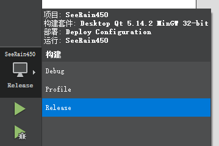

# SN100的Qt开发环境与依赖

本文件只维护SN100仍需使用的Qt版本、编译输入、中文输入和恢复入口。2026-10-27按用户要求删除独立显示示例、照片和操作说明；共用依赖已归入SN100专用目录。

## 原Windows参考环境

原工程为`06_programs/sn100_host_reference/Seerain450_PC/SeeRain450.pro`，参考原件保持只读。原版使用Qt5.14.2 / MinGW32；Windows动态库是32位x86，不能直接作为RK的Linux ARM64库加载。

原图SHA-256为`749514844EE303045AD3F34F3C137D9C1E083D1509411D113772582A61AA609F`。该图属于SN100原版工程，保留用于核对原环境。

## 当前编译和运行安排

| 环境 | 用途及版本 |
| --- | --- |
| Windows | 编辑同一份源码；原Windows行为和界面依据只读源码、已有截图及用户提供的信息核对。 |
| WSL Ubuntu-24.04 / qyq | 编辑、源码检查和ARM64交叉编译；SN100所用Qt开发工具为5.15.13，G++13.3。 |
| RK3576 / Linux ARM64 | SN100业务实际运行和验证，Qt5.15.13；界面、输入、数据读写和真实仪器分开验收。 |

2026-10-27起，每项功能或修复直接在RK核对；不再运行新的Windows/WSL本机产品测试或Windows测试构建。历史安装事实保留原日期和范围，不当作新业务验收。[执行约定](20261021_ai_workflow.md#rk-direct-verification)

## SN100依赖归属与恢复入口

| 内容 | 位置与当前用途 |
| --- | --- |
| Qt基础头文件、基础库 | [sn100_base_arm64](../07_backups/qt_environment/sn100_base_arm64/README.md)，已从旧通用归属移入SN100专用目录，6个原文件内容不变。 |
| SQL/SQLite开发输入 | [sn100_arm64](../07_backups/qt_environment/sn100_arm64/source.json)，供原库和业务数据访问构建。 |
| 加载器和SQLite运行输入 | [sn100_rk_runtime](../07_backups/qt_environment/sn100_rk_runtime/source.json)，加载器只用于电脑端依赖检查，不覆盖RK系统加载器。 |
| 网络、报表、字体、SVG等 | [Qt依赖索引](../07_backups/qt_environment/README.md)中的SN100对应目录，按实际功能使用。 |

基础依赖由`06_programs/sn100_host/prepare_arm64.sh`校验并恢复到`temp/sn100_host/arm64_sysroot/`；统一主程序使用现有`shell/rk.sh prepare`准备构建及运行组件。具体参数按[SN100工程说明](../06_programs/sn100_host/README.md)执行。缺少正式归档时明确停止，不从已删除的示例目录查找备用输入，也不替换为电脑系统库。

原采集`source.json`和固定版本校验清单按原字节保留，用来解释来源；其中历史采集路径不再作为当前入口。运行数据、ARM64构建和临时日志留在`temp/sn100_host/`；正式恢复输入留在`07_backups/qt_environment/sn100_*/`。

## 2026-10-23的WSL安装与中文输入记录

当时为SN100新增WSL Ubuntu24.04.5 / x86_64的Qt/qmake5.15.13、G++13.3、SQLite驱动、中文字体及Qt Creator13.0.0，共新增169包，无已有包升级或删除。Qt Creator自身使用Qt6.4.2，登记的SN100工程套件仍为Qt5.15.13，没有将工程改成Qt6。[安装输入、清单与配置](../07_backups/qt_environment/wsl_amd64/source.json)

Fcitx5拼音及Qt5输入插件当时新增26个依赖，无已有包升级或删除；用户确认候选字并保存“测试医院”，界面和数据库一致。安装和恢复输入见[输入法归档](../07_backups/qt_environment/wsl_ime/README.md)，业务过程仍见[同一移植记录](20261022_sn100_host_migration.md#hospital-ime-setup-20261023)。这些是历史WSL结果，不能代替RK中文输入验证。

## 当前资料入口

[SN100工程说明](../06_programs/sn100_host/README.md) · [唯一移植计划](../01_docs/plans/sn100_host_migration_plan.md) · [同一移植记录](20261022_sn100_host_migration.md)

本轮仅清理文件和修正依赖恢复路径，没有新运行业务程序或真实仪器测试；构建、RK功能、实际仪器和资源验收分别记录。
