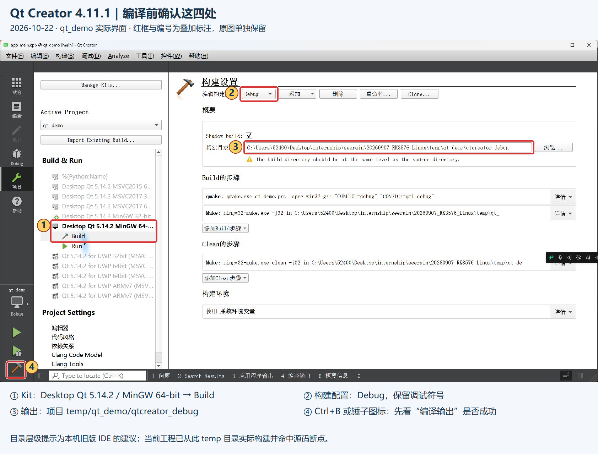
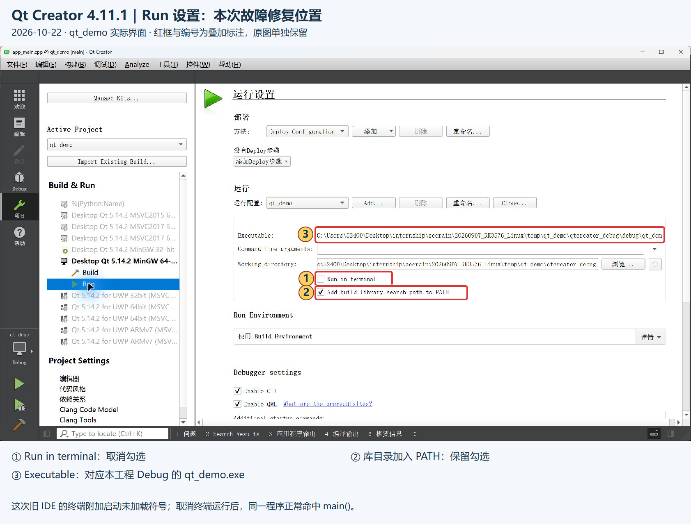
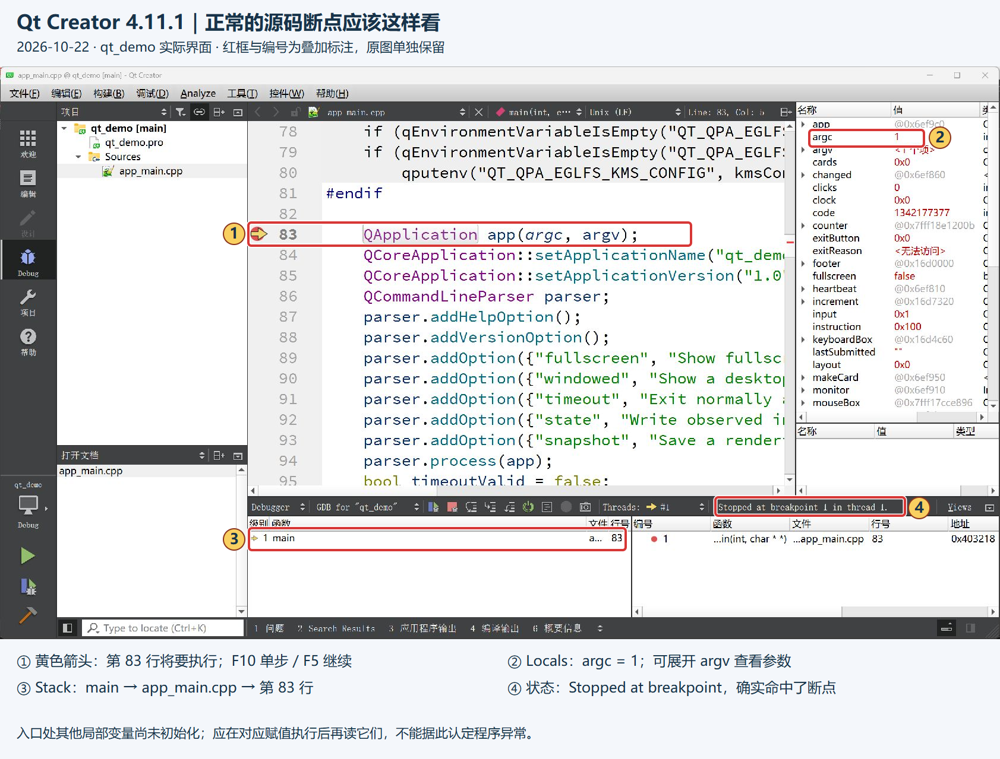
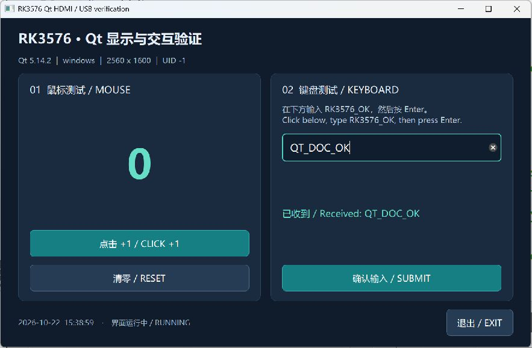
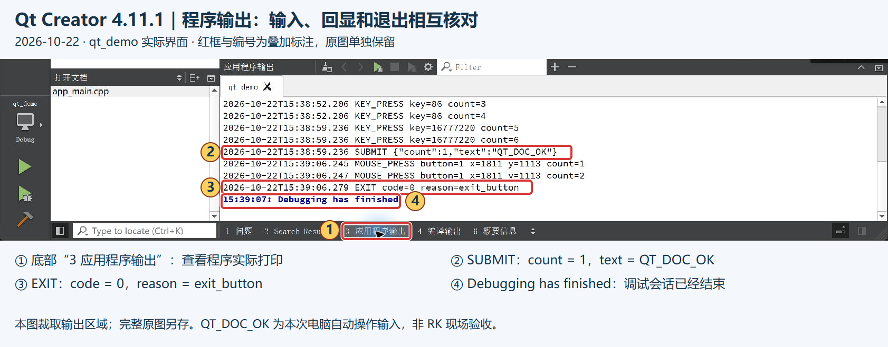
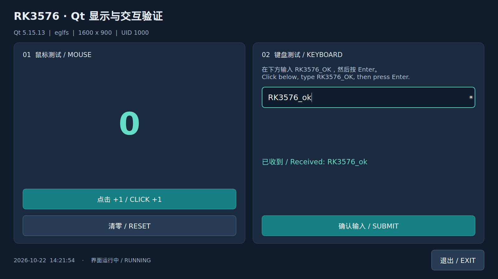

# Qt 工程、HDMI 运行与 Windows / RK 调试记录

2026-10-22｜泰山派 3M RK3576｜**HDMI / USB 键鼠现场验证、Windows Qt Creator 图形调试、WSL→RK 命令行远程调试均已通过。**

**2026-10-23 新增 WSL 本机脱机开发入口见第9节；以下保留 Qt 最小示例的 Windows / RK 历史流程。** Windows 编码和日常调试 → 同一台电脑的 WSL 交叉编译 RK 版本 → 上传 RK 直接运行并验收。全部编译在电脑完成，RK 不承担编译。涉及板端特有问题时，再用电脑上的 WSL 调试器连接 RK 的轻量 `gdbserver`，不将远程调试作为每次部署的必经步骤。下面按当前这台电脑、当前 `qt_demo` 工程说明操作。配套[结构化实测数据](20261022_qt_environment.json)保留版本、哈希和历史验收依据；同一事项继续更新本文。

2026-10-23补充：Ubuntu24.04/qyq已安装Fcitx5、拼音及Qt5输入插件的26个新增依赖，无已有包升级/移除；SN100正常WSL GUI启动入口自动接入。用户实际确认中文候选并保存“测试医院”，UI/数据库一致。安装/恢复输入在[07_backups/qt_environment/wsl_ime](../07_backups/qt_environment/wsl_ime/README.md)，详细范围、WSLg必要适配与操作证据只维护在[SN100同一记录](20261022_sn100_host_migration.md#hospital-ime-setup-20261023)。本项没有修改Windows设置、系统Qt路径或RK环境，RK拼音输入仍待实屏验证。

## 1. 工程与软件在哪里

工程根目录：`C:\Users\52400\Desktop\internship\seerain\20260907_RK3576_Linux`。下文项目内路径都相对此根目录。

| 内容 | 当前实际位置或版本 |
| --- | --- |
| 打开的工程文件 | [06_programs/qt_demo/qt_demo.pro](../06_programs/qt_demo/qt_demo.pro) |
| 两种目标共用的源码 | [app_main.cpp](../06_programs/qt_demo/app_main.cpp)；Windows 与 WSL 直接读取同一份文件，当前界面由 C++ 创建，没有 `.ui` 文件 |
| 旧 Linux 专用版本 | [history/linux_main_20261022.cpp](../06_programs/qt_demo/history/linux_main_20261022.cpp)，仅供历史追溯，不参与当前构建 |
| 本次使用的 IDE | **Qt Creator 4.11.1**，`C:\Qt5.14\Qt5.14.2\Tools\QtCreator\bin\qtcreator.exe` |
| Windows Qt / Kit | **Qt 5.14.2 / Desktop Qt 5.14.2 MinGW 64-bit** |
| Windows Qt 目录 | `C:\Qt5.14\Qt5.14.2\5.14.2\mingw73_64` |
| Windows 编译器 / 调试器 | MinGW GCC **7.3.0** / GDB **8.1**，目录 `C:\Qt5.14\Qt5.14.2\Tools\mingw730_64\bin` |
| RK 系统 / Qt | Ubuntu 24.04.5、aarch64、`6.1.99-rt36-tspi`；已有 **Qt 5.15.13** |
| RK 交叉编译器 | WSL `Ubuntu-24.04` / `qyq`，`aarch64-linux-gnu-g++ 13.3.0` |
| 本机工程设置 | `06_programs/qt_demo/qt_demo.pro.user`，机器相关文件，由 Git 忽略 |

**Qt Creator 的版本和 Qt 库的版本是两回事。** 本机 5.14.2 已实际编译通过，不必为打开这个 `.pro` 先换成板端版本。两种编译都在电脑完成：

| 用途 | 编译实际发生在哪里 | 使用的工具 / Qt | 生成的程序在哪里运行 |
| --- | --- | --- | --- |
| 电脑查看界面、断点调试 | Windows 的 Qt Creator | MinGW 7.3 / Windows Qt 5.14.2 | x86-64 `qt_demo.exe`，在 Windows 运行 |
| 生成最终 RK 程序 | **同一台 Windows 电脑内的 WSL** | `aarch64-linux-gnu-g++` / 匹配 RK Qt 5.15.13 的 ARM64 头文件、链接库 | AArch64 Linux `qt_demo`，上传 RK 直接运行 |

这是**从同一份 C++ 源码生成两个目标程序**，不是把 Windows `.exe` 转换成 RK 程序，也不需要先构建 `.exe` 才能交叉编译。当前 Qt Creator 的 Desktop Kit 按 Ctrl+B 只生成 Windows 版本；生成 RK 版本使用第 6 节的电脑 WSL 脚本。

匹配 RK 的头文件和库已准备在电脑的 `temp/qt_demo/sysroot/`，构建时直接使用；无需每次在 RK 编译 Qt 或应用。`RK_BOARD` 仅对 RK 目标开启，用于隔离 EGLFS / KMS 等设置；新增 API 时仍需检查两种 Qt 版本兼容性。

### 1.1 同份源码、相同 Qt 版本与实际兼容性

当前 Windows 使用 Qt 5.14.2，电脑 WSL 为 RK 目标使用 Qt 5.15.13；本程序已分别构建并验证。Qt 5.15 对此前 Qt 5 提供向后兼容，但新版本增加的 API 不会自动出现在旧版 5.14 中，不能将“当前能编译”当作以后所有新增代码均能通过。规则依据 [Qt 5.15 官方发布说明](https://www.qt.io/blog/qt-5.15-released)。

此前针对最小示例建议核查对齐至 5.15.13。**收到 SN100 原业务工程后，版本方案改为先保留 Qt 5.14.2 / MinGW32 原版基线，评估源码兼容 RK 5.15.13，并与 RK 私有部署 5.14.2 的路线比较后定版**，详见下一节和[详细移植计划](../01_docs/plans/sn100_host_migration_plan.md)。当前尚未安装、切换 Windows Qt 或更改 RK 库。Windows / RK 分别使用为对应操作系统和架构构建的 Qt 库，不能混用 Windows DLL 与 ARM64 Linux SO；Windows Qt Kit 的编译器也须与其 Qt 库配套。

| 差异来源 | 相同 Qt 版本能否消除 | 后续控制方式 |
| --- | --- | --- |
| Qt API、修复和版本行为差异 | 能减少；仍须核对模块、构建选项和发行版补丁 | 对齐 Qt 版本和所用模块，固定目标头文件与库 |
| Windows / Linux 路径、设备接口与第三方库 | 不能 | 通用逻辑用跨平台接口，设备代码单独适配；每次改动同时做 Windows 与 WSL ARM64 构建 |
| 字体、DPI、分辨率、窗口模式、图形插件 / 驱动 | 不能 | 固定所需字体和布局策略，在目标 HDMI 屏幕运行验收 |

目前共用的是界面与交互源码。代码有意采用 Windows 微软雅黑 / 普通窗口、RK Linux 字体 / 全屏，图形插件分别为 windows 与 eglfs，不能称为像素和行为全部一致。已通过 Windows 图形调试、RK 交叉编译和远程 offscreen 验证；早先的 RK HDMI / USB 现场验收使用此前产物，**最终跨平台源码的 HDMI 对照复测仍待完成**。后续以“电脑双目标构建通过 + RK 目标功能验收”判定通过，RK 无需编译；只有定位板端特有问题时才按需远程调试。

### 1.2 SN100 原上位机环境与版本路线补充

2026-10-22，用户提供 `SN100_host/` 并确认目标仪器为 **SN100**，上位机功能与 CV450、6600 大致一致。目录内主工程为 `06_programs/sn100_host_reference/Seerain450_PC/Seerain450_PC/SeeRain450.pro`；具体型号参数、协议和功能范围仍需逐项核对。


截图明确显示：项目 **SeeRain450**，构建套件 **Desktop Qt 5.14.2 MinGW 32-bit**，当前配置 **Release**。本次逐字节保存原图，SHA-256 为 `749514844EE303045AD3F34F3C137D9C1E083D1509411D113772582A61AA609F`。这与本记录前面 `qt_demo` 的 **MinGW 64-bit** 是两个工程的配置，后续原业务参考版先选32位；不能直接复用demo的64位Kit链接原32位DLL。

只读核对 `.pro.user` 和DLL：Qt5Core版本5.14.2.0；Qt5Core、QtXlsx、qtcsv、算法AL4A和日志后端GL4A的DLL均为32位x86。部分Linux算法包装没有实际计算却返回成功，Linux日志/崩溃分支及正式工程依赖也需补齐。**本轮未构建、启动该业务工程，不能将最小示例通过写成原上位机已移植通过。**

| 用户提出的路线 | 本轮记录与后续判断 |
| --- | --- |
| 更改RK Qt环境，与原版5.14.2一致；必要时重新烧录 | 先评估在当前系统中交叉构建并隔离部署应用私有Qt5.14.2，不覆盖系统5.15；只有确需更换rootfs/BSP等才评估烧录及实际影响范围。同Qt版本仍须重建ARM64算法/第三方库并验证图形/外设 |
| Windows保持5.14，源码同时兼容5.14/5.15 | 建议优先进行可行性验证：Windows5.14.2/32参考和调试，WSL使用匹配RK5.15.13的完整开发输入生成ARM64版本，兼容点集中处理，每模块两端构建与回归；不保证无报错或无行为差异 |

上述是**待验证方案**，尚未更改Windows/RK Qt、内核、软件包或设备配置。原软件源码保持不变，本轮完成代码审查、技能/官方资料检索和[SN100详细移植计划](../01_docs/plans/sn100_host_migration_plan.md)，下一步先固定可运行Windows基线、取得真实ARM64算法实现和完整依赖。后续“如何编译/调试”的原业务操作步骤须在该工程实际验证后追加，下面第2节起仍针对 `qt_demo`。

2026-10-22后续补充：按用户要求，将原 `SN100_host/` 整体整理到 `06_programs/sn100_host_reference/`，并新建相邻 `06_programs/sn100_host/` 作为正式工作目录，当时仅有局部AGENTS（2026-10-23后已有多个离线切片，最新见[移植盘点](20261022_sn100_host_migration.md#progress-review-20261023)）。原压缩包/关键源码SHA和文件数/总大小移位前后核对一致，见[位置与校验依据](../04_references/sn100_host/reference_location.json)；未修改原代码、构建或启动业务软件。目录/工程风格/未来仓库Skill结构与调研来源见[工程管理说明](../01_docs/knowledge/sn100_host_project_guide.md)。

用户确认现有SN100仪器可用于后续验收，**按一个模块移植、该模块仪器验证、通过后进入下一个模块**推进；本轮仅记录方式，接口参数以后提供。首批候选是连接/状态显示，源码审查发现状态收包会触发自动校时和首次收包联动，需隔离后再作为只读验证；模块范围、条件、真实输入输出和通过标准见[计划2.6节](../01_docs/plans/sn100_host_migration_plan.md#26-逐模块移植和现有仪器验收用户已确认)。这不是已完成仪器验证的记录，不将最小demo结果移作业务模块结果。

**后续业务移植过程统一追加[SN100 Qt上位机移植记录](20261022_sn100_host_migration.md)**，包括资源调配、代码删减前依据/对照、删后回归和各模块仪器验证；本文继续承载Qt环境/最小示例的事实，后续互相引用，不重复建立移植流水。

## 2. Windows：打开工程并编译

### 2.1 打开与选择构建配置

1. 启动上表所列 **Qt Creator 4.11.1**，用“文件 → 打开文件或项目”打开 `06_programs\qt_demo\qt_demo.pro`。
2. 初次配置时选择 **Desktop Qt 5.14.2 MinGW 64-bit**。已配置工程则点左侧扳手“项目”，在 **Build & Run** 下选择这个 Kit 的 **Build**。
3. 顶部选 **Debug**，构建目录设为下面的完整路径，再按 **Ctrl+B** 编译。

```text
C:\Users\52400\Desktop\internship\seerain\20260907_RK3576_Linux\temp\qt_demo\qtcreator_debug
```



[完整原图](../03_photos/20261022_qt_build_01.png)｜[可编辑圈注 SVG](../03_photos/20261022_qt_build_marked_01.svg)。截图中的目录层级黄字是旧 IDE 的建议；本工程已从此目录实际构建并命中断点。

底部 **“4 编译输出”** 查看 qmake、g++、链接过程和错误；**“1 问题”** 用于定位报错文件与行号。构建结束无错误，且生成 `temp/qt_demo/qtcreator_debug/debug/qt_demo.exe`，才进入运行。修改 `.pro` 后可在“构建”菜单重新执行 qmake，再构建；普通 `.cpp` 修改直接 Ctrl+B。

本机 Release / Profile 已分别指向 `temp/qt_demo/qtcreator_release`、`temp/qt_demo/qtcreator_profile`；当前验证使用 Debug。

### 2.2 本工程的 Run 设置

在相同 Kit 下点 **Run**，核对下面三处。当前已保存，关闭并重开 IDE 后仍保留；换电脑或重建 `.pro.user` 时重新检查。



[完整原图](../03_photos/20261022_qt_run_settings_01.png)｜[可编辑圈注 SVG](../03_photos/20261022_qt_run_settings_marked_01.svg)。**取消 `Run in terminal`；保留 `Add build library search path to PATH`。** 普通运行点左下绿色三角；调试使用带小虫的三角或 F5。

## 3. Windows：断点、单步、变量与调用栈

### 3.1 先在入口处验证调试链路

打开 `app_main.cpp`，找到当前第 **83 行** `QApplication app(argc, argv);`。光标放在该行按 **F9**，左侧出现红点；按 **F5** 启动调试。程序应停在源码中，显示黄色箭头、`main` 调用栈和参数。



[完整原图](../03_photos/20261022_qt_debug_01.png)｜[可编辑圈注 SVG](../03_photos/20261022_qt_debug_marked_01.svg)。本次 GUI 不带额外参数，`argc=1`；此前脚本带启动参数，`argc=7`，两者不矛盾。行号随以后源码修改可能变化，以语句为准。

| 操作 | 当前工程中怎样使用 |
| --- | --- |
| F9 | 在当前源码行添加 / 取消断点；调试前确认红点实际存在 |
| F5 | 尚未调试时启动；暂停时继续运行，直到下个断点或退出 |
| F10 | 执行当前行，通常不进入函数；本次从第 83 行到第 84 行已验证 |
| F11 | 需要追踪自己写的函数时进入函数；Qt / 系统库源码符号未完全配齐 |
| Locals / 局部变量 | 看当前作用域的值；展开 `argv` 等对象，等赋值执行后再读对应变量 |
| Stack / 调用栈 | 查看“谁调用了这里”；选择自己工程的帧，返回对应源码与局部变量 |
| Expressions | 添加需要持续观察的表达式，例如 `clicks`；仅在其可访问的作用域内解释结果 |
| Stop Debugger 红色停止按钮 | 结束调试；验证正常退出时，应继续运行后点击应用里的 EXIT |

视图不见时，在 Debug 模式的 **Views** 中勾选 **Locals、Stack、Breakpoints、Expressions**。入口处尚未执行初始化的变量可能显示随机值或“无法访问”，这不单独证明程序故障。

### 3.2 真正排查按钮逻辑时，断在回调里

入口断点只用于确认环境。下一次练习可在当前 **第 212 行** `++clicks; ++totalIncrements; ...` 设断点，F5 显示界面后点击“点击 +1”。在回调中查看 `clicks` / `totalIncrements`，F10 后确认从 0 变为 1，继续运行后界面计数与 `COUNTER` 日志一致。输入提交可在当前 **第 219 行** `lastSubmitted = input->text(); ...` 设断点，检查输入文本和 `submissions`。

**该回调断点练习是下一步任务；已通过的是入口断点、F10 和继续运行后的界面操作。** 暂停 Qt 主线程时，界面和计时器会一起停住；按 F5 后继续。Qt 事件循环 `app.exec()` 持续等待事件，排查交互时优先在相关回调设断点。

## 4. 怎样查看并保存相关信息

### 4.1 程序输出与状态文件一起看

按 F5 继续后，在测试窗口输入 `QT_DOC_OK`、按 Enter，再点击 EXIT。本次为补采文档图片，由电脑自动操作完成，显示如下。



点 Qt Creator 底部 **“3 应用程序输出”**，核对实际输入和退出原因。



[完整原图](../03_photos/20261022_qt_output_01.png)｜[可编辑圈注 SVG](../03_photos/20261022_qt_output_marked_01.svg)。本图只截取输出区域，原图完整保留。实际摘录：

```text
2026-10-22T15:38:59.236 SUBMIT {"count":1,"text":"QT_DOC_OK"}
2026-10-22T15:39:06.279 EXIT code=0 reason=exit_button
15:39:07: Debugging has finished
```

| 信息 | 到哪里看、怎样保存 |
| --- | --- |
| 编译命令、错误、链接结果 | 底部“编译输出”；在输出文本中全选、复制，保存到 `temp/qt_demo/` 下的当次 `.log` |
| `START / READY / COUNTER / SUBMIT / EXIT` | 底部“应用程序输出”；保存实际输入、实际输出及退出码，不能只写“通过” |
| 本次界面状态 | 当前工作目录的 `state.json`；IDE 默认位于 `temp/qt_demo/qtcreator_debug/state.json` |
| 应用生成的界面图 | 同目录 `render.png`；是 QWidget 渲染图，区别于电脑窗口截图或 HDMI 实物照片 |
| IDE 自身调试问题 | Debug → Views → **Debugger Log**；看加载的 EXE、GDB、符号、信号；右键可保存日志 |
| 正式证据 | 关键输入输出摘入本文 / 配套 JSON，原图放 `03_photos/`；本次历史日志已归档到 [04_references/qt_environment/](../04_references/qt_environment/)，新运行日志先写 `temp/`，见第 8 节 |

本次 `state.json` 实际为 `platform=windows`、`qt_version=5.14.2`、`submissions=1`、`submitted_text=QT_DOC_OK`、`exit_reason=exit_button`；这次只验证输入提交，计数为 0。之前另一轮测试的计数为 1、提交文本为 `WIN_QTCREATOR_OK`，详见配套 JSON。`key_presses` / `mouse_presses` 是 Qt 事件分发计数，可能包含传播事件，不当作物理按键次数。

Debugger Log 用来排查调试器，应用程序输出用来看业务打印。保存或分享 Debugger Log 前检查内容：其中可能包含环境变量和进程数据，只保留必要片段。此处保存方式参考 [Qt 官方 Debugger Log 说明](https://doc.qt.io/qtcreator/creator-debugger-log-view.html)；界面操作以上述本机 4.11.1 实测为准。

### 4.2 留下一条能复现的问题记录

在同一记录补充：**时间与平台 → 源码版本 / SHA-256、Kit 和 Debug 配置 → 操作与输入 → 预期 → 实际输出、截图及栈帧 → 修改 → 同样输入的复测结果。** 不把编译成功、软件回显、板端执行和实物动作混成一次验收。

在 **Windows PowerShell、项目根目录**可查询当前源码标识：

```powershell
Get-FileHash -Algorithm SHA256 .\06_programs\qt_demo\app_main.cpp
```

本次入口调试使用的源码 SHA-256 为 `f498bda87931b8bae566e3e1e0fcbeff3b6086794e97799c084d63aeffe2476f`。需要复查 Windows Qt 工具版本时使用明确路径，避开本机 PATH 中 Anaconda 的 qmake：

```powershell
& 'C:\Qt5.14\Qt5.14.2\5.14.2\mingw73_64\bin\qmake.exe' -v
```

### 4.3 不依赖 IDE 的复查入口

仍在 **Windows PowerShell、项目根目录**，使用现有 [windows.ps1](../06_programs/qt_demo/windows.ps1) 编译并自动验证 GDB 断点、参数、回溯、单步和 10 秒退出：

```powershell
powershell.exe -NoProfile -ExecutionPolicy Bypass -File .\06_programs\qt_demo\windows.ps1 -Action debug-check
```

本入口使用独立的 `temp/qt_demo/windows_debug_x64/`，新运行日志为 `debugger.log`；不是 IDE 的 `qtcreator_debug/`。其中应出现 `DEBUG_BREAKPOINT_REACHED`、`DEBUG_SINGLE_STEP_COMPLETE`、正常退出。[本次历史验收日志](../04_references/qt_environment/windows_debug_x64/debugger.log)已正式归档；旧构建产物已清理，脚本每次会重新运行 qmake 和编译。只想运行测试窗口时，把脚本参数改为 `-Action run`，点击 EXIT 结束。

## 5. 本次遇到的反汇编 / ?? 问题

[修复前的用户原图](../03_photos/20261022_qt_debug_error_01.png)中，状态为 `signal-received`，调用栈是 `??`。进一步日志显示：终端模式执行 `attach`、`No symbol table is loaded`、64 位 DLL 与 `target architecture i386` 不兼容，随后停在 **SIGTRAP**。

本次 Qt 5.14.2、64 位 MinGW / GDB 和 EXE 的调试符号都已核对。**关闭本工程 Run 的 `Run in terminal` 后，同一 EXE 立即正常命中源码断点。** 移到新的 temp 构建目录、关闭重开 IDE 后也验证通过。这个结论限于本次旧 IDE 的启动问题，不将所有 SIGTRAP 都归因为这个开关。

以后出现相似问题，依次核对 Run 的 EXE 路径、Debug 构建、Kit / GDB 位数和 Debugger Log 中的具体信号；构建失败时先修复构建，避免运行旧 EXE。受影响的旧工程配置已单独备份，见 [windows_qtcreator/source.json](../07_backups/qt_environment/windows_qtcreator/source.json)，其中写明恢复方法和范围。

## 6. 电脑 WSL 编译 RK 程序，上传后直接运行

### 6.1 编译位置与 HDMI 部署

下列命令均在 **WindTerm 的 wsl 会话 / Ubuntu-24.04 / qyq** 执行，不是在板端终端执行。先进入共用源码目录：

```bash
cd /mnt/c/Users/52400/Desktop/internship/seerain/20260907_RK3576_Linux/06_programs
```

首次准备或清理 sysroot 后，校验并解包已归档的 Qt 5.15.13 构建输入：

```bash
bash qt_demo/prepare.sh
```

只在电脑编译、检查 RK 目标程序，不连接或部署到板卡：

```bash
bash rk.sh qt_demo build
```

该命令在电脑 WSL 调用 `qt_demo/build.sh`，生成 `temp/qt_demo/build/qt_demo` 并检查 AArch64 架构；这就是后续交给 RK 运行的程序。无需先在 Windows 构建 `.exe`。

HDMI 和 USB 键鼠接好后，重新编译、检查 AArch64、上传、核对 SHA-256 / 动态库，再运行，最长 1800 秒：

```bash
bash qt_demo/run.sh start 1800
```

这条启动命令的编译阶段同样在**电脑 WSL**完成，编译失败会停止，不上传旧产物。RK 仅接收程序、核对哈希与动态库并执行，没有板端编译步骤。程序部署到 `/home/rkshare/programs/qt_demo/qt_demo`，以 `lckfb` 身份运行；临时启动器分配 tty7，应用退出后恢复 tty1，没有配置开机自启。构建 / 部署日志在电脑 `temp/qt_demo/logs/`。

Windows 本机调试覆盖界面与通用逻辑，交叉编译覆盖 RK 目标的编译和链接；真实 HDMI、USB、驱动和业务外设仍在 RK 运行验收。只有出现板端特有问题时才启用第 6.2 节远程调试；编译成功不承诺所有后续硬件行为自动正确。

查看本次运行状态与末尾日志：

```bash
bash qt_demo/run.sh status
```

优先点屏幕 EXIT 正常退出；需要远程停止时：

```bash
bash qt_demo/run.sh stop
```

退出后回收最新一次 **HDMI 启动记录**：

```bash
bash qt_demo/collect.sh
```

新运行输出保存为 `temp/qt_demo/evidence/<本次编号>/` 的 `app.log`、`state.json`、`render.png`、`runtime.txt` 和已结束时的 `exit_code`。查看 `SUBMIT` 的真实文本、`EXIT` 的原因和代码；`runtime.txt` 包含内核、实时标志、活动终端等核对信息。[本次 HDMI 原始日志与状态](../04_references/qt_environment/hdmi_20261022_141944_7325/)和[渲染图](../03_photos/20261022_qt_hdmi_render_01.png)已正式归档。`collect.sh` 不回收下面独立的远程调试目录。



这是应用渲染图。**实物 HDMI 显示、点击、键盘输入、Enter 提交及退出返回终端由用户现场确认。** 首次现场验收的最后实际提交为 `RK3576_ok`，14:23:31.550 正常退出、代码 0，随后活动终端为 tty1；不改写为本次 Windows 的输入。

需要重新查看 RK 的 Qt 包版本，在 **板端 SSH / HDMI 终端**执行：

```bash
dpkg-query -W libqt5core5t64 libqt5gui5t64 libqt5widgets5t64
```

本次三项版本均为 `5.15.13+dfsg-1ubuntu1`；应用 `START` 中的 `Qt 5.15.13` 是运行时的再次核对。

### 6.2 电脑运行 GDB，RK 只运行辅助进程

已有 WSL `gdb-multiarch 15.1` 与板端应用目录中解包的 `gdbserver 15.1`；板端未安装 IDE。通过 **SSH stdio** 连接，未开放调试 TCP 监听端口；主调试器读取电脑上的源码、ELF 和 sysroot。该机制见 [GDB 官方 gdbserver / SSH 说明](https://sourceware.org/gdb/current/onlinedocs/gdb.html/Server.html)。

仍在 **WSL 的 `06_programs` 目录**，自动重新构建 Debug、部署并验证远程断点：

```bash
bash qt_demo/debug_rk.sh check
```

已实测命中 `app_main.cpp:67`，`argc=7`、回溯和单步通过，出现 `RK_REMOTE_BREAKPOINT_REACHED` / `RK_REMOTE_SINGLE_STEP_COMPLETE`；Qt 5.15.13 运行 10 秒后退出码 0。[最终验收日志](../04_references/qt_environment/remote_debug_20261022_150737_1215/debugger.log)、[状态与当次 GDB 原稿](../04_references/qt_environment/remote_debug_20261022_150737_1215/)及[渲染原图](../03_photos/20261022_qt_remote_debug_01.png)已归档。新会话仍写入 `temp/qt_demo/remote_debug/<本次编号>/`。

需要手动停住、查看变量时：

```bash
bash qt_demo/debug_rk.sh interactive
```

进入 `(gdb)` 后按需要逐条操作：`continue` 到 main 断点，`print argc` 查看参数，`bt` 看回溯，`next` 单步，最后 `quit` 结束会话。交互模式的初始暂停点不一定就是 main，先 `continue`。

该交互模式不自动保存完整日志。要记录后续 GDB 输出，先在 **`(gdb)` 提示符**指定本机文件：

```gdb
set logging file /mnt/c/Users/52400/Desktop/internship/seerain/20260907_RK3576_Linux/temp/qt_demo/remote_debug/interactive.log
```

然后启用记录，再进行上述变量与单步操作：

```gdb
set logging enabled on
```

结束记录时执行下面一条，然后 `quit` 结束会话。此为 GDB 15.1 的使用方法；本次已保存的自动验证日志由 `check` 模式生成。

```gdb
set logging enabled off
```

**当前边界：** 远程脚本固定使用 `offscreen`，验证项目源码调试，不接管 HDMI / USB 输入；Windows 原生 Qt Creator 的 RK 远程 Kit 尚未配置。当前 MinGW GDB 调 Windows 目标，不能直接替代 AArch64 Linux 调试器。Qt 插件和部分系统库源码符号未完全配齐。一次 main 断点处测得 gdbserver RSS 4460 KiB，约 4.35 MiB，只是辅助进程的单次快照，不含 Qt 应用内存。断点暂停和 Debug 构建不作为实时延迟验收。

构建与辅助工具的来源、校验及恢复资料统一保存在 [07_backups/qt_environment/](../07_backups/qt_environment/)；此前新增依赖范围见配套 JSON。本文整理期间未再改动板端配置。

## 7. 已完成与下一步

下面是本事项的阶段状态；全项目依赖和优先级继续以[开发计划](../01_docs/plans/development_plan.md)为准。

**已完成**

- [x] `.pro` 跨平台工程；Windows 64 位 Debug、F5 入口断点、局部参数、栈、F10 和继续运行 / 退出。
- [x] RK Qt 5.15.13、HDMI / USB 键鼠现场验收；WSL→RK 的 GDB 命令行远程链路。
- [x] 构建、Run 设置、断点和日志的圈注图，原图与可编辑 SVG 分开归档；统一本文、JSON、README 与计划入口。

**当前需要做**

- [ ] 配合SN100首轮RK离线实屏，复核现有Qt5.15.13/SQLite插件、字体、EGLFS及键鼠环境；独立页与统一壳的构建/部署入口按[首验卡](../01_docs/plans/sn100_host_migration_plan.md#rk-offline-card)分别核对。当前SN100业务页面未有板端通过结论。
- [ ] 第3.2节按钮回调断点仅作为按需学习练习：核对`clicks`、界面和日志；不作为SN100移植或上机前置。

**未完成即将执行**

- [ ] SN100已交付医院/账户/历史查询三页统一离线入口及独立报告/协议/算法切片；设备到场后先O01再逐模块补实屏/数据/退出与资源，再做三页累计回归。仪器、调度/算法及生产认证按各自接口和前置条件推进；[最新状态与边界](20261022_sn100_host_migration.md#progress-review-20261023)。
- [ ] 确有板端特有故障、需要图形化远程调试时，再配置电脑端 AArch64 GDB / Qt Creator Kit，并用真实目标进程验收；需要 HDMI 时另核对启动和附加方式。

**将来需要做**

- [ ] 业务输入明确后，验证真实后端数据、通信异常、退出 / 恢复和日志关联。
- [ ] 按使用需要确认 MIPI DSI 配套屏型号与触摸；按交付要求验证自启、重启恢复、长期稳定性及界面负载下的实时性。

## 8. 清理后文件入口与重新构建

2026-10-22 将本次唯一旧源码、关键日志、状态和未重复的渲染图移出 `temp/`，逐字节校验后清理 EXE、ELF、对象文件、Makefile、旧调试尝试及一次性文档辅助脚本。归档来源与 SHA-256 见[清单](../04_references/workspace_setup/20261022_temp_archive_manifest.json)。此为资料整理，没有重新执行板端或图形测试。

| 需要使用的内容 | 正式入口与范围 |
| --- | --- |
| 日常开发 | 打开 [qt_demo.pro](../06_programs/qt_demo/qt_demo.pro)，修改 [app_main.cpp](../06_programs/qt_demo/app_main.cpp)；当前工程只编译这一份源码 |
| 旧 Linux 版本 | [linux_main_20261022.cpp](../06_programs/qt_demo/history/linux_main_20261022.cpp)，只作历史对照，不加入 SOURCES |
| HDMI / USB 键鼠实测 | [app.log](../04_references/qt_environment/hdmi_20261022_141944_7325/app.log)、[state.json](../04_references/qt_environment/hdmi_20261022_141944_7325/state.json)、[runtime.txt](../04_references/qt_environment/hdmi_20261022_141944_7325/runtime.txt)、[退出码](../04_references/qt_environment/hdmi_20261022_141944_7325/exit_code)及[渲染图](../03_photos/20261022_qt_hdmi_render_01.png)；现场显示 / 输入仍以用户当时确认的范围为准 |
| Windows 64 位脚本调试 | [debugger.log](../04_references/qt_environment/windows_debug_x64/debugger.log)、[state.json](../04_references/qt_environment/windows_debug_x64/state.json)和[渲染图](../03_photos/20261022_qt_windows_render_01.png) |
| Qt Creator 故障与修复核查 | [失败片段](../04_references/qt_environment/qtcreator_diagnosis/failure_excerpts.txt)、[成功片段](../04_references/qt_environment/qtcreator_diagnosis/success_excerpts.txt)、[操作状态](../04_references/qt_environment/qtcreator_diagnosis/interaction_state.json)；仅保留原筛选片段，没有导出完整环境变量日志 |
| 文档补采与 IDE 最终状态 | [补采输出](../04_references/qt_environment/qtcreator_diagnosis/documentation_output.txt)、[补采状态](../04_references/qt_environment/documentation/documentation_state.json)、[IDE 最终状态](../04_references/qt_environment/windows_ide_final/state.json)及[对应渲染图](../03_photos/20261022_qt_windows_ide_final_01.png) |
| WSL→RK 最终远程调试 | [debugger.log](../04_references/qt_environment/remote_debug_20261022_150737_1215/debugger.log)、[state.json](../04_references/qt_environment/remote_debug_20261022_150737_1215/state.json)、[当次 session.gdb](../04_references/qt_environment/remote_debug_20261022_150737_1215/session.gdb)和[渲染图](../03_photos/20261022_qt_remote_debug_01.png)；GDB 原稿保留历史路径，后续调试使用现有 `debug_rk.sh` 重新生成 |
| 构建与依赖来源 | [原构建 / 部署日志](../04_references/qt_environment/build_logs/)、[ELF 核查输出](../04_references/qt_environment/build_metadata/)、[ARM64 Qt 构建输入](../07_backups/qt_environment/qt5_arm64/source.json)、[调试工具](../07_backups/qt_environment/debug_tools/source.json) |

清理后按目标重新构建，不使用历史归档中的旧脚本路径启动程序：

- **Windows Qt Creator：**打开上述 `.pro`，保留本机 `qt_demo.pro.user` 的 Kit / Run 设置，先执行 qmake，再 Ctrl+B；随后按第 3 节 F5 调试。构建目录仍为 `temp/qt_demo/qtcreator_debug/`。
- **Windows 脚本：**使用 [windows.ps1](../06_programs/qt_demo/windows.ps1)，按第 5 节选择 `build`、`run` 或 `debug-check`；三种模式都会重新编译，输出到 `temp/qt_demo/windows_debug_x64/`。
- **RK 目标：**当前保留的 `temp/qt_demo/sysroot/` 可直接继续使用；在 WSL 的 `06_programs/` 执行第 6.1 节 `bash rk.sh qt_demo build` 重新生成 ELF。需要实际显示时再使用 [run.sh](../06_programs/qt_demo/run.sh)；板端特有问题按需使用 [debug_rk.sh](../06_programs/qt_demo/debug_rk.sh)。
- **重建依赖：**如果以后主动删掉 sysroot，在 WSL `06_programs/` 执行 [prepare.sh](../06_programs/qt_demo/prepare.sh)（`bash qt_demo/prepare.sh`），从已校验的正式归档恢复；当前无需重复准备。

## 9. WSL 本机 Qt5 开发环境（2026-10-23）

为 SN100 离线移植新增 WSL Ubuntu24.04.5 / x86_64 的 Qt/qmake5.15.13、G++13.3、SQLite 驱动、中文字体和 Qt Creator13.0.0。IDE 自身基于 Qt6.4.2，登记的 **SN100 WSL Qt 5.15.13 x86_64** Kit 使用 `/usr/lib/qt5/bin/qmake`、`/usr/bin/g++` 与 GDB；没有升级工程到 Qt6。启动使用 XCB/WSLg，Windows 与 RK 原环境未改。

实际安装新增169包、无已有包升级/删除；安装输入、包版本、SHA及新Kit配置在[正式归档](../07_backups/qt_environment/wsl_amd64/source.json)。本机 `.deb` 为 amd64，不上传 RK；ARM64 新增 SQL 输入另在[sn100_arm64](../07_backups/qt_environment/sn100_arm64/source.json)。

开发入口见[SN100简明说明](../06_programs/sn100_host/README.md)。O01 实际界面、按钮、数据持久化、响应与资源证据统一在[同一移植记录第7节](20261022_sn100_host_migration.md#7-2026-10-23wsl-qt-环境与-o01-医院信息脱机实验)，不在本环境记录重复业务实验。终端构建/XCB运行和同切片Windows32/ARM64构建通过，IDE F5、完整原Windows行为及板端/仪器仍待验。
