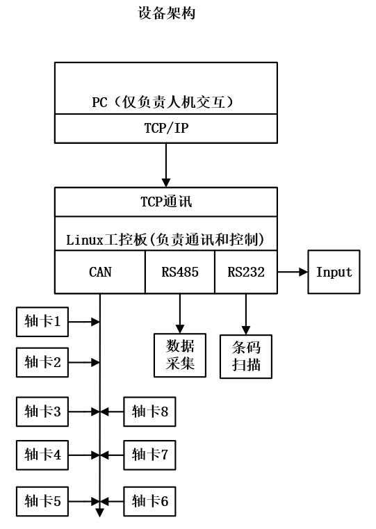

# 工程整体设备架构

记录日期：2026-10-22。来源：用户提供的“设备架构”原图，作为后续业务与接口设计的依据。

## 1. 架构原图

原图已按项目规则重命名为 `20261022_system_architecture_01.png`，统一保存在 `03_photos/`。保留原始 PNG 文件，未压缩、裁剪或重绘；归档副本与用户附件的 SHA-256 一致。

## 2. 模块职责与连接

| 模块 | 图中职责或连接关系 |
| --- | --- |
| PC | 仅负责人机交互，通过 TCP/IP 与 Linux 工控板通信 |
| Linux 工控板 | 负责通信和控制；本工程以 RK3576 为开发平台 |
| CAN | 连接轴卡 1～8，共 8 张轴卡；图中排列位置不代表节点地址或接线顺序 |
| RS485 | 连接数据采集模块 |
| RS232 | 连接条码扫描模块 |
| Input | 与工控板相连的独立模块，原图标注为 `Input`；具体接口、信号含义和方向待明确 |

整体分工为：**PC 负责人机交互，Linux 工控板负责设备通信和控制，各外设通过对应接口接入。**

## 3. 后续细化事项

- 通信协议：PC 与工控板的 TCP 连接角色、报文、命令、状态、错误和超时处理；CAN 轴卡的节点标识与控制协议。
- 硬件接口：RS485 数据采集设备、RS232 扫码设备和 Input 的具体型号、通信或电气参数、接线与引脚资源。
- 软件边界：调度流程、关键时序和算法部署位置；图中未指定界面技术及本地屏幕方案，既有 RK 外接屏 Qt 最小验证与最终 PC 界面的关系在业务阶段细化。

本次完成架构资料归档，图中的连接关系属于用户提供的工程设计；接口及整机功能的实际验证结果仍以各事项记录为准。后续补充继续更新本记录，待办统一维护在[开发计划](../01_docs/plans/development_plan.md#1-明确业务流程与接口边界)。
