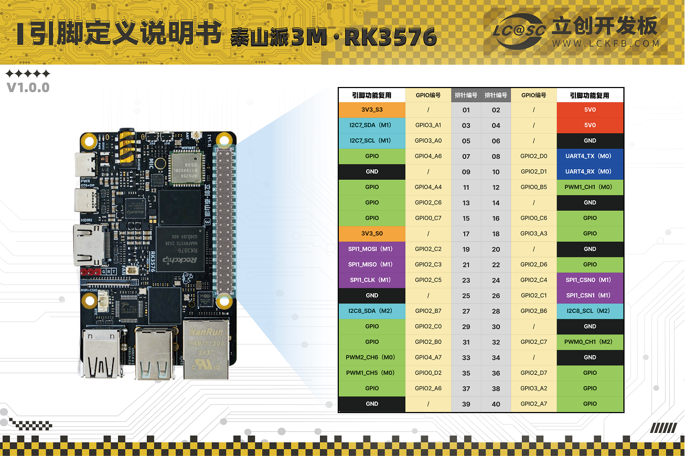

# 板A与板B的CAN0引脚配置与验证

**适用：板A、板B分别记录。**下方原过程为板B；后续[板A配置结果](#can-board-a-20261102)单独追加，不能互套结论。

更新：2026-11-02。用途：按用户提供的接口图，把40针排针的第7、11脚用于CAN0，与后续轴卡通信。**新板的CAN0已启用，重启后接口和引脚归属核对通过，没有烧录分区镜像。3帧本机发送确认核对通过，但关闭本机回送后接收超时，不能认定硬件接收已通过；真实收发器及轴卡尚未连接。**最终接口已停止，回环模式已关闭。后续继续更新本记录。

## 引脚在哪里，如何连接

来源：[用户接口开发图](../03_photos/06_设备整体架构说明/20261027_rk3576_interface_development_plan_01.png)、[本地板卡引脚图](../04_references/泰山派3M_40Pin引脚图.png)及官方系统源码。



按上图方向摆放板子：USB和网口在下方，40针排针在右侧。靠板内侧一列为1、3、5等奇数脚，从上向下找第4、5、6排，即7、9、11脚；接线前以实物丝印的针1标记再次核对。这里说的是排针的物理针号，不是Linux中的GPIO编号。

| 物理针号 | 芯片引脚 | 配置后的用途 | 接收发器一侧 |
| --- | --- | --- | --- |
| 7 | `GPIO4_A6` | `CAN0_RX_M2`，RK接收 | 收发器的RXD输出 |
| 9 | 地 | 共地，不需软件配置 | 收发器的GND |
| 11 | `GPIO4_A4` | `CAN0_TX_M2`，RK发送 | 收发器的TXD输入 |

`M2`表示这组引脚复用方式。原图的“3pinCAN”是接口规划，不能据此认定实物上已有收发器。排针上的TX/RX是芯片逻辑信号，需要经过与板卡电平匹配的CAN收发器，才能接轴卡的CANH/CANL；不能把CANH/CANL直接接7、11脚。收发器供电、使能引脚、终端电阻和插座线序，等实际型号确定后核对。用户本轮确认尚未接CAN硬件。

## 配置前的核对

准备阶段先检查本地归档；登录新板后，又读取实际内核配置和当前设备树确认适用。

- `07_backups/system_image/ubuntu24_server/kernel.config`已包含`CONFIG_CAN=y`、`CONFIG_CAN_RAW=y`、`CONFIG_CAN_DEV=y`、`CONFIG_CANFD_RK3576=y`，即已有CAN基础能力及RK3576控制器驱动。
- 同目录`tspi-3m-rk3576-panfrost.dtb`中的`/can@2ac00000/status`为`disabled`，控制器尚未启用；`pinctrl-0`已经指向`can0m2-pins`。
- 实际官方源码位于专用WSL的`/home/qyq/TaishanPi-3-Linux`。`kernel-6.1/arch/arm64/boot/dts/rockchip/tspi-3m-rk3576-40pin.dtsi`第198行起关闭了CAN0，但选择的正是M2引脚组。`rk3576-pinctrl.dtsi`第105行起将接收/发送分别定义为`GPIO4_A6`、`GPIO4_A4`，功能选择值为13。
- 驱动`drivers/net/can/rockchip/rk3576_canfd.c`支持设置`LOOPBACK`控制器回环模式。不过，本机收到的数据还可能是驱动返回的发送确认，必须区分来源；不能据此推定接收通道或外部硬件正常。

本轮新增[CAN0配置源码](../06_programs/rk3576_system/configs/can0_m2.dts)，只启用CAN0及这组引脚，不设置正式通信速率、不自动收发，也未改动既有正式镜像。配置编译成`dtbo`，即启动时叠加到原设备树上的小配置文件；本次已在新板安装并重启生效，其他板使用前仍须核对实际设备树和启动方式。

## 已做的检查

- 配置文件经`dtc -@`编译通过，生成`tspi-3m-can0-m2.dtbo`。
- 用`fdtoverlay`合并到上述归档设备树成功。合并前后转换为可读文本比较，唯一变化为CAN0的`status`由`disabled`变为`okay`；M2引脚和其他配置不变。这是电脑上的配置文件检查，没有运行板端功能。
- [回环检查程序](../05_tools/tests/can/can_loopback.c)用GCC交叉编译为ARM64通过，启用`-Wall -Wextra -Werror`；未在Windows或WSL运行该程序。初版只比较3帧内容，后续根据板端接收计数为0的现象，增加消息来源显示及`--no-local-echo`模式，区分发送确认和接收通道数据。初版源码及全部结果保留。
- [准备阶段摘要](../04_references/can/20261102/source_check.json)保留当时尚未登录新板的状态，其初版源码对应[固定副本](../04_references/can/20261102/can_loopback_initial.c)。最终结果和当前源码指纹见[RK结果索引](../04_references/can/20261102/rk_result.json)。生成物仍在`temp/can_20261102/`，关键日志已另存正式资料目录。

## 新板登录及配置过程

用户确认本次已经更换另一块RK，地址仍为`192.168.100.123`，账号为`lckfb`，且已有终端登录。Windows和WSL原有主机记录与新板不同；本次已按换板事实单独核对新板公开指纹，使用临时的独立主机记录，未关闭主机身份检查，也未覆盖旧板记录。

最初电脑密钥登录返回`Permission denied (publickey,password)`。用户在`root@localhost`终端执行追加公钥命令后没有提示，这是命令成功时的正常表现；因为`~`指当前账号的主目录，当时授权加到了root。随后通过root登录核实新板，再只把同一电脑公钥追加到`/home/rkshare/lckfb/.ssh/authorized_keys`，日常配置和检查改回普通用户`lckfb`，需要系统权限的命令单独用`sudo`。没有更改账号密码，没有归档私钥或其他认证凭据。

实际读取的新板为立创泰山派3M RK3576，内核`6.1.99-rt36-tspi #2`，`/sys/kernel/realtime`为1；驱动已编入内核，CAN0原为`disabled`，7/11脚均未被占用。把配置文件合并到从新板读取的当前设备树成功后，才开始写入。

本轮写入范围只有`/boot/overlays/overlays.ini`、`/boot/overlays/.ubootenv`和新增的`tspi-3m-can0-m2.dtbo`。前两个原文件已在修改前取回，并与板端指纹逐项比较一致；同名CAN小配置原先不存在。新旧配置及小配置源码/编译文件保存在[有限恢复输入](../07_backups/can/board_b_20261102/README.md)。没有覆盖boot/rootfs分区、内核、原有显示配置或正式整机镜像。

上传小配置和ARM64程序后，板端文件指纹与电脑一致，所需动态库齐全。首轮配置在最后查询状态时漏用`sudo`，工具返回需要root权限，配置脚本自动恢复了两个原文件并移除了本轮新文件；第二轮先比较原配置确认回退成立，再以正确权限启用成功。两轮输出均保留。重启后的首次引脚通配路径读取也失败，随后确认debugfs可用，并以`sudo`读取确定路径核对成功；旧输出保留。

本次实际启用命令如下，工具同时更新启动清单；随后已重启一次，不需要再次烧录镜像。

```bash
sudo ovtree --lang zh enable tspi-3m-can0-m2.dtbo
```

## 重启和板端检查结果

重启编号从`001d3663-830d-476c-b124-21b8e01bda6f`变为`72b43693-95d9-4b7e-8620-63f56dfacbc4`，不是把重启前的输出当成重启后结果。

| 检查内容 | 实际结果 | 验证范围 |
| --- | --- | --- |
| CAN0接口与设备树 | 出现`can0`，CAN0状态为`okay` | 启用及重启生效通过 |
| 7/11脚归属 | `gpio4-6`和`gpio4-4`均为`2ac00000.can`，组名`can0m2-pins` | 软件引脚复用通过，未测电平或波形 |
| 本机发送确认 | 3帧逐条一致，程序退出0；消息标记均为`tx-confirmation` | 发送及驱动回送确认通过，不是外部接收证据 |
| 关闭本机回送后的接收 | 第一帧等待1秒后超时，退出1，接口硬件RX计数仍为0 | 没有验证接收通道通过，具体原因未确证 |
| 最终状态 | 接口`DOWN/STOPPED`，回环模式关闭，检查进程已退出 | 无持续测试或自动收发 |
| 其他边界 | 实时标志仍为1；`ttyS4`、`ttyS6`设备节点仍存在 | 只核对存在，没有复测串口通信或实时性能 |

临时检查使用普通CAN、500000 bit/s，实际设置值为500000。它不是已确认的轴卡速率，没有保存开机自动启用该速率的服务。当前设备没有外部CAN硬件，不能归因说“缺收发器就是接收超时原因”，也不能把回送确认算作硬件接收通过。

来源已区分后的实际消息摘录：

```text
TX seq=1 standard ID=123 DLC=8 DATA=11 22 33 44 55 66 77 88
RX seq=1 standard ID=123 DLC=8 DATA=11 22 33 44 55 66 77 88
RX seq=1 source=tx-confirmation flags=0x804
TX seq=2 standard ID=321 DLC=0 DATA=(empty)
RX seq=2 standard ID=321 DLC=0 DATA=(empty)
RX seq=2 source=tx-confirmation flags=0x804
TX seq=3 extended ID=001ABCDE DLC=8 DATA=00 FF 55 AA 01 02 03 04
RX seq=3 extended ID=001ABCDE DLC=8 DATA=00 FF 55 AA 01 02 03 04
RX seq=3 source=tx-confirmation flags=0x804
```

关闭本机回送后的原始结果：

```text
interface=can0 required-mode=controller-loopback classic-CAN local-echo=disabled
TX seq=1 standard ID=123 DLC=8 DATA=11 22 33 44 55 66 77 88
RX seq=1 failed: timeout or socket error
[loopback_process_exit] 1
[cleanup_exit] 0
```

初版回送、消息来源复核及关闭回送检查累计发送7帧，板端最终TX计数为7、RX计数为0；两组3帧不是7帧都完成了接收。完整输出见[发送确认](../04_references/can/20261102/rk_echo_confirmed.log)、[关闭本机回送](../04_references/can/20261102/rk_no_local_echo.log)及[最终状态](../04_references/can/20261102/final_state.log)。

## 以后如何查看，下一步还缺什么

在板端执行下面的只读命令，确认接口仍存在，不会发送数据。看到`DOWN/STOPPED`是本轮主动停止测试后的状态，不等于小配置未启用。

```bash
ip -details -statistics link show can0
```

需要复现本机检查时，使用[检查程序及运行脚本](../05_tools/tests/can/README.md)，先断开外部硬件，再按其中说明操作；区分发送确认、独立接收和实际外部数据。

接收发器和真实轴卡前，补齐收发器型号/供电、轴卡速率、普通CAN或CAN FD、帧标识和协议，然后用真实对端核对接收数据、发送应答和重启复测。若接收仍异常，再针对驱动或硬件通道诊断；本轮未更改内核驱动、直接写寄存器或重新烧录系统。

## 参考入口

- [立创官方40针排针说明](https://wiki.lckfb.com/zh-hans/tspi-3-rk3576/hardware-gpio/taishanpi-3m/v1-0.html)与本地保留的原图；软件配置以本轮实际官方源码和归档设备树为依据。
- [Linux内核CAN说明](https://docs.kernel.org/networking/can.html)：说明Linux中的CAN网络接口、通信速率及回环；控制器内部回环与软件本地消息回送的范围需要区分。
- [野火RK3576 CAN接线示例](https://doc.embedfire.com/linux/rk3576/quick_start/zh/latest/doc/can/can.html)：仅参考原生TX/RX经过收发器再接CANH/CANL的关系，不照搬其板卡针号或启动文件路径。

<a id="can-board-a-20261102"></a>
## 板A：沿用板B配置并独立验证（2026-11-02）

想按顺序看完整过程，可先读[板A重新配置的八个步骤](20261021_TTL串口调试验证.md#board-a-configuration-process-20261102)：包括确认板卡、原设置备份、两份小配置编译与合并检查、上传启用、重启、串口/CAN核对及后续root登录。本节继续保留CAN事项的具体依据和结果。

用户换回现有Qt板A，要求把板B串口和CAN配置重新实施。SSH主机指纹与原板A一致，实读序列号`3bf8222fe1417f6a`；操作、日志和恢复材料均按板A保存。配置前CAN0关闭、7/11脚空闲，内核已有CAN及RK3576驱动。板A的U-Boot含读取`/boot/overlays/.ubootenv`和加载小配置的代码；缺少`ovtree`工具，因此从已归档源码对应的官方SDK编译产物补入ARM64静态工具。

与五组串口一起应用，两份`.dtbo`均与板B指纹相同；与板A本次设备树合并只有9处预期变化。写入两个启动设置、两个新增叠加配置及新增配置工具，未烧录分区镜像或更换内核。原启动设置和新增输入存[板A恢复目录](../07_backups/interfaces/board_a_20261102/README.md)，不能使用板B清单恢复板A。

一次重启后标识为`046347e9-a651-4392-af42-61fc37d00bcd`，与重启前不同；CAN0状态`okay`、`can0`出现，7脚`GPIO4_A6`和11脚`GPIO4_A4`实际归`can0m2-pins`。五路串口同时通过设备入口、引脚分配及root打开检查；内核仍`6.1.99-rt36-tspi #1`、实时标志1，没有新增实时性能或Qt功能验收。

用户确认40针排针未接收发器、轴卡或其他外设，允许本机CAN检查。ARM64检查程序重新交叉编译，上传SHA-256和动态库核对通过后，在板A临时以500000 bit/s普通CAN、控制器回环执行：

| 场景 | 实际结果 | 验证范围 |
| --- | --- | --- |
| 本机发送确认 | 三帧逐条一致，来源全为`tx-confirmation`，实际退出0 | 驱动发送确认通过，不是独立接收证据。 |
| 关闭本机回送 | 第一帧等1秒超时，实际退出1；清理退出0 | 独立接收没有通过，原因未确证。 |
| 最终状态 | `DOWN/STOPPED`、回环关闭；TX=4、RX=0 | 无持续CAN测试或自动收发；500000只是临时测试速率。 |

三帧发送内容与板B同一源码定义：标准帧`123`、8字节`11 22 33 44 55 66 77 88`；标准帧`321`、0字节；扩展帧`001ABCDE`、8字节`00 FF 55 AA 01 02 03 04`。原始TX/RX及消息来源分别见[发送确认](../04_references/interfaces/board_a/20261102_configuration/can_echo.log)及[关闭回送](../04_references/interfaces/board_a/20261102_configuration/can_no_local_echo.log)。

[本轮完整证据](../04_references/interfaces/board_a/20261102_configuration/README.md)保留成功和超时原文。配置已生效；实际接收、排针电平、收发器与轴卡通信继续待验，下一步确认收发器及真实设备速率、帧格式和协议后实测，不把板B或本机确认结果当作板A外部通信通过。
